---
format:
  revealjs:
    theme: [default, hygge.scss]
    center-title-slide: false
    slide-number: true
    height: 900
    width: 1600
    chalkboard:
      theme: whiteboard
      src: drawings.json
    post-render: "scripts/decktape.sh"
    incremental: false
editor: visual
---


<h1>Labour Supply and Income Support Programs</h1>

<hr>

<h2>EC306- Wages and Employment</h2>

<h2>Justin Smith</h2>

<h2>Wilfrid Laurier University</h2>

<h2>Fall 2026</h2>

{.absolute top="275" left="900" width="550"}

# Goals of This Section

## Goals of This Section

In this section we will:

- Describe the main income support programs in Canada
- Use the labour supply model to evaluate a policy, step by step
- Analyze the work incentives of demogrants, social assistance, and negative income taxes
- Analyze wage subsidies and refundable tax credits like the Canada Workers Benefit
- Examine how economists measure these effects, including with experiments

# Income Support Programs in Canada

## Income Support and the Social Safety Net

::: {.callout-important}
## Key Definitions
**[Income support programs]{.fg style="color: #2780e3;"}**: cash transfers meant to guarantee a minimum standard of living to people with low income, the core of Canada's **[social safety net]{.fg style="color: #2780e3;"}**

**[Means-tested]{.fg style="color: #2780e3;"}**: eligibility depends on income or wealth
:::

- Some programs target low income that is permanent, others low income that is temporary
- [Social insurance]{.fg style="color: #2780e3;"} is a separate group: EI, CPP, disability
  - It pays out based on past contributions, not current need, and we cover it in [Chapter 5]{.fg style="color: #555;"}
- Both are [income maintenance programs]{.fg style="color: #2780e3;"}: they support incomes, and they change how much people choose to work
- That is the tension in this chapter: support versus [work incentives]{.fg style="color: #2780e3;"}

::: {.notes}
Two reasons to care about work disincentives, and the second is the one students do not expect. The first is the standard one: lost output when labour supply falls below where it would otherwise be. The second is Atkinson's: a program can reduce poverty and still leave people cut off, because being out of work for a long time means being out of the networks that come with work. Also flag that everything in this chapter is static. Programs surely affect schooling, careers, and family decisions over time, but those dynamics wait for later chapters.
:::

## Government Transfers in Canada, 2022

In 2022, [95% of Canadian families]{.fg style="color: #2780e3;"} received at least one government transfer

```{r echo=FALSE}
library(tidyverse)
library(gt)
library(scales)

# Census-family transfer variables from the 2022 Canadian Income Survey PUMF
cis <- read_csv("../ch02/CIS2022_PUMF.csv",
                col_select = c(CFID, FWEIGHT, CFGTR, CFCHFED, CFCHPRV, CFGSTXC,
                               CFSAPIS, CFCWB, CFFRTXCR, CFOAS, CFGI),
                show_col_types = FALSE)

# One record per census family, weighted by FWEIGHT
families <- cis %>% distinct(CFID, .keep_all = TRUE)

transfer_labels <- c(
  CFGTR    = "All government transfers",
  CFCHFED  = "Federal child benefit",
  CFCHPRV  = "Provincial child benefit",
  CFGSTXC  = "GST credit",
  CFSAPIS  = "Social assistance",
  CFCWB    = "Canada Workers Benefit",
  CFFRTXCR = "Federal refundable tax credits",
  CFOAS    = "Old Age Security",
  CFGI     = "Guaranteed Income Supplement"
)

# Share of families receiving each transfer, and the average among recipients
transfers <- map_dfr(names(transfer_labels), function(v) {
  x <- families[[v]]
  w <- families$FWEIGHT
  tibble(
    benefit = transfer_labels[[v]],
    pct     = 100 * weighted.mean(x > 0, w),
    avg     = weighted.mean(x[x > 0], w[x > 0])
  )
})

transfers %>%
  gt() %>%
  cols_label(benefit = "Benefit", pct = "Percent of families",
             avg = "Average amount") %>%
  fmt_number(columns = pct, decimals = 1) %>%
  fmt_currency(columns = avg, decimals = 0) %>%
  tab_style(style = cell_text(weight = "bold"), locations = cells_body(rows = 1)) %>%
  tab_source_note("Source: Canadian Income Survey (2022). Census families; average amount among families receiving the benefit.") %>%
  tab_options(table.font.size = px(28), column_labels.font.weight = "bold",
              data_row.padding = px(4), table.width = pct(80))
```

::: {.notes}
This is the book's Table 4.1, rebuilt from the same public-use microdata we used in Chapter 2, and it matches the published table. Point at the spread. Refundable credits like the GST credit reach about half of all families but pay a few hundred dollars. Social assistance reaches 8% of families and pays over \$11,000 to those who get it. The EI and CPP rows from earlier versions of this table are gone on purpose: those are social insurance, and they belong to Chapter 5.
:::

## Issues in Program Design

:::: columns
:::: {.column width="50%"}
[Universal vs. Targeted Programs]{.fg style="color: #2780e3;"}

- Universal: easy to implement but expensive
- Targeted: benefits only those in need but costly to administer
- Canada swapped the universal UCCB for the income-tested CCB in 2016
::::

:::: {.column width="50%"}
[Work Disincentives]{.fg style="color: #2780e3;"}

- Some programs reduce incentive to work
- Example: welfare benefits can encourage labour force dropout for those with strong preference for leisure
::::
::::

[Permanent vs. Transitory Income Loss]{.fg style="color: #2780e3;"}

- Different situations require different program designs
- Temporary layoff → short-term support
- Long-term disability → longer support + reintegration costs

## {background-color="#f0f4f8"}

::: {style="text-align: center; font-size: 1.3em;"}
**Think About It**

If 95% of Canadian families receive some form of government transfer, why is program design so important? What happens if a program is too generous or too stingy?
:::

# Demogrants and Social Assistance Programs

## Using the Model to Evaluate a Policy

- Same tool as [Chapter 3]{.fg style="color: #555;"}: [comparative statics]{.fg style="color: #2780e3;"}, comparing choices before and after a change
- Policy rarely changes what people like; it changes what they can have
  - So the action is in the [potential income constraint]{.fg style="color: #2780e3;"}, not the indifference curves
- Every program in this chapter gets the same three steps:
  1. Draw the constraint without the policy
  2. Draw the constraint with the policy
  3. Given preferences, compare the chosen bundles

::: {.callout-important}
## Key Definitions
**[Partial equilibrium effects]{.fg style="color: #2780e3;"}**: how the people a program reaches respond, holding wages and everything else fixed

**[General equilibrium effects]{.fg style="color: #2780e3;"}**: the knock-on effects once the program works its way through the whole economy
:::

::: {.notes}
We stay in partial equilibrium for the whole chapter, and it is worth saying what that leaves out. Suppose a program pulls a lot of people out of work. Employers now compete for the ones left, wages rise, and some people come back, which softens the effect we started with. That feedback matters for real policy. The first question is simpler, though: does anyone respond at all?
:::

## Four Standard Income Support Programs

We will examine four policy approaches:

1. [Demogrants]{.fg style="color: #2780e3;"} - Fixed payment to a demographic group, such as everyone over 65, not means-tested
2. [Social assistance (welfare)]{.fg style="color: #2780e3;"} - Tops up income to a threshold for those with little else, clawed back dollar-for-dollar with earnings
3. [Negative Income Tax (NIT)]{.fg style="color: #2780e3;"} - A guarantee clawed back at a rate < 100% as earnings rise
4. [Wage Subsidies]{.fg style="color: #2780e3;"} - Addition to the wage rate

## Demogrant: Theory

:::: columns
:::: {.column width="50%"}
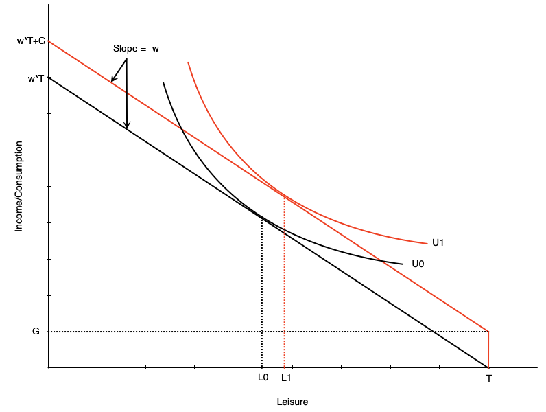
::::

:::: {.column width="50%"}
[How it works:]{.fg style="color: #2780e3;"}

- Unconditional lump sum transfer $G$
- Shifts budget line up parallel
- Wage unchanged → [pure income effect]{.fg style="color: #2780e3;"}

[Labour supply impact:]{.fg style="color: #2780e3;"}

- If leisure is normal → optimal leisure rises
- Reduces hours worked
- Raises reservation wage → some may quit
::::
::::

::: {.callout-note}
## Work Incentive Effect
[Unambiguously negative]{.fg style="color: #c7254e;"}
:::

## Demogrants in Canada

[Old Age Security (OAS)]{.fg style="color: #2780e3;"}

- Monthly benefit for people 65 and over who meet residency rules
- Not a pure demogrant: it is taxed back from high-income seniors
- Together with the Guaranteed Income Supplement, more than \$76 billion in 2024

[Universal Child Care Benefit (UCCB)]{.fg style="color: #2780e3;"}

- Paid to families with children from 2006 to 2016, whatever their income
  - Started at \$100 a month per child under 6
  - From 2015: \$160 a month under 6, \$60 a month aged 6–17
- Taxable, so lower-income families kept more of it: not a pure demogrant either
- Replaced in 2016 by the income-tested [Canada Child Benefit (CCB)]{.fg style="color: #2780e3;"}

::: {.notes}
Pure demogrants are rare. Both of Canada's examples are taxed, so higher-income recipients keep less. They are still worth the diagram, because most programs share the demogrant's income effect. Hold the UCCB in mind: the research on what it did to parents' work is in the evidence section, and Figure 4.2 is exactly the prediction those studies test.
:::

## Social Assistance: Overview

::: {.callout-important}
## Key Definition
**[Social assistance]{.fg style="color: #2780e3;"}** (income assistance, or **[welfare]{.fg style="color: #2780e3;"}**): means-tested provincial support for people with little or no other income
:::

- [Perfect targeting:]{.fg style="color: #2780e3;"} top income up to a threshold $z$: grant $G = z - (wH + Y_N)$
- Every dollar earned costs a dollar of benefit: a [100% clawback rate]{.fg style="color: #2780e3;"}
- Most recipients have a disability or another barrier to full-time work
- Benefits are modest: Ontario pays a single employable adult at most \$733 a month (2025), about 10 hours a week at minimum wage
- A lone parent with one child got 57–86% of the poverty line, depending on province (2023)
- [Source: Laidley & Tabbara (2024)]{.fg style="color: #555;"}

::: {.notes}
The reality check matters for how students read the next three diagrams. Drawn with a generous flat segment, welfare looks like an easy choice over work. Scale the benefit to what provinces actually pay and the disincentive looks much less alarming. And for many recipients the straight-line constraint is the wrong picture anyway, because their barriers to work are not about the wage. The 57 to 86 percent range is the book's Table 4.2; Nova Scotia is at the bottom and PEI at the top.
:::

## Social Assistance: Budget Constraint

:::: columns
:::: {.column width="50%"}
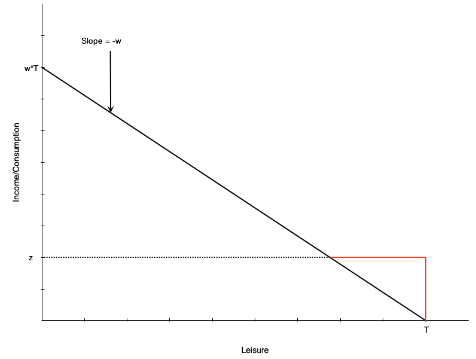
::::

:::: {.column width="50%"}
[Budget line structure:]{.fg style="color: #2780e3;"}

- [Black line:]{.fg style="color: #555;"} original budget (leisure at $L_0$)
- [Red then black:]{.fg style="color: #c7254e;"} with social assistance up to the threshold $z$

[Key features:]{.fg style="color: #2780e3;"}

- Grant $G = z$ at zero hours of work
- Reduced \$1 for each \$1 earned
  - Equivalent to [100% tax rate]{.fg style="color: #2780e3;"} on earnings
- Income stays at $z$ until earnings reach $z$
- After that, earn wage $w_0$ per hour worked
::::
::::

## Social Assistance: No Effect Case

:::: columns
:::: {.column width="50%"}
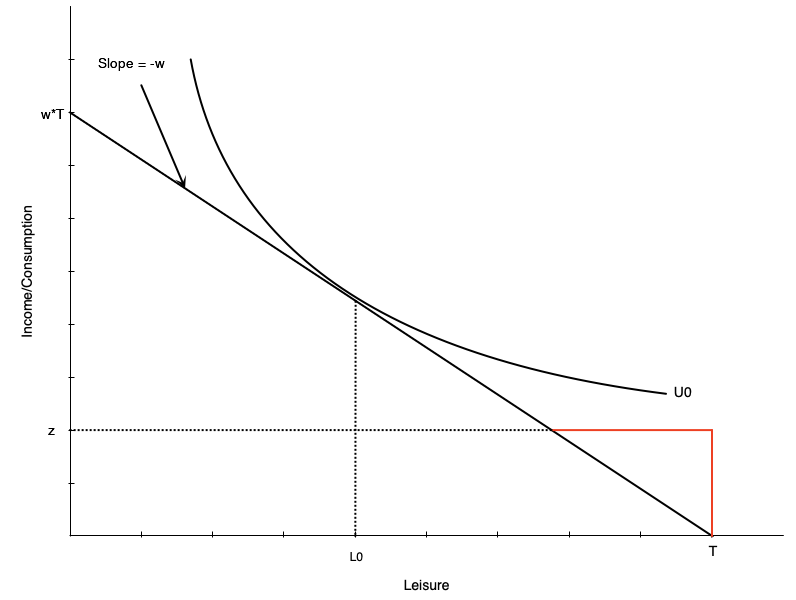
::::

:::: {.column width="50%"}
[For some workers, welfare has no effect:]{.fg style="color: #2780e3;"}

- Person working $H_0$ hours before benefit
- Still maximizes utility at $H_0$ hours after
- Generally occurs with people already working many hours
::::
::::

## Social Assistance: Work Disincentive Case

:::: columns
:::: {.column width="50%"}
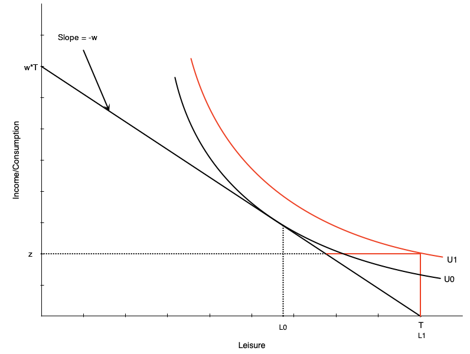
::::

:::: {.column width="50%"}
[Others face strong work disincentive:]{.fg style="color: #2780e3;"}

- Person chooses [zero hours]{.fg style="color: #c7254e;"} after welfare benefit

[This occurs when:]{.fg style="color: #2780e3;"}

- Welfare benefit is generous
- Individual places high value on leisure
::::
::::

::: {.callout-warning}
## Work Incentive Effect
This is the problematic effect of welfare programs
:::

## {background-color="#f0f4f8"}

::: {style="text-align: center; font-size: 1.3em;"}
**Discussion**

Why might someone who was working 20 hours per week before welfare was introduced choose to stop working entirely, while someone working 40 hours per week continues to work the same amount?
:::

## Negative Income Tax: Overview

::: {.callout-important}
## Key Definition
**[Negative income tax (NIT)]{.fg style="color: #2780e3;"}**: welfare program where benefit reduced at rate [< 100%]{.fg style="color: #2780e3;"} of earnings
:::

- Example: guarantee $z$ of \$10,000, reduced by 50¢ per dollar earned

::: {.callout-tip}
## Advantages
Provides income support with fewer work disincentives. Still maintains incentive to work since benefit reduces slowly.
:::

[How it relates to basic income:]{.fg style="color: #2780e3;"}

- A targeted [basic income guarantee (BIG)]{.fg style="color: #2780e3;"} is an NIT: a guarantee plus a clawback
- A [universal basic income (UBI)]{.fg style="color: #2780e3;"} pays everyone the same amount, so it works like a demogrant

## Negative Income Tax: Budget Constraint

:::: columns
:::: {.column width="50%"}
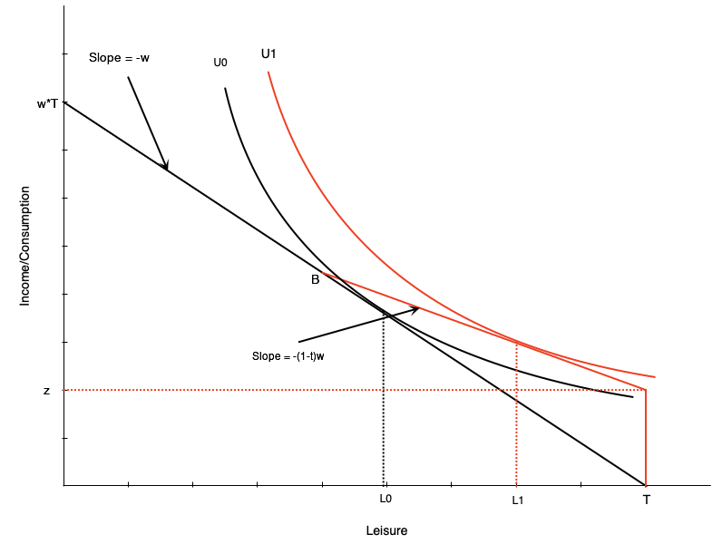
::::

:::: {.column width="50%"}
[NIT has two components:]{.fg style="color: #2780e3;"}

- Guarantee $z$ at zero hours of work
- Implicit tax rate $t$ on earnings, until the benefit is gone at the [breakeven point]{.fg style="color: #2780e3;"} $B$

[Effect on labour supply:]{.fg style="color: #2780e3;"}

- Pivots budget line up vs. pure welfare
- Work hours reduced from $H_0$ to $H_1$
- Person still works some hours
::::
::::

::: {.callout-note}
## Work Incentive Effect
Work disincentive [less than pure welfare]{.fg style="color: #5cb85c;"}
:::

## Negative Income Tax: Income and Substitution Effects

:::: columns
:::: {.column width="50%"}
[Income effects:]{.fg style="color: #2780e3;"}

- Benefit increases non-labour income → increases leisure ↑
- Tax has negative income effect → reduces leisure ↓
- [Net:]{.fg style="color: #2780e3;"} benefit effect dominates → leisure ↑
::::

:::: {.column width="50%"}
[Substitution effect:]{.fg style="color: #2780e3;"}

- Tax rate reduces effective wage
- Makes leisure relatively cheaper → reduces work hours ↓
::::
::::

::: {.callout-note}
## Overall Effect
Negative effect on work hours, but [smaller than pure welfare]{.fg style="color: #5cb85c;"}
:::

## Negative Income Tax: Math

The budget constraint with NIT:

$$
I =
\begin{cases}
wH + z - twH, & \text{if } z - twH \geq 0 \\
wH, & \text{otherwise}
\end{cases}
$$

[Interpretation:]{.fg style="color: #2780e3;"}

- Income = earnings ($wH$) + net benefit $G = z - twH$, as long as $z - twH \geq 0$
- Otherwise just earnings ($wH$)
- The same thing in one line: $I = z + (1-t)wH$, with $G = \max(z - twH,\, 0)$

[Breakeven point $B$:]{.fg style="color: #2780e3;"} the benefit reaches zero when $wH = \frac{z}{t}$

## Basic Income in Canada: MINCOME

[Manitoba Basic Annual Income Experiment, 1975–1979]{.fg style="color: #2780e3;"}

- A targeted basic income, so an NIT, offered to eligible families in two places
  - [Winnipeg:]{.fg style="color: #555;"} families assigned to plans or to a control group
  - [Dauphin:]{.fg style="color: #555;"} a [saturation site]{.fg style="color: #2780e3;"}, where every resident was eligible, with a 50% clawback
- Plans varied both the guarantee and the clawback rate
- The idea had real policy weight: the Macdonald Commission (1985) recommended a national NIT for low-income families

::: {.notes}
Be careful with Dauphin. Everyone in town was eligible, not everyone received a payment; families with enough other income got nothing, exactly as an NIT predicts. The saturation design is what makes Dauphin interesting, because it can pick up community effects like changing norms about work, but it also means there is no control group inside the town. Winnipeg is the cleaner comparison for labour supply.
:::

## MINCOME: Results

:::: columns
:::: {.column width="50%"}
[Labour supply effects:]{.fg style="color: #2780e3;"}

- Hours fell, but not by much (Hum & Simpson 1991)
  - Men: 0.8–1.6%
  - Married women: 2.4–3%
- The US income maintenance experiments found much larger drops for husbands and wives (Hum & Simpson 1993)
::::

:::: {.column width="50%"}
[The debate continues:]{.fg style="color: #2780e3;"}

- Basic income is back on the policy agenda in Canada
- Koebel & Pohler (2019): grow the Canada Workers Benefit into a basic income run through the tax system
- Open questions: cost, financing, and federal–provincial cooperation
::::
::::

::: {.notes}
The model says an NIT cuts hours; MINCOME says yes, by a little. Why the Canadian estimates are so much smaller than the American ones is still an open question, and researchers are still testing how robust the Winnipeg numbers are. The Koebel and Pohler proposal is a good bridge to the next section: it bolts a guarantee onto a refundable tax credit we are about to study.
:::

## Other Ways to Reduce Work Disincentives

[Policy options:]{.fg style="color: #2780e3;"}

:::: columns
:::: {.column width="50%"}
1. [Reduce the guarantee $z$]{.fg style="color: #555;"}
   - But then support may be inadequate for those who cannot work
2. [Move toward an NIT]{.fg style="color: #555;"}
   - Clawback below 100%; most provinces now let recipients keep some earnings
::::

:::: {.column width="50%"}
3. [Change preferences]{.fg style="color: #555;"}
   - Stigma, or support for getting into work: flatter indifference curves
   - Difficult to achieve
4. [Raise the wage]{.fg style="color: #555;"}
   - Training, job information, minimum wages, unions
   - Or subsidize the wage directly: next section
::::
::::

::: {.notes}
Options 3 and 4 are the two panels of Figure 4.6: flatten the indifference curve, or steepen the budget line, and the same person moves off assistance into work. Do not draw option 2 for them. Problem 2 asks them to work out what an earnings exemption does to the constraint.
:::

# Wage Subsidies and Refundable Tax Credits

## Wage Subsidies: Theory

::: {.callout-important}
## Key Definition
**[Wage subsidy]{.fg style="color: #2780e3;"}**: payment to workers that increases their wage rate
:::

- Example: \$5/hour subsidy increases \$15/hour wage to \$20/hour

[Effect on budget constraint:]{.fg style="color: #2780e3;"}

- Budget line pivots upward

[Labour supply effects:]{.fg style="color: #2780e3;"}

:::: columns
:::: {.column width="50%"}
- Income effect → increases leisure ↑
::::

:::: {.column width="50%"}
- Substitution effect → decreases leisure ↓
::::
::::

::: {.callout-note}
## Work Incentive Effect
Overall effect on work hours is [ambiguous]{.fg style="color: #2780e3;"}
:::

## Wage Subsidies: Diagram

:::: columns
:::: {.column width="50%"}
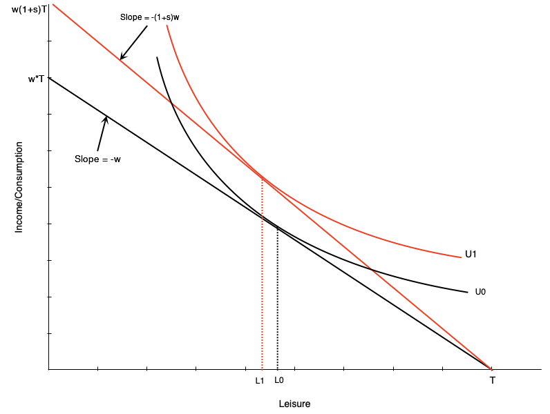
::::

:::: {.column width="50%"}
[Budget line pivots up with subsidy]{.fg style="color: #2780e3;"}

- Graph shows person working more
- But effect is theoretically ambiguous
- Income and substitution effects work in opposite directions
::::
::::

## Wage Subsidies: Policy Implications

:::: columns
:::: {.column width="50%"}
::: {.callout-tip}
## Advantages
- Less negative work incentives than welfare or NIT
- No reduction in effective wage rate
:::
::::

:::: {.column width="50%"}
::: {.callout-warning}
## Disadvantages
- Do not provide income support to non-workers
- High earners qualify too, so it is a very expensive way to reach those in need
:::
::::
::::

[In practice:]{.fg style="color: #2780e3;"}

- Pure wage subsidies are rare, because of that cost
- The fix is to target: pay the subsidy only to low earners
  - Canada's version is the [Canada Workers Benefit]{.fg style="color: #2780e3;"}

::: {.notes}
The textbook's point is that a pure wage subsidy has the demogrant's problem in a different form: everyone who works collects, including people who need nothing. Targeting it on low earnings is what makes it affordable, and that is the design of the CWB. Subsidies paid to employers, like the pandemic wage subsidy, come up later when we get to labour demand.
:::

## {background-color="#f0f4f8"}

::: {style="text-align: center; font-size: 1.3em;"}
**Think About It**

A negative income tax reduces the benefit as you earn more, while a wage subsidy increases your pay for each hour worked. Which program would you expect to have a larger positive effect on labour force participation among non-workers, and why?
:::

## Refundable Tax Credits

::: {.callout-important}
## Key Definitions
**[Non-refundable]{.fg style="color: #2780e3;"}**: can reduce tax owed to zero (but not below)

**[Refundable]{.fg style="color: #2780e3;"}**: can reduce tax owed below zero (results in payment)
:::

[Income-Tested Wage Subsidies Paid as Refundable Credits:]{.fg style="color: #2780e3;"}

- [Canada Workers Benefit (CWB)]{.fg style="color: #2780e3;"} - Canada, since 2007 (first called the WITB)
- [Earned Income Tax Credit (EITC)]{.fg style="color: #2780e3;"} - US, since 1975, now one of the largest US income supports
- Similar programs in the UK (Working Families Tax Credit) and New Zealand (In-Work Tax Credit)

- Popular across the political spectrum: targeted, pro-work, and cheap to run through the tax system, with no caseworkers
- [Source: Nichols & Rothstein (2015); Blundell (2006)]{.fg style="color: #555;"}

## The Canada Workers Benefit, 2024

:::: columns
:::: {.column width="50%"}
```{r echo=FALSE}
#| fig-width: 7
#| fig-height: 5.6

# CWB for a single person in Ontario, 2024 (parameters as in the textbook)
cwb <- function(E) {
  pmax(pmin(pmax(0.27 * (E - 3000), 0), 1590) - pmax(0.15 * (E - 26149), 0), 0)
}

tibble(earnings = seq(0, 40000, by = 25)) %>%
  mutate(benefit = cwb(earnings)) %>%
  ggplot(aes(earnings, benefit)) +
  geom_line(colour = "#2780e3", linewidth = 1.6) +
  annotate("text", x = c(5000, 17500, 33500), y = c(1150, 1700, 1150),
           label = c("phase-in\n27%", "flat range", "phase-out\n15%"), size = 5.5) +
  scale_x_continuous(labels = dollar, breaks = seq(0, 40000, 10000)) +
  scale_y_continuous(labels = dollar, limits = c(0, 1850), breaks = seq(0, 1500, 500)) +
  labs(x = "Annual earnings", y = "CWB payment", subtitle = "Single person, Ontario, 2024") +
  theme_minimal(base_size = 16)
```
::::

:::: {.column width="50%"}
- Nothing until earnings pass \$3,000
- [Phase-in:]{.fg style="color: #2780e3;"} 27 cents per dollar earned above \$3,000
- [Flat range:]{.fg style="color: #2780e3;"} the \$1,590 maximum, reached at about \$8,900 of earnings
- [Phase-out:]{.fg style="color: #2780e3;"} clawed back at 15% of earnings above \$26,149
- Gone entirely at \$36,749
- A small program next to the EITC: low benefits and low thresholds
::::
::::

::: {.notes}
These are the book's example parameters, and the publisher's own CWB example file uses the same ones. The real program varies with province and family type. Problem 4 gives them the EITC's parameters and asks what a \$3,000 entry threshold like this one would do to it, so leave that question alone here.
:::

## Tax Credits: Budget Constraint

:::: columns
:::: {.column width="50%"}
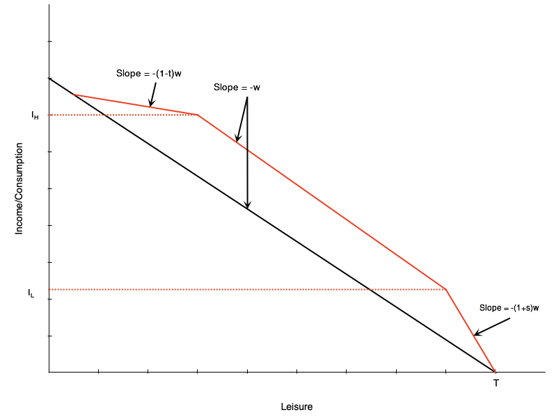
::::

:::: {.column width="50%"}
[Three segments:]{.fg style="color: #2780e3;"}

1. [Phase-in:]{.fg style="color: #2780e3;"} Subsidy proportional to earned income, up to income $I_L$
2. [Flat range:]{.fg style="color: #2780e3;"} Maximum benefit level, between $I_L$ and $I_H$
3. [Phase-out:]{.fg style="color: #2780e3;"} Benefit reduced with earned income above $I_H$

[Combines elements of:]{.fg style="color: #2780e3;"}

- Wage subsidy (phase-in)
- Demogrant (flat range)
- NIT (phase-out)
::::
::::

## Tax Credits: Effect in Phase-In Range

:::: columns
:::: {.column width="50%"}
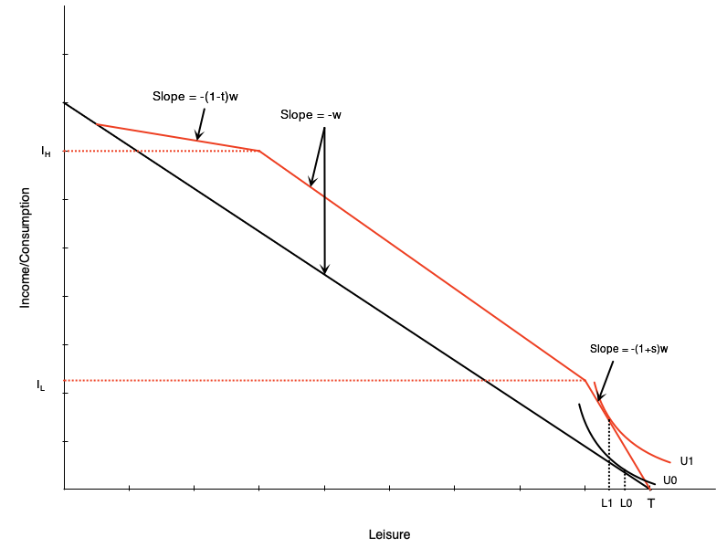
::::

:::: {.column width="50%"}
[Person in phase-in range:]{.fg style="color: #2780e3;"}

- Sees increase in effective wage
- Acts like [pure wage subsidy]{.fg style="color: #2780e3;"}
- Income and substitution effects in opposite directions
::::
::::

::: {.callout-note}
## Work Incentive Effect
Effect on hours is [ambiguous]{.fg style="color: #2780e3;"}
:::

## Tax Credits: Effect in Flat Range

:::: columns
:::: {.column width="50%"}
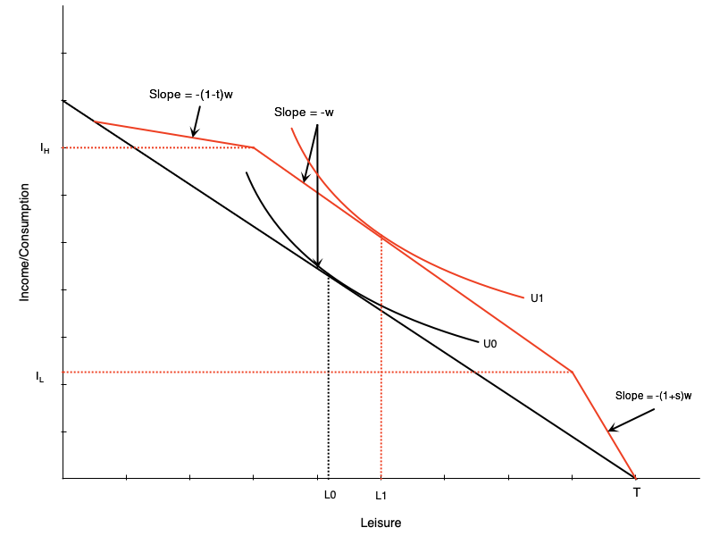
::::

:::: {.column width="50%"}
[Person initially in the flat range:]{.fg style="color: #2780e3;"}

- Tax credit gives maximum benefit
- Acts like [pure income effect]{.fg style="color: #2780e3;"}
- If leisure is normal good → reduce work hours
::::
::::

## Tax Credits: Effect in Phase-Out Range

:::: columns
:::: {.column width="50%"}
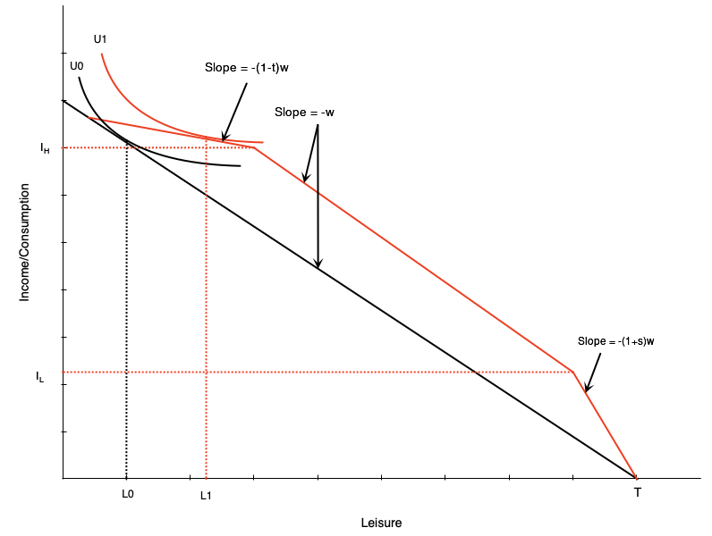
::::

:::: {.column width="50%"}
[Person in phase-out range:]{.fg style="color: #2780e3;"}

- Similar to [negative income tax]{.fg style="color: #2780e3;"}
- Income effect → reduce hours ↓
- Substitution effect → reduce hours ↓
::::
::::

::: {.callout-note}
## Work Incentive Effect
Effect on work is [unambiguously negative]{.fg style="color: #c7254e;"}
:::

## Tax Credits and Participation

:::: columns
:::: {.column width="50%"}
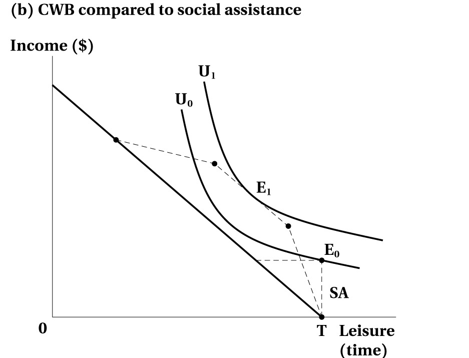

[Source: Benjamin et al. (2026), Figure 4.8(b)]{.fg style="color: #555;"}
::::

:::: {.column width="50%"}
::: {.callout-note}
## Key Result
Effect on hours is ambiguous, but the incentive to [participate]{.fg style="color: #2780e3;"} [rises]{.fg style="color: #5cb85c;"}
:::

- For a non-worker, the phase-in raises the return to the first hours of work
- Against social assistance with a 100% clawback, the contrast is sharper
  - Without the credit: no work, collect assistance ($E_0$)
  - With it: work, and reach a higher indifference curve ($E_1$)
::::
::::

::: {.notes}
This is the answer to the Think About It from the wage subsidy section, and it is the result in this chapter most worth remembering. The intensive margin is a mess of competing effects; the extensive margin is not. Problem 6(a) asks them to compare the CWB with perfectly targeted social assistance for someone indifferent between the two, so describe this picture but do not work that version through.
:::

# Empirical Evidence of Incentive Effects

## Social Assistance in Ontario, 1980–2024

```{r echo=FALSE}
#| fig-width: 13
#| fig-height: 6.2

# Book Figure 4.9: Benefits = maximum annual benefit for a single employable person
# (2024 dollars); BenefitRate = recipiency rate (% of population, incl. dependants);
# UnemploymentRate = Ontario unemployment rate, 15+
ontario_sa <- read_csv("Benjamin2026_Figure4-9-data.csv", show_col_types = FALSE)

k <- 12000 / 14   # left axis $6,000-$18,000 lines up with right axis 0-14%

ggplot(ontario_sa, aes(Year)) +
  geom_rect(aes(xmin = Year - 0.4, xmax = Year + 0.4, ymin = 6000, ymax = Benefits),
            fill = "#2780e3", alpha = 0.35) +
  geom_line(aes(y = 6000 + BenefitRate * k), colour = "#c7254e", linewidth = 1.4) +
  geom_line(aes(y = 6000 + UnemploymentRate * k), colour = "#f0ad4e", linewidth = 1.3,
            linetype = "dashed") +
  annotate("text", x = c(1999.5, 2003, 2004), y = c(6000 + 10.2 * k, 6000 + 8.6 * k, 17100),
           label = c("Recipiency rate", "Unemployment rate",
                     "Maximum benefit, single employable (bars)"),
           colour = c("#c7254e", "#c08a2e", "#2780e3"), size = 5.5, hjust = 0) +
  scale_y_continuous(name = "Annual benefit, 2024 dollars", labels = dollar,
                     breaks = seq(6000, 18000, 2000),
                     sec.axis = sec_axis(~ (. - 6000) / k, name = "Percent",
                                         breaks = seq(0, 14, 2))) +
  scale_x_continuous(breaks = seq(1980, 2024, 5)) +
  coord_cartesian(ylim = c(6000, 18000), expand = FALSE) +
  labs(x = NULL, caption = "Source: Benjamin et al. (2026) replication data, from Maytree and Statistics Canada") +
  theme_minimal(base_size = 16)
```

::: {.notes}
Walk the picture left to right before asking anything. The share of Ontarians on assistance climbed through the 1980s, spiked in the early 1990s, and fell hard in the second half of the decade. Benefits tracked it closely until the 1995 cuts, when the province also brought in workfare. There is a smaller rise around 2008 to 2012. Then ask the question the next slide answers: does this picture show that generous benefits cause people to go on assistance?
:::

## Correlation Is Not Causation

- Benefits and recipiency move together, but which way does causation run? We saw this problem in [Chapter 2]{.fg style="color: #555;"}
- [Reverse causation:]{.fg style="color: #2780e3;"} a big caseload is a big constituency, and governments raised benefits to match
- [Confounding:]{.fg style="color: #2780e3;"} unemployment drives both; recessions push people onto assistance, booms pull them off
- Berg & Gabel (2015): across provinces, work requirements did the most to cut caseloads, 1986–2009

::: {.callout-important}
## Key Definitions
**[Nonexperimental sources]{.fg style="color: #2780e3;"}**: responses to real policy changes, compared across people, places, or time

**[Experimental sources]{.fg style="color: #2780e3;"}**: programs that randomly assign who is offered the treatment
:::

::: {.notes}
Look back at the figure for the confounding story: unemployment spikes in the early 1990s and again in 2008, and recipiency follows. There is an extra twist in the early 1990s, when tighter unemployment insurance rules pushed more of the unemployed onto welfare. The two definitions set up the rest of the section: Quebec and the child benefit studies are nonexperimental, and the Self-Sufficiency Project is experimental.
:::

## Quebec: A Discontinuity at Age 30

- [Until August 1989:]{.fg style="color: #2780e3;"} Quebec paid singles and couples without children far less if they were under 30
  - Age 29: \$185 a month; age 30: \$507 a month
- Someone a few months short of 30 is otherwise much like someone a few months past it
  - Comparing the two is a [regression discontinuity design]{.fg style="color: #2780e3;"}, as in [Chapter 2]{.fg style="color: #555;"}
- [Results:]{.fg style="color: #2780e3;"}
  - Fortin et al. (2004): the higher benefit led to much longer spells on assistance
  - Lemieux & Milligan (2008): employment of male high-school dropouts fell about 4 percentage points past age 30 (1986)

::: {.callout-note}
## Key Result
Two [nonexperimental]{.fg style="color: #2780e3;"} studies, one conclusion: higher benefits reduce work
:::

::: {.notes}
Some of the young claimants sued under the Charter for age discrimination, and the Supreme Court upheld the rule in a split decision (Gosselin v. Quebec, 2002). A policy that was hard on young people turned out to be very good for research. Nobody can choose their birthday to qualify, so people just either side of 30 differ in almost nothing except the benefit they could get. That is what makes the jump at 30 believable as a cause.
:::

## Child Benefits and Work

- [National Child Benefit, 1998:]{.fg style="color: #2780e3;"} some provinces effectively cut the clawback for welfare recipients
  - Work incentives improved, explaining much of the fall in caseloads from 1997 to 2000
- [UCCB, 2006:]{.fg style="color: #2780e3;"} compare parents of children 5 and under to parents of older children, before and after
  - A [difference-in-differences]{.fg style="color: #2780e3;"} design, as in [Chapter 2]{.fg style="color: #555;"}
  - Married mothers cut both participation and hours, as the demogrant model predicts
  - From the paper itself: participation of lower-educated married mothers fell 3.2 percentage points
  - Divorced mothers worked *more*
- [UCCB expansion and the CCB:]{.fg style="color: #2780e3;"} large cuts in poverty, no sign of lower labour supply
- [Source: Milligan & Stabile (2007); Schirle (2015); Koebel & Schirle (2016); Baker et al. (2023)]{.fg style="color: #555;"}

::: {.notes}
Child benefits have been redesigned several times, and each redesign is a natural experiment. Schirle's result is the demogrant diagram coming true: a pure income effect, fewer hours and less participation. Koebel and Schirle are the reminder that the simple model is not the whole story, since divorced mothers moved the other way. Baker and coauthors are the most recent word, and they find the CCB cut poverty a lot without any measurable labour supply cost. Note that the 3.2-point figure comes from Schirle's paper; the textbook reports only the direction.
:::

## The Self-Sufficiency Project

::: {.callout-important}
## Key Definition
**[Self-Sufficiency Project (SSP)]{.fg style="color: #2780e3;"}**: a randomized Canadian experiment that paid an earnings supplement to long-term assistance recipients who left for full-time work
:::

- [Who:]{.fg style="color: #555;"} about 5,600 single parents, mostly mothers, on assistance for at least a year
- [Where and when:]{.fg style="color: #555;"} New Brunswick and British Columbia, 1992–1999
- [Design:]{.fg style="color: #555;"} random assignment to a program group or a control group
- [The offer:]{.fg style="color: #555;"} leave assistance for a job of 30+ hours a week within a year, and collect a supplement
  - Half the gap between earnings and a benchmark of \$30,000 (NB) or \$37,000 (BC)
  - Paid for up to three years, as long as the work stays full time
  - Roughly doubled what assistance paid

::: {.notes}
Do not draw the budget constraint for this one. Problem 5 asks them to build exactly this program's constraint, so describe it in words and let them do the geometry. Worth saying that this is not an NIT: there is nothing at all unless you work full time, which is a very different shape.
:::

## SSP: Results

:::: columns
:::: {.column width="55%"}
```{r echo=FALSE}
#| fig-width: 7.5
#| fig-height: 5.6

# Share working full time, months after random assignment (from the textbook)
ssp <- tribble(
  ~time,       ~group,          ~pct,
  "Start",     "Program group",  6,
  "Start",     "Control group",  6,
  "12 months", "Program group", 30,
  "12 months", "Control group", 15,
  "36 months", "Program group", 27,
  "36 months", "Control group", 18,
  "54 months", "Program group", 28,
  "54 months", "Control group", 28
) %>%
  mutate(time = fct_inorder(time), group = fct_inorder(group))

ggplot(ssp, aes(time, pct, fill = group)) +
  geom_col(position = position_dodge(width = 0.8), width = 0.75) +
  geom_text(aes(label = paste0(pct, "%")), position = position_dodge(width = 0.8),
            vjust = -0.4, size = 5.5) +
  scale_fill_manual(values = c("#2780e3", "#f0ad4e")) +
  scale_y_continuous(limits = c(0, 35), labels = function(x) paste0(x, "%")) +
  labs(x = NULL, y = "Working full time", fill = NULL) +
  theme_minimal(base_size = 16) +
  theme(legend.position = "top")
```
::::

:::: {.column width="45%"}
- [Naive estimate:]{.fg style="color: #2780e3;"} full-time work in the program group went from 6% to 30%, so 24 points
- But the control group got to 15% with no offer at all
- [Experimental estimate:]{.fg style="color: #2780e3;"} 30 − 15 = 15 points
- The gap closed after the offer ended
  - 9 points at 36 months
  - Gone by 54 months; assistance receipt equal by month 69
::::
::::

::: {.notes}
The naive number is a before-and-after comparison, and it is wrong because single parents leave assistance over time anyway. The control group shows how many would have left without the offer, which is the whole point of an experimental source. Fifteen points is still a big effect for the group with the lowest exit rates of anyone on assistance.
:::

## SSP: Why the Effect Faded

- Card & Hyslop (2005): the time limits created two incentives
  - [Establishment incentive:]{.fg style="color: #2780e3;"} find full-time work within 12 months to qualify
  - [Entitlement incentive:]{.fg style="color: #2780e3;"} once qualified, keep working to keep collecting
  - Both end when the program ends
- Riddell & Riddell (2014): the program group went back to school less
  - Less high-school completion, college or trade school, and university
  - [Work-first]{.fg style="color: #2780e3;"} policies can trade long-run earning power for short-run jobs

::: {.callout-note}
## Key Result
The SSP sped up the move from assistance to work while it ran; it did not change where people ended up
:::

- [Source: Card & Hyslop (2005); Riddell & Riddell (2014)]{.fg style="color: #555;"}

::: {.notes}
Riddell and Riddell's framing is worth repeating: both groups built up their earning power during the experiment, the program group on the job and the control group in the classroom, which is part of why the gap closed. Do not let them leave thinking the SSP failed. It moved people into work faster, and the control group's behaviour is itself a finding: a slow but large exit from assistance, much of it through finishing high school. That tells us something about how people get off assistance when nobody pays them to.
:::

# Summary

## Summary

[Income support programs:]{.fg style="color: #2780e3;"}

- Provide crucial income support to various groups
- Can create work disincentives in some cases
- Must balance support needs against incentive effects

[We examined several programs through the labour supply model:]{.fg style="color: #2780e3;"}

- Three steps: constraint before, constraint after, compare choices
- Demogrants, social assistance, NIT, wage subsidies, and tax credits like the CWB

[Evidence:]{.fg style="color: #2780e3;"}

- Experiments and natural experiments beat simple correlations
- Both benefit generosity and labour market opportunities predict who relies on assistance

## References {.smaller}

- Atkinson, A. B. (1998). Social exclusion, poverty and unemployment. In A. B. Atkinson & J. Hills (Eds.), *Exclusion, employment and opportunity* (CASEpaper 4). Centre for Analysis of Social Exclusion, London School of Economics.
- Baker, M., Messacar, D., & Stabile, M. (2023). Effects of child tax benefits on poverty and labor supply: Evidence from the Canada Child Benefit and Universal Child Care Benefit. *Journal of Labor Economics*, 41(4), 1129–1182.
- Benjamin, D., Foley, K., Gunderson, M., Lemieux, T., Schirle, T., & Skuterud, M. (2026). *Labour Market Economics*, 2026 Release. McGraw Hill. Chapter 4.
- Berg, N., & Gabel, T. (2015). Did Canadian welfare reform work? The effects of new reform strategies on social assistance participation. *Canadian Journal of Economics*, 48(2), 494–528.
- Blundell, R. (2006). Earned income tax credit policies: Impact and optimality. *Labour Economics*, 13(4), 423–443.
- Card, D., & Hyslop, D. R. (2005). Estimating the effects of a time-limited earnings subsidy for welfare-leavers. *Econometrica*, 73(6), 1723–1770.
- Fortin, B., Lacroix, G., & Drolet, S. (2004). Welfare benefits and the duration of welfare spells: Evidence from a natural experiment in Canada. *Journal of Public Economics*, 88(7–8), 1495–1520.

## References (cont.) {.smaller}

- Hum, D., & Simpson, W. (1991). *Income maintenance, work effort, and the Canadian Mincome experiment*. Economic Council of Canada.
- Hum, D., & Simpson, W. (1993). Economic response to a guaranteed annual income: Experience from Canada and the United States. *Journal of Labor Economics*, 11(1, Part 2), S263–S296.
- Koebel, K., & Pohler, D. (2019). Expanding the Canada Workers Benefit to design a guaranteed basic income. *Canadian Public Policy*, 45(3), 283–309.
- Koebel, K., & Schirle, T. (2016). The differential impact of universal child benefits on the labour supply of married and single mothers. *Canadian Public Policy*, 42(1), 49–64.
- Laidley, J., & Tabbara, M. (2024). *Welfare in Canada, 2023*. Maytree.
- Lemieux, T., & Milligan, K. (2008). Incentive effects of social assistance: A regression discontinuity approach. *Journal of Econometrics*, 142(2), 807–828.

## References (cont.) {.smaller}

- Milligan, K., & Stabile, M. (2007). The integration of child tax credits and welfare: Evidence from the Canadian National Child Benefit program. *Journal of Public Economics*, 91(1–2), 305–326.
- Nichols, A., & Rothstein, J. (2015). *The Earned Income Tax Credit (EITC)*. NBER Working Paper No. 21211.
- Riddell, C., & Riddell, W. C. (2014). The pitfalls of work requirements in welfare-to-work policies: Experimental evidence on human capital accumulation in the Self-Sufficiency Project. *Journal of Public Economics*, 117, 39–49.
- Royal Commission on the Economic Union and Development Prospects for Canada. (1985). *Report*. Minister of Supply and Services Canada.
- Schirle, T. (2015). The effect of universal child benefits on labour supply. *Canadian Journal of Economics*, 48(2), 437–463.
- Statistics Canada. *Canadian Income Survey, 2022*: Public Use Microdata File.
