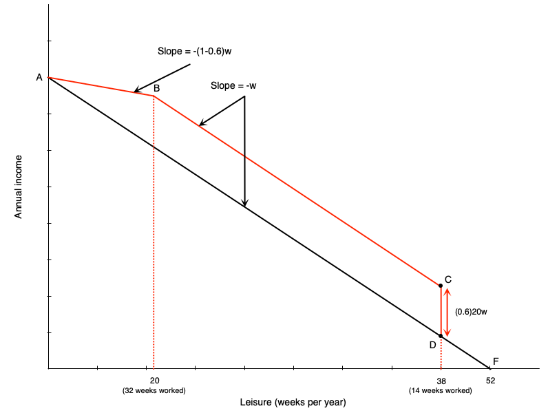
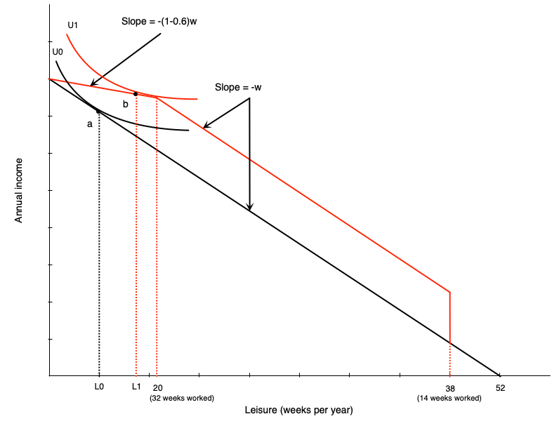
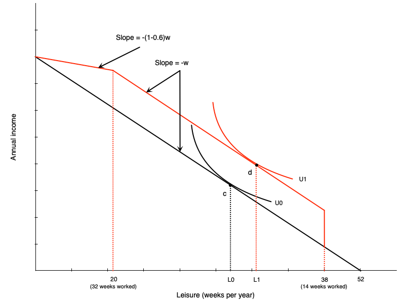
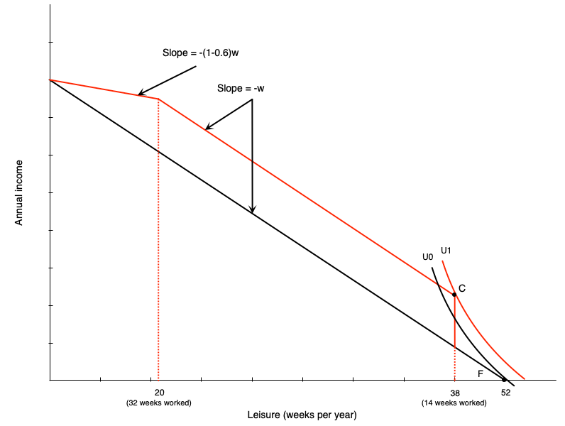
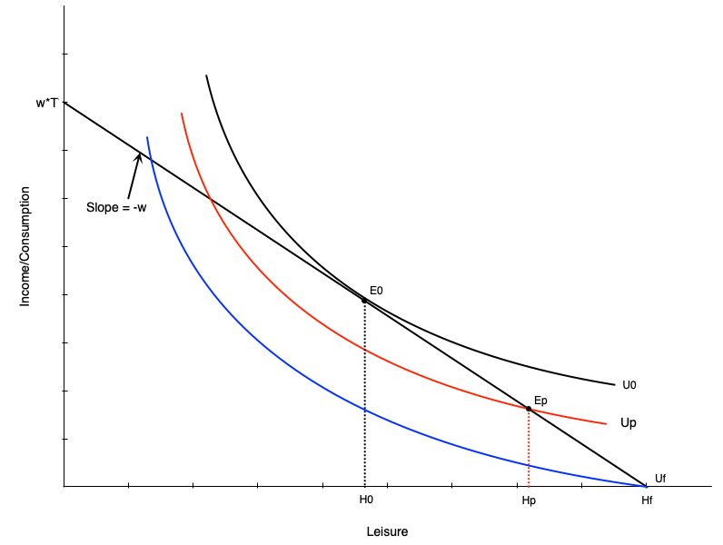
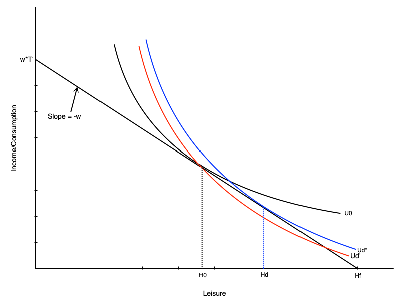
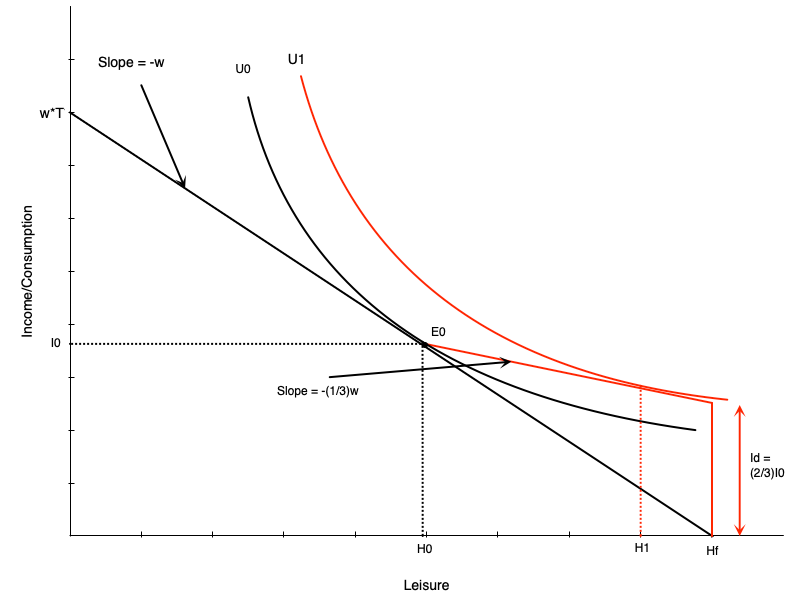
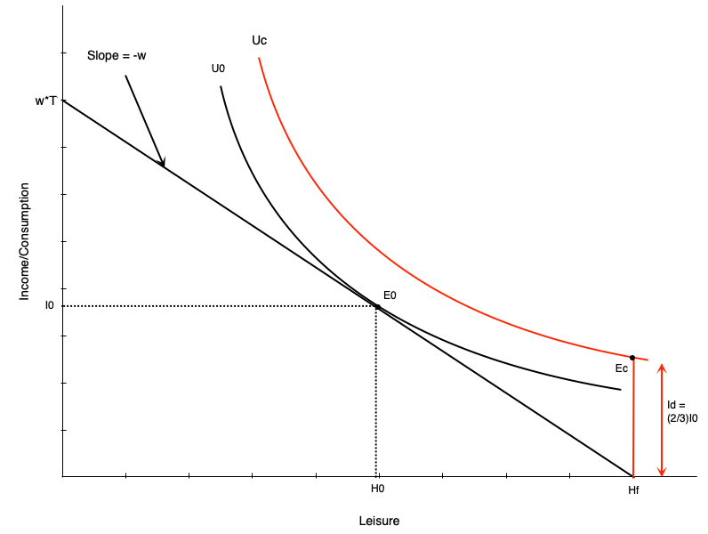
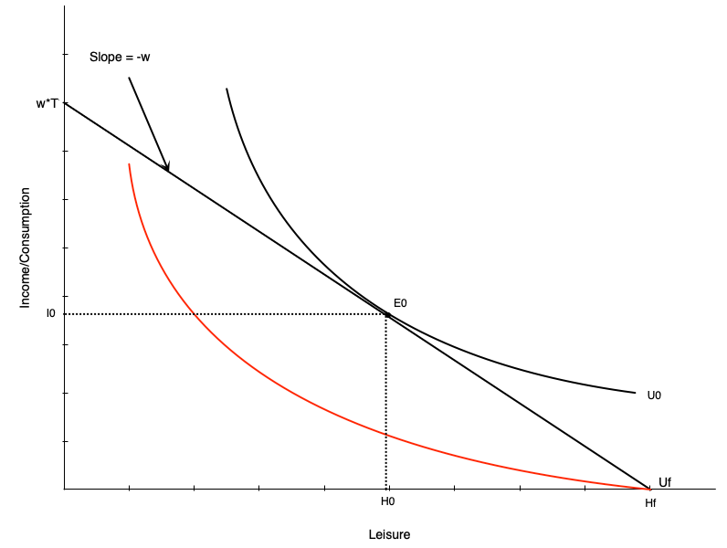
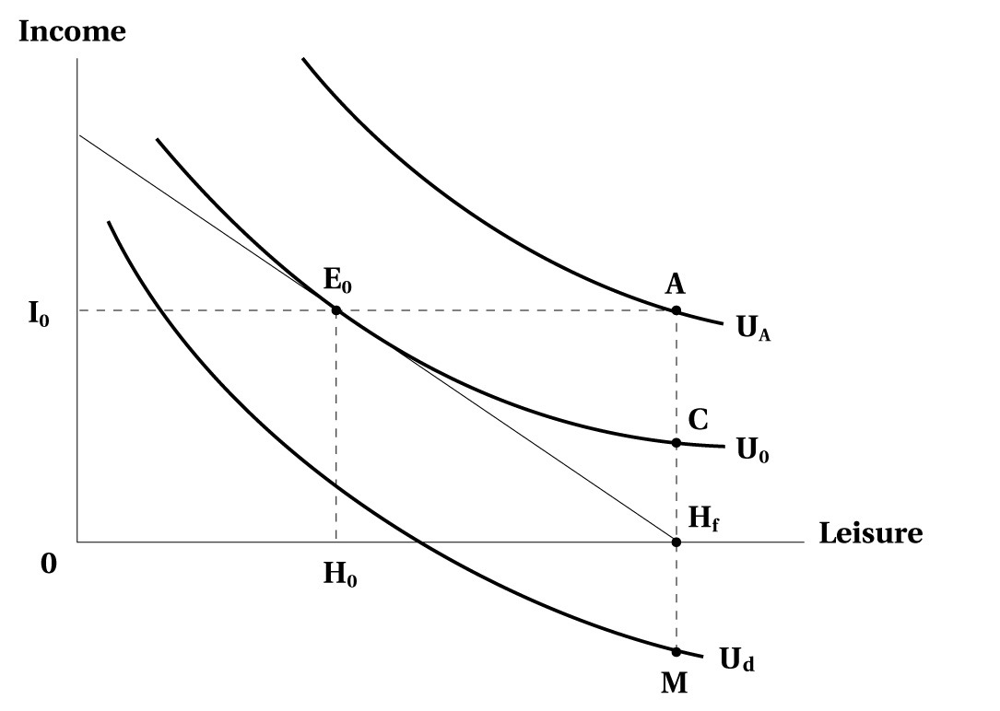

---
format:
  revealjs:
    theme: [default, hygge.scss]
    center-title-slide: false
    slide-number: true
    height: 900
    width: 1600
    chalkboard:
      theme: whiteboard
      src: drawings.json
    post-render: "scripts/decktape.sh"
    incremental: false
editor: visual
---

<h1>Labour Supply and Social Insurance Programs</h1>

<hr>

<h2>EC306- Wages and Employment</h2>

<h2>Justin Smith</h2>

<h2>Wilfrid Laurier University</h2>

<h2>Fall 2026</h2>

{.absolute top="275" left="900" width="550"}

# Goals of This Section

## Goals of This Section

In this section we will:

- Describe Canada's main social insurance programs and how they differ from income support
- Use the labour supply model to show how EI changes work incentives, and for whom
- Analyze how a disability changes the potential income constraint
- Analyze the work incentives of workers' compensation, and the problem of setting the compensation level
- Examine the evidence, much of it from natural experiments

# Social Insurance Programs in Canada

## Social Insurance vs. Income Support

::: {.callout-important}
## Key Definition
**[Social insurance programs]{.fg style="color: #2780e3;"}**: programs that insure workers against income losses from events like job loss or disability, with eligibility and benefits tied to past contributions and work history
:::

- Part of the social safety net, like the income support programs of [Chapter 4]{.fg style="color: #555;"}
  - The losses they cover can be temporary or permanent
- Unlike income support, the major Canadian programs are [not means-tested]{.fg style="color: #2780e3;"}
  - Eligibility depends on your own contributions, not your family's income or wealth
- Same method as [Chapter 4]{.fg style="color: #555;"}: draw the constraint without the program, draw it with the program, compare the choices

::: {.notes}
The authors make a point worth saying out loud before we draw a single diagram. Losing a job or becoming disabled brings hardships that matter far more than anything we will say about work incentives. We focus on incentives because that is the part the labour supply model can speak to, not because it is the most important part of the story.
:::

## Social Insurance Transfers in Canada, 2022

In 2022, 82% of individuals received a government transfer; far fewer collected EI or workers'&nbsp;compensation

```{r echo=FALSE}
library(tidyverse)
library(gt)
library(scales)

# Individual-level transfer and contribution variables from the 2022 CIS PUMF,
# trimmed from the full file used in Chapter 2
cis <- read_csv("CIS2022_social_insurance.csv", show_col_types = FALSE) %>%
  filter(GTR < 1e11)   # children carry a "not applicable" code (1e12) on income variables

rows <- tribble(
  ~var,    ~group,          ~item,
  "GTR",   "Benefits",      "All government transfers",
  "EIBEN", "Benefits",      "Employment Insurance",
  "WKRCP", "Benefits",      "Workers' compensation",
  "CPQPP", "Benefits",      "Canada/Quebec Pension Plan",
  "EICON", "Contributions", "Employment Insurance",
  "CQPC",  "Contributions", "Canada/Quebec Pension Plan"
)

# Share with a positive amount, and the average among those with one
social_insurance <- rows %>%
  mutate(stats = map(var, function(v) {
    x <- cis[[v]]
    w <- cis$FWEIGHT
    tibble(pct = 100 * weighted.mean(x > 0, w),
           avg = weighted.mean(x[x > 0], w[x > 0]))
  })) %>%
  unnest(stats)

social_insurance %>%
  select(group, item, pct, avg) %>%
  gt(rowname_col = "item", groupname_col = "group") %>%
  cols_label(pct = "Percent of individuals", avg = "Average amount") %>%
  fmt_number(columns = pct, decimals = 1) %>%
  fmt_currency(columns = avg, decimals = 0) %>%
  tab_style(style = cell_text(weight = "bold"),
            locations = list(cells_body(rows = 1), cells_stub(rows = 1))) %>%
  tab_source_note("Source: Canadian Income Survey (2022). Individuals aged 15 and older; average amount in 2022 dollars among those receiving or contributing. EI includes regular, maternity, parental, and sickness benefits; C/QPP includes retirement, disability, and survivor benefits.") %>%
  tab_options(table.font.size = px(28), column_labels.font.weight = "bold",
              row_group.font.weight = "bold", data_row.padding = px(4),
              table.width = pct(80))
```

::: {.notes}
This is the book's Table 5.1, rebuilt from the same microdata as Table 4.1, and every cell matches. It counts individuals rather than families, because eligibility for social insurance is individual. The insurance logic is in the EI rows: almost 60% of people paid premiums in 2022, but fewer than 9% collected anything. Most people who pay in never claim in a given year, which is exactly what insurance looks like. Two rows include programs we hold for later: the EI row includes maternity and parental benefits (Chapter 6), and most of the C/QPP row is retirement pensions (Chapter 7).
:::

## Employment Insurance

:::: columns
:::: {.column width="50%"}
[Financing]{.fg style="color: #2780e3;"}

- Premiums from employees and employers, on earnings up to \$65,700 (2025)
- Employees pay 1.64% of insurable earnings; employers pay 1.4 times that, about&nbsp;2.30%
- Rates differ in Quebec, which runs its own maternity and parental benefits
::::

:::: {.column width="50%"}
[Regular benefits]{.fg style="color: #2780e3;"}

- For job loss through no fault of your own; quitting doesn't qualify
- Self-employment earnings are not insured
- 55% of insurable earnings, up to \$695 a week&nbsp;(2025)
- 420 to 700 hours of work to qualify, then 14 to 45 weeks of benefits
  - Fewer hours needed, and more weeks paid, where unemployment is high
- Must be actively looking for work
::::
::::

- Maternity and parental benefits come in [Chapter 6]{.fg style="color: #555;"}

::: {.notes}
Canada's unemployment insurance has been called Employment Insurance since 1996, and it is the largest social insurance program for people under 65. These are the book's 2025 figures, so they match what students are reading; the 2026 values are slightly different. One correction to the book: it gives the premium rates the wrong way round. In 2025 employees paid 1.64% and employers paid 1.4 times the employee rate, about 2.30%.
:::

## Insurance for Illness and Disability {.smaller}

::: {.callout-important}
## Key Definition
**[Disability]{.fg style="color: #2780e3;"}**: an umbrella term for impairments, activity limitations, and restrictions on participation, arising from the interaction between a health condition and a person's surroundings and circumstances (World Health Organization)
:::

- [A few days:]{.fg style="color: #555;"} job-protected sick leave under provincial employment standards, usually unpaid
- [Up to 26 weeks:]{.fg style="color: #555;"} [EI sickness benefits]{.fg style="color: #2780e3;"}
  - 55% of earnings, up to \$695 a week; needs a medical certificate; one-week wait
  - Only if the employer offers no paid sick leave or short-term disability coverage
- [Long term or permanent:]{.fg style="color: #555;"} [C/QPP disability benefits]{.fg style="color: #2780e3;"}
  - Must have contributed in 4 of the 6 years before the disability
  - CPP pays \$598 to \$1,673 a month in 2025; converts to a retirement pension at 65
  - Private long-term disability insurance can top it up

::: {.notes}
The people we have in mind are mostly those whose disability arrives unexpectedly, temporarily or permanently, and leaves them unable to work as much as before. The same tools work for someone whose disability has limited their work since early adulthood. People with a disability who can't earn enough to live on can also qualify for the income support programs from Chapter 4. As with EI, the dollar figures are the book's 2025 values.
:::

## Workers' Compensation

::: {.callout-important}
## Key Definition
**[Workers' compensation]{.fg style="color: #2780e3;"}**: income support for people who can't work because of a work-related injury or occupational disease
:::

- Each province and territory runs its own program, as does the federal government for its own&nbsp;workers
- The main difference between them is generosity
  - [Ontario (WSIB):]{.fg style="color: #555;"} 85% of earnings
  - [Saskatchewan:]{.fg style="color: #555;"} 90%
  - [Nova Scotia:]{.fg style="color: #555;"} 75% for the first 26 weeks, then 85%
  - Each also sets its own maximum benefit
- The largest program of all, the C/QPP retirement pension, comes in [Chapter 7]{.fg style="color: #555;"}

::: {.notes}
The C/QPP retirement pension is longevity insurance: you can outlive your savings, but you can't outlive your CPP. Survivor benefits insure against the loss of a spouse's income. Both belong with the retirement decisions in Chapter 7.
:::

## iClicker Question {background-color="#f0f4f8"}

Ana and Ben are laid off from the same plant. Both earned \$50,000 a year and worked the same hours. Ana's spouse earns \$150,000; Ben lives alone with no savings. Under EI regular benefits:

A\) Both receive the same weekly benefit\
B) Only Ben qualifies, because Ana's family income is too high\
C) Both qualify, but Ben gets more because his need is greater\
D) Ana gets more, because her household paid more in premiums\
E) Ana must use up her family's savings before she qualifies

::: {.notes}
Answer: A. EI is social insurance: the benefit is 55% of your own insurable earnings, about \$529 a week for each of them. A spouse's income, family income, and savings never enter. B, C, and E all carry the Chapter 4 means-testing logic over to a program that doesn't use it, and E adds an asset test, which is a feature of social assistance. D gets premiums wrong: they are paid on each person's own earnings and insure that person, so the spouse's premiums do nothing for Ana. If someone raises the EI Family Supplement, it does top up the rate for low-income families with children, but neither of these two fits.
:::

# Unemployment Insurance

## Unemployment Insurance and Work Incentives

::: {.callout-important}
## Key Definition
**[Unemployment insurance (UI)]{.fg style="color: #2780e3;"}**: benefits paid to workers who lose their job, much higher than social assistance, to support them while they look for work
:::

Three features shape the potential income constraint:

1. [Entrance requirement (ER):]{.fg style="color: #555;"} how long you must work before you qualify
2. [Replacement rate:]{.fg style="color: #555;"} the share of earnings that benefits replace
3. [Maximum duration:]{.fg style="color: #555;"} how many weeks you can collect

- The model assumes jobs are there for anyone who wants more work
  - Where jobs are scarce, stronger incentives to work don't create jobs (Phipps 1990, 1991)

::: {.notes}
Phipps's point is about the demand side. Everything in the next few diagrams is about the incentive to supply labour. In a region or a recession with no jobs, a reform that sharpens that incentive mostly makes the unemployed poorer, because the jobs it is meant to push them into aren't there. Keep the caveat in mind for every diagram that follows. The book returns to job search and unemployment in Chapter 19, which we don't cover.
:::

## A Simplified UI System

The book's example, over one year, with leisure measured in weeks:

- [Entrance requirement:]{.fg style="color: #555;"} 14 weeks of work
- [Replacement rate:]{.fg style="color: #555;"} 60% of the weekly wage $w$
- [Maximum duration:]{.fg style="color: #555;"} 20 weeks of benefits
- You can't work and collect in the same week

Work 14 weeks, then collect for 20:

$$
Y = 14w + (0.6)20w
$$

- Work up to 32 weeks and there are still 20 weeks left to collect
- Beyond 32 weeks, each extra week of work costs a week of benefits

::: {.notes}
Real EI replaces 55% and the entrance requirement varies by region; 60% and 14 weeks keep the arithmetic clean. The 32 is just 52 minus 20: it is where weeks of work start eating into weeks of collecting. Review Question 1 and Problem 1 ask for other parameter sets, so don't draw alternatives here.
:::

## UI: The Potential Income Constraint

:::: columns
:::: {.column width="50%"}

::::

:::: {.column width="50%"}
- [AF:]{.fg style="color: #555;"} the constraint without UI, slope $-w$
- [DF:]{.fg style="color: #555;"} fewer than 14 weeks of work, so no UI
- [D to C:]{.fg style="color: #555;"} qualifying adds the full 20-week benefit, $(0.6)20w$
- [CB:]{.fg style="color: #555;"} 14 to 32 weeks of work: full benefits, plus $w$ for each extra week
- [BA:]{.fg style="color: #555;"} past 32 weeks, a week of work earns $w$ but gives up $0.6w$ of&nbsp;benefits
  - You keep only $(1-0.6)w = 0.4w$
::::
::::

## iClicker Question {background-color="#f0f4f8"}

In the book's UI system (14-week ER, 60% replacement, at most 20 weeks of benefits), Sam earns $w = \$1{,}000$ a week. What is Sam's annual income from working 40 weeks?

A\) \$26,000\
B) \$40,000\
C) \$44,800\
D) \$47,200\
E) \$52,000

::: {.notes}
Answer: D. Forty weeks of work leaves 12 weeks, and all 12 can be collected: 40 × 1,000 + 12 × 600 = \$47,200. That point is on segment BA. E is the most common slip: it adds the full 20 weeks of benefits to 40 weeks of work, which takes a 60-week year. C uses 0.4w, the net return to a week of work on BA, as if it were the weekly benefit. B assumes UI disappears once you work past 32 weeks; it shrinks, it doesn't vanish. A is income at point C, after 14 weeks of work.
:::

## UI Effect: Working More Than 32 Weeks

:::: columns
:::: {.column width="50%"}

::::

:::: {.column width="50%"}
[Someone who worked more than 32 weeks (at&nbsp;a):]{.fg style="color: #2780e3;"}

- Now on segment BA: benefits raise income, and a week of work pays only $0.4w$
- Income effect → less work
- Substitution effect → less work
- Moves to b: fewer weeks of work, some weeks of UI
::::
::::

::: {.callout-note}
## Work Incentive Effect
[Unambiguously negative]{.fg style="color: #c7254e;"}
:::

## UI Effect: Working 14 to 32 Weeks

:::: columns
:::: {.column width="50%"}

::::

:::: {.column width="50%"}
[Someone who worked 14 to 32 weeks (at c):]{.fg style="color: #2780e3;"}

- Already qualifies, and working a little more doesn't cut benefits
- The constraint shifts up in parallel: a [pure income effect]{.fg style="color: #2780e3;"}
- With leisure a normal good → fewer weeks of work (moves to d)
::::
::::

## UI Effect: Non-Participants {.smaller}

:::: columns
:::: {.column width="50%"}

::::

:::: {.column width="50%"}
[Someone out of the labour force (at F):]{.fg style="color: #2780e3;"}

- Values non-market time highly, so works zero weeks without UI
- Now 14 weeks of work brings a large jump in income
- Some will enter, work exactly 14 weeks, and collect&nbsp;(C)
  - Others will still stay out
- Same logic for anyone who worked fewer than 14 weeks (on DF)
::::
::::

::: {.callout-note}
## Work Incentive Effect
Participation [rises]{.fg style="color: #5cb85c;"}: UI draws people into the labour force
:::

## UI: What the Model Predicts

- UI [raises]{.fg style="color: #5cb85c;"} work for some and [lowers]{.fg style="color: #c7254e;"} it for others
  - Out of the labour force, or below the ER → may work up to the ER
  - Above the ER → fewer weeks of work, more weeks of UI
- Both responses [raise the unemployment rate]{.fg style="color: #c7254e;"}
  - Weakly attached workers enter for short spells; strongly attached workers spend more weeks unemployed
- Strongest where seasonal and part-year work is common
- These effects are [potential]{.fg style="color: #2780e3;"}
  - Most workers never claim, and few would give up a good job for a few weeks of UI
  - The incentive bites for those with a job they can count on returning to, and for those laid off in a recession

::: {.notes}
The diagrams are static, and this is where that matters. Someone with a good job risks not getting it back once their UI runs out, so the a-to-b move is not something most workers would make. The people who respond are those who know the job will be there: seasonal work, a job with family or friends, or a low-paid job nobody else wants. People who have already lost their job in a recession, with poor alternatives, face the same incentive.
:::

## iClicker Question {background-color="#f0f4f8"}

The book's UI system is introduced (14-week ER, 20 weeks of benefits). Who is most likely to work *more* weeks as a result?

A\) Dana, who works 45 weeks a year in a steady job\
B) Eli, who works 20 weeks a year in a seasonal job\
C) Fran, who worked 10 weeks last year on short contracts\
D) Gus, who works exactly 32 weeks a year\
E) None of them: UI only ever reduces work

::: {.notes}
Answer: C. Fran is on DF, below the entrance requirement: four more weeks of work bring 20 weeks of benefits, so Fran may well work up to 14. B is the trap. Seasonal workers are the group everyone associates with EI, and they do use it heavily, but at 20 weeks Eli already qualifies. For Eli, UI is a pure income effect (c to d), so Eli works fewer weeks, possibly dropping to exactly 14. Dana and Gus are on BA or at its corner, where both effects cut work. E is the view that UI is only ever a disincentive; the F-to-C move is the counterexample, and Kuhn and Riddell find it in the data.
:::

## Evidence: Maine vs. New Brunswick

::: {.callout-important}
## Key Definition
**[Natural experiment]{.fg style="color: #2780e3;"}**: a policy change or other event that affects one group but not another, comparable group, so that comparing them works like an experiment
:::

- Kuhn & Riddell (2010) compare New Brunswick and Maine, 1940–1991
  - Similar economies, labour forces, and industries
  - Similar UI programs, and similar rates of part-year work, before 1950
- New Brunswick's UI became much more generous in the 1950s and again in the 1970s; Maine's barely changed
- Maine shows what New Brunswick would have looked like without the expansions
  - A before-and-after comparison against a control group, like [difference-in-differences]{.fg style="color: #2780e3;"} in [Chapter 2]{.fg style="color: #555;"}

## Maine vs. New Brunswick: Results

:::: columns
:::: {.column width="50%"}
[Weakly attached workers:]{.fg style="color: #2780e3;"}

- More participation, and more part-year work
- The F → C move from the diagram

[Strongly attached workers:]{.fg style="color: #2780e3;"}

- Less work, and more part-year work
- The a → b and c → d moves
::::

:::: {.column width="50%"}
[By 1990:]{.fg style="color: #2780e3;"}

- Part-year work among working-age men: 13% in northern Maine, 26% in New Brunswick
- More than 75% of that gap comes from New Brunswick's more generous UI
- New Brunswick's unemployment rate [rose substantially]{.fg style="color: #c7254e;"} as a result
::::
::::

::: {.callout-note}
## Key Result
Both responses the model predicts show up in the data
:::

::: {.notes}
The comparison counties are Maine's northern ones, the parts of the state most like New Brunswick. Doubling the share of part-year workers is a large effect, and most of it is UI.
:::

## Bunching at the Entrance Requirement

- The model predicts [bunching]{.fg style="color: #2780e3;"}: many jobs lasting exactly as long as the ER
- In Canada the ER varies by region with the local unemployment rate
  - [Variable entrance requirements (VERs)]{.fg style="color: #2780e3;"} are *lower* where unemployment is higher
- Christofides & McKenna (1996): job durations bunch at each region's own ER
- But causation could run backwards
  - The VER is set from local labour market conditions, which reflect how long jobs last

::: {.notes}
The book says VERs are set higher where unemployment is higher. That is backwards, and the next slide shows why it can't be right: moving every region to 14 weeks was an increase for the high-unemployment regions. It is the same rule as the 420-to-700 hours on the EI slide: high unemployment, fewer hours to qualify. What a clean test needs is an ER that changes for reasons unrelated to local conditions; let the clicker ask for that before the next slide shows it.
:::

## iClicker Question {background-color="#f0f4f8"}

Which comparison would give the most credible test of whether the entrance requirement changes how long jobs last?

A\) Job durations across regions with different ERs, in the same year\
B) Job durations in one region, before and after its ER fell because its unemployment rate rose\
C) Regions where a national change, unrelated to local conditions, raised the ER a lot, against those where it barely changed\
D) A survey asking workers whether they timed the end of their job to qualify for UI\
E) Job durations of UI claimants compared with those of workers who never claim

::: {.notes}
Answer: C, and the next slide is exactly that experiment: in 1990 the ER went to 14 weeks everywhere, a large increase in high-unemployment regions and little or none elsewhere, for reasons that had nothing to do with local labour markets. A is the Christofides and McKenna comparison, with the reverse causality problem from the last slide. B is the tempting one: a before-and-after comparison feels like an experiment, but the ER fell because local conditions changed, and those same conditions affect how long jobs last. The change has to come from outside the local labour market. D relies on people admitting they gamed the system. E compares people who chose to claim with people who didn't, so the two groups differ before UI enters the picture at all.
:::

## 1990: An Accidental Experiment

- Unless the Senate renewed them by January 1990, the VERs would revert to 14 weeks&nbsp;everywhere
- The Senate and the House of Commons were fighting over the GST, and the bill stalled
- For most of 1990, every region had a 14-week ER
  - A large increase for the high-unemployment regions
- Green & Riddell (1997) and Baker & Rea (1998): job durations shifted with the new ER

::: {.callout-note}
## Key Result
Labour supply responds to the details of UI design, not just to how generous it is
:::

::: {.notes}
A fight over a sales tax produced exactly what the researchers needed: a change in the entrance requirement that had nothing to do with local labour markets. Nobody chose the 1990 rules because of how long jobs lasted in Cape Breton. That is what makes the shift in job durations believable as a response to the ER.
:::

## Working While on Claim

- Lluis & McCall (2019) study EI pilot projects in the 2000s
  - In some provinces, claimants could earn more while on claim without losing benefits
- More [marginal employment]{.fg style="color: #2780e3;"}: claimants took more part-time and temporary work
- But [worse job search]{.fg style="color: #c7254e;"}: more time on passive methods like reading job ads, less on contacting employers or former coworkers
- The potential income constraint can't see job search at all

::: {.notes}
This is the limit of the diagram. The pilots changed the constraint in a way the model handles easily, and the hours response went the way you'd expect. The cost showed up somewhere the model doesn't look: in how people searched for their next job. The book takes up job search in Chapter 19, which we don't cover.
:::

# Illness and Disability Insurance

## Disability and Work Incentives

- Many programs replace income lost to disability
  - Workers' compensation, public and private disability pensions, long-term disability insurance, and court awards for personal injury
- Often, work incentives don't matter at all
  - Benefits are paid precisely because the disability prevents work
- Sometimes people do have a choice: whether to work, how much, or when to go back
  - Then the program's incentive effects are a [legitimate policy concern]{.fg style="color: #2780e3;"}

## Disability That Limits Hours

:::: columns
:::: {.column width="50%"}

::::

:::: {.column width="50%"}
[Before:]{.fg style="color: #555;"} choose $E_0$, working $H_0$ hours, on $U_0$

[Partial disability:]{.fg style="color: #555;"} can work at most $H_p$ hours

- Same wage, but only the segment from $E_p$ to $H_f$ is available
- Best choice is $E_p$, on a lower curve $U_p$

[Full disability:]{.fg style="color: #555;"} no work possible

- Stuck at $H_f$ with no earnings, on $U_f$
::::
::::

::: {.notes}
Leisure has always been a catch-all for time outside paid work. Here it includes time spent unable to work or in treatment, which is nobody's idea of leisure.
:::

## Medical Costs and Lower Wages

:::: columns
:::: {.column width="50%"}
[Medical expenses]{.fg style="color: #2780e3;"}

- Cut income by the same amount at every level of hours, like losing non-labour income
- The constraint shifts down in parallel: a [pure income effect]{.fg style="color: #2780e3;"}
- With leisure a normal good → more hours of&nbsp;work
::::

:::: {.column width="50%"}
[A lower wage]{.fg style="color: #2780e3;"}

- A disability can also reduce what someone earns per hour
- A flatter constraint: income and substitution effects pull in opposite directions
- Effect on hours is [ambiguous]{.fg style="color: #2780e3;"}
::::
::::

::: {.notes}
The medical cost result surprises people: the disability makes them work more, not less. It is the same income effect as everywhere else in the course, running in reverse. The lower wage is a Chapter 3 wage cut, and the answer is the usual one.
:::

## Disability That Makes Work Harder {.smaller}

:::: columns
:::: {.column width="50%"}

::::

:::: {.column width="50%"}
- Constraint unchanged: same wage, same hours&nbsp;available
- But work is now harder relative to other activities
- Indifference curves get [steeper]{.fg style="color: #2780e3;"}: it takes more income to make up for an hour of work
  - $U_d'$ is the new curve through the old choice
- A substitution toward non-market time: hours fall from $H_0$ to $H_d$
::::
::::

::: {.callout-note}
## In Practice
A real disability often combines all four effects: fewer possible hours, a lower wage, medical costs, and harder work
:::

## iClicker Question {background-color="#f0f4f8"}

Jordan's injury leaves the wage and possible hours unchanged, but adds \$400 a month in physiotherapy costs. The province then starts covering those costs, whatever Jordan's hours. With leisure a normal good, compared with just before the province covers them, Jordan's hours of work:

A\) Fall, through a pure income effect\
B) Rise, because Jordan can now afford to work more\
C) Are ambiguous, because the income and substitution effects pull in opposite directions\
D) Don't change, because the wage hasn't changed\
E) Fall, through a substitution effect

::: {.notes}
Answer: A. The medical costs shifted the constraint down in parallel; covering them shifts it back up. The wage hasn't changed, so there is no substitution effect, only an income effect, and Jordan works less. It is the medical cost slide run in reverse: the costs raised Jordan's hours, and the coverage brings them back down. That is why the stem fixes the comparison: measured against before the injury, hours end up where they started. C and E treat this as a wage change. D assumes only a wage change can move hours. Keep this in mind for the next few slides: any payment that doesn't depend on hours has an income effect that cuts work.
:::

## Workers' Compensation: The Constraint {.smaller}

:::: columns
:::: {.column width="50%"}

::::

:::: {.column width="50%"}
- Suppose it pays two-thirds of lost earnings: at full disability, $I_d = \frac{2}{3}I_0$
- Each hour worked earns $w$ but cuts benefits by $\frac{2}{3}w$
  - Net gain from an hour of work: $\frac{1}{3}w$
- The same shape as a negative income tax from [Chapter 4]{.fg style="color: #555;"}
  - Income effect → less work
  - Substitution effect → less work
- Someone free to choose their hours moves from $H_0$ to $H_1$
::::
::::

::: {.notes}
The book's figure caption says benefits fall by a third of the wage for each hour worked. A third of the wage is the net gain from working, not the cut in benefits: with two-thirds replacement, each hour of work costs two-thirds of a wage in benefits and leaves one-third. For people with no choice about their hours, none of this matters.
:::

## When Compensation Is All or Nothing

:::: columns
:::: {.column width="50%"}

::::

:::: {.column width="50%"}
- The full constraint assumes partial disabilities get partial compensation
- If only proven [full disability]{.fg style="color: #2780e3;"} is compensated, there are two choices: $E_0$ (work as before) or $E_c$ (stop and collect)
- Here $U_c > U_0$: the worker is better off not&nbsp;working
  - Working pays more, but not enough to make up for the effort of working
- [No incentive to return to work]{.fg style="color: #c7254e;"}, even where it is possible
::::
::::

::: {.notes}
Problem 2 works through restricted hours with numbers for Juan, so leave the arithmetic to them.
:::

## The Cost of Not Compensating

:::: columns
:::: {.column width="50%"}

::::

:::: {.column width="50%"}
- With no compensation, someone who truly can't work falls to $U_f$ at $H_f$
- Cutting benefits until $U_c < U_0$ would bring back those able to work...
- ...but it [penalizes those who can't]{.fg style="color: #c7254e;"}
- With medical costs, and pain and suffering, replacing lost earnings rarely leaves anyone better off than before the injury
::::
::::

::: {.callout-note}
## The Policy Trade-off
Compensate those who need it, while keeping an incentive to return to work where that is feasible
:::

## Restoring Income or Restoring Utility

:::: columns
:::: {.column width="50%"}


[Source: Benjamin et al. (2026), Figure 5.3(c)]{.fg style="color: #555;"}
::::

:::: {.column width="50%"}
- A fully disabling injury: no work, plus medical costs $H_fM$
- Utility falls from $U_0$ to $U_d$
- [Restore income:]{.fg style="color: #555;"} pay lost earnings $AH_f$ plus medical costs $H_fM$, an award of $AM$
  - Utility $U_A > U_0$, because there is no work to do: overcompensated, ignoring pain and&nbsp;suffering
- [Restore utility:]{.fg style="color: #555;"} pay $CM$, back to $U_0$
  - But $AC$, the income they'd have given up to stop working, can't be observed
::::
::::

::: {.notes}
This is the dilemma for any court or tribunal trying to make someone whole. What they can see is lost income, AH_f. A utility-based award needs AC as well, the income the person would willingly have traded to stop working, and nobody observes that. And if the injury brings pain and suffering, even AM might leave the person below U_0.
:::

## iClicker Question {background-color="#f0f4f8"}

Kim and Lee suffer the same fully disabling injury, with the same lost earnings and the same medical costs. Before the injury, Kim would have accepted a much lower income in exchange for not working; Lee would have accepted only a slightly lower one. A tribunal awards each of them lost earnings plus medical costs ($AM$). Ignoring pain and suffering:

A\) The award restores both to their pre-injury utility\
B) Kim is overcompensated by more than Lee\
C) Lee is overcompensated by more than Kim\
D) Both are left worse off than before, because of the medical costs\
E) Both are overcompensated by the same amount, since their lost earnings are equal

::: {.notes}
Answer: B. The income Kim would have given up to stop working is AC in the diagram, and for Kim it is large: C sits well below A, so AM is far more than the CM that would restore U_0. For Lee, AC is small and AM is close to right. E is the income-only view, which is the one the tribunal is stuck with: it sees equal lost earnings and assumes equal losses. A is the same mistake taken all the way. D forgets that AM includes the medical costs. The catch is that the tribunal can't tell Kim from Lee, and that is the point of the slide.
:::

## Evidence on Workers' Compensation

- Hard to measure: if fitness to work is assessed strictly and accurately, incentives don't matter
  - Where disability is hard to assess, program effects mix with local job prospects
- Most research studies [claims]{.fg style="color: #2780e3;"}: how often, how long, what kind (Fortin & Lanoie 2000)
  - Program design affects how safely workers and firms behave, and whether accidents get&nbsp;reported
  - Some substitution between EI and workers' compensation
- Biddle & Roberts (2003): in Michigan, more generous benefits made eligible workers more likely to file a claim
- Hyatt (1996): before 1990, Ontario paid lump sums for permanent partial disabilities, based on the injury and not on later earnings
  - A pure income effect: more generous awards made work after the injury less likely

## Evidence on Disability Insurance

- Around the world, disability insurance can be a [pathway to retirement]{.fg style="color: #2780e3;"} (Coile et al. 2016)
- C/QPP disability gives weaker incentives than most (Milligan & Schirle 2016)
  - Less generous, strict medical tests, and it converts to a pension at 65
- Campolieti & Riddell (2012): CPP disability added an earnings exemption; QPP did not
  - More CPP beneficiaries worked, with no change in how many received benefits
- Milligan & Schirle (2019), Canada vs. the United States
  - Both the [pull]{.fg style="color: #2780e3;"} of generous benefits and the [push]{.fg style="color: #2780e3;"} of worsening wages drive take-up
  - Together they help explain the large rise in US disability claims

::: {.notes}
Campolieti and Riddell is another natural experiment with a built-in control group: Quebec's program didn't change, so it plays the role Maine played for New Brunswick.
:::

# Summary

## Summary {.smaller}

[Social insurance programs:]{.fg style="color: #2780e3;"}

- Insure against income lost to job loss, illness, and injury
- Pay according to past contributions and work history, not current need

[Work incentives:]{.fg style="color: #2780e3;"}

- Matter only when people have a choice about how much to work
- EI raises work for some, up to the entrance requirement, and lowers it for others
- Disability programs can discourage a return to work, especially with high replacement rates

[Setting compensation:]{.fg style="color: #2780e3;"}

- Restoring income can overcompensate; restoring utility needs something nobody can observe

[Evidence:]{.fg style="color: #2780e3;"}

- Natural experiments show people respond to the details of program design

## References {.smaller}

- Baker, M., & Rea, S. (1998). Employment spells and unemployment insurance eligibility requirements. *Review of Economics and Statistics*, 80(1), 80–94.
- Benjamin, D., Foley, K., Gunderson, M., Lemieux, T., Schirle, T., & Skuterud, M. (2026). *Labour Market Economics*, 2026 Release. McGraw Hill. Chapter 5.
- Biddle, J., & Roberts, K. (2003). Claiming behavior in workers' compensation. *Journal of Risk and Insurance*, 70(4), 759–780.
- Campolieti, M., & Riddell, C. (2012). Disability policy and the labor market: Evidence from a natural experiment in Canada, 1998–2006. *Journal of Public Economics*, 96(3), 306–316.
- Christofides, L. N., & McKenna, C. J. (1996). Unemployment insurance and job duration in Canada. *Journal of Labor Economics*, 14(2), 286–312.
- Coile, C., Milligan, K. S., & Wise, D. A. (2016). Introduction. In D. A. Wise (Ed.), *Social security programs and retirement around the world: Disability insurance programs and retirement* (pp. 1–44). University of Chicago&nbsp;Press.

## References (cont.) {.smaller}

- Fortin, B., & Lanoie, P. (2000). Incentive effects of workers' compensation: A survey. In G. Dionne (Ed.), *Handbook of insurance*. Kluwer Academic Publishers.
- Green, D. A., & Riddell, W. C. (1997). Qualifying for unemployment insurance: An empirical analysis. *Economic Journal*, 107(440), 67–84.
- Hyatt, D. (1996). Work disincentives of workers' compensation permanent partial disability benefits: Evidence for Canada. *Canadian Journal of Economics*, 29(2), 289–308.
- Kuhn, P., & Riddell, C. (2010). The long-term effects of unemployment insurance: Evidence from New Brunswick and Maine, 1940–1991. *Industrial and Labor Relations Review*, 63(2), 183–204.
- Lluis, S., & McCall, B. (2019). Employment and job search implications of the Extended Weeks and Working While on Claim pilot initiatives. *Canadian Public Policy*, 45(2). https://doi.org/10.3138/cpp.2018-031
- Milligan, K., & Schirle, T. (2016). Option value of disability insurance in Canada. In D. A. Wise (Ed.), *Social security programs and retirement around the world: Disability insurance programs and retirement* (pp. 137–178). University of Chicago Press.

## References (cont.) {.smaller}

- Milligan, K., & Schirle, T. (2019). Push and pull: Disability insurance, regional labour markets, and benefit generosity in Canada and the United States. *Journal of Labor Economics*, 37(S2), S289–S323.
- Phipps, S. (1990). Quantity-constrained household responses to UI reform. *Economic Journal*, 100(399), 124–140.
- Phipps, S. (1991). Behavioural response to UI reform in constrained and unconstrained models of labour supply. *Canadian Journal of Economics*, 24(1), 34–54.
- Statistics Canada. *Canadian Income Survey, 2022*: Public Use Microdata File.
- World Health Organization. *Disability* [Health topic]. https://www.who.int/health-topics/disability
