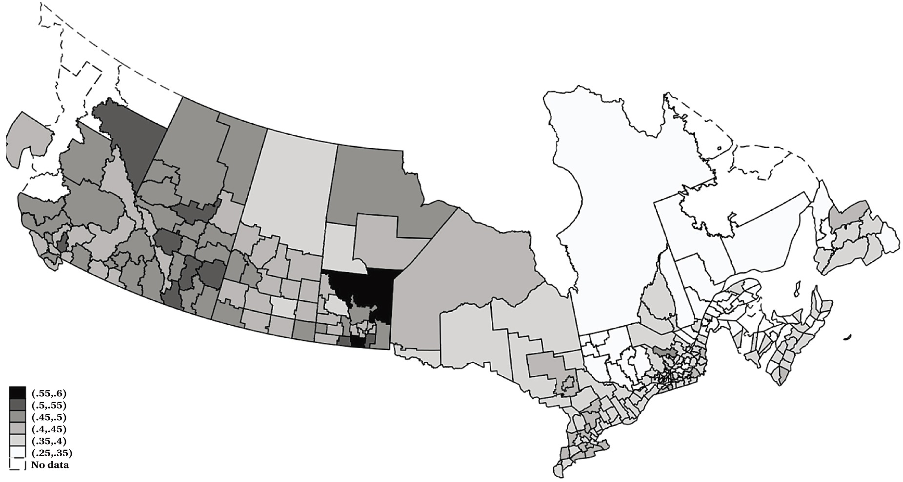
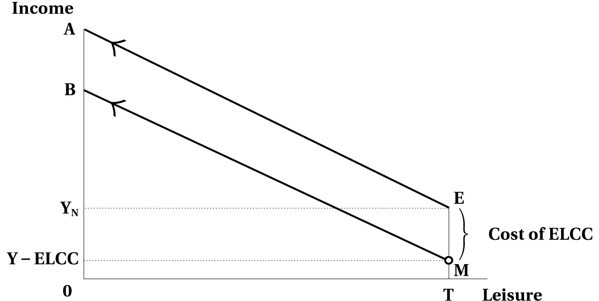
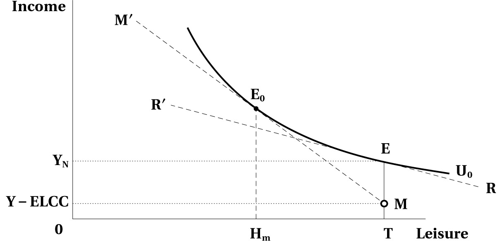
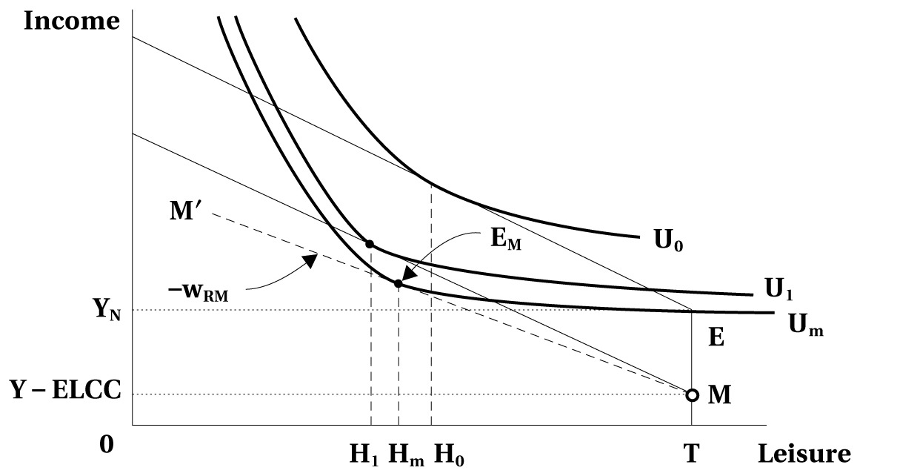
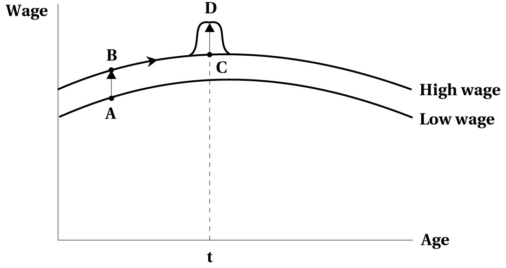

---
format:
  revealjs:
    theme: [default, hygge.scss]
    center-title-slide: false
    slide-number: true
    height: 900
    width: 1600
    chalkboard:
      theme: whiteboard
      src: drawings.json
    post-render: "scripts/decktape.sh"
    incremental: false
editor: visual
---

<h1>Labour Supply and Early&nbsp;Career&nbsp;Decisions</h1>

<hr>

<h2>EC306- Wages and Employment</h2>

<h2>Justin Smith</h2>

<h2>Wilfrid Laurier University</h2>

<h2>Fall 2026</h2>

{.absolute top="275" left="900" width="550"}

# Goals of This Section

## Goals of This Section

In this section we will:

- Explain why comparing people of different ages mixes up age effects and cohort effects
- Describe what new graduates face when they enter the labour market, especially in a&nbsp;recession
- Analyze how becoming a parent affects paid work, and how family leave and child care policy change the cost
- Use a life-cycle model to show why the response to a wage change depends on whether it is permanent, anticipated, or temporary

::: {.notes}
Every chapter so far has taken labour supply one moment at a time: a wage, some nonlabour income, a program, and a choice. But how much people work changes in predictable ways over a lifetime, and the decisions made early in a career are different in kind from the ones made later. This chapter is the early career: entering the labour market, becoming a parent, and planning work over a lifetime. Chapter 7 picks up the later career and retirement.
:::

# Characterizing Life-Cycle Labour&nbsp;Supply

## Comparing People at Different Ages

- Compare the assets of 20-year-olds and 55-year-olds in 2026
  - The 55-year-olds have far more
  - Does that tell us who is better at saving? Not really
- One group is just starting to earn and save; the other has been at it for decades
- A single snapshot mixes two things: [stage of life]{.fg style="color: #2780e3;"} and [generation]{.fg style="color: #2780e3;"}
- Better: compare the generations at the [same age]{.fg style="color: #2780e3;"}

::: {.callout-important}
## Key Definition
**[Life-cycle labour supply]{.fg style="color: #2780e3;"}**: how labour supply changes over a person's lifetime, and how decisions made earlier in life shape it later
:::

::: {.notes}
Ask the class the assets question before showing the answer. Most will say the 55-year-olds are better savers. The point is that a single year's data can't separate the effect of being older from the effect of being a different generation, and the same problem comes up every time we line people up by age in one year. That is the whole of this section.
:::

## Age–Participation Profiles: Women

Each solid line follows one generation; the dashed line is all women in a single year

```{r echo=FALSE}
#| message: false
#| warning: false
#| fig-width: 13
#| fig-height: 5.9

library(tidyverse)

# Book Figure 6.1: LFS participation rates by sex and five-year age group, observed every
# five years from 1980 to 2025 (2025 is January to May). Age is the bottom of each group.
lfp <- read_csv("Benjamin2026_Figure6-1-data.csv", show_col_types = FALSE)

series_cols <- c("Born 1936–40" = "#f0ad4e", "Born 1956–60" = "#2780e3",
                 "Born 1996–2000" = "#5cb85c", "Everyone in 2025" = "#c7254e")
age_labels <- c(paste0(seq(15, 65, 5), "–", seq(19, 69, 5)), "70+")

profile_plot <- function(g) {
  cohorts <- lfp %>%
    filter(gender == g, birth_year %in% c(1940, 1960, 2000)) %>%
    mutate(series = recode(as.character(birth_year), "1940" = "Born 1936–40",
                           "1960" = "Born 1956–60", "2000" = "Born 1996–2000"))
  snapshot <- lfp %>% filter(gender == g, year == 2025) %>% mutate(series = "Everyone in 2025")
  ggplot(bind_rows(cohorts, snapshot),
         aes(age, lfp, colour = factor(series, levels = names(series_cols)))) +
    geom_line(aes(linetype = series == "Everyone in 2025"), linewidth = 1.4) +
    geom_point(data = cohorts, size = 3) +
    scale_colour_manual(values = series_cols, name = NULL) +
    scale_linetype_manual(values = c("solid", "dashed"), guide = "none") +
    scale_x_continuous(breaks = seq(15, 70, 5), labels = age_labels) +
    scale_y_continuous(limits = c(0, 100), breaks = seq(0, 100, 20)) +
    labs(x = "Age group", y = "Participation rate (%)",
         caption = "Source: Benjamin et al. (2026) replication files, from the Labour Force Survey") +
    theme_minimal(base_size = 16) +
    theme(legend.position = "top", panel.grid.minor = element_blank())
}

profile_plot("Women")
```

::: {.notes}
Start with the dashed line, the snapshot. It has the inverted U that shows up in most countries: participation climbs steeply into the 20s, stays high from about 30 to 50, and falls as people approach retirement. Now the solid lines. Each one follows a single birth cohort, observed every five years, so it is a genuine life-cycle profile. The boomer women born 1956–60 sit well above the women born 1936–40 at every age they share. The youngest cohort only reaches 25–29 by 2025. The 1936–40 line starts at 40 because the LFS microdata only go back far enough to catch that cohort in middle age.
:::

## Age Effects and Cohort Effects

::: {.callout-important}
## Key Definition
**[Cohort effect]{.fg style="color: #2780e3;"}**: a difference in behaviour that comes from belonging to a particular generation, born in the same years or entering the labour market at the same time, rather than from age itself
:::

- In 2025, women aged 25–29 participate 61 points more than women aged 65–69
  - The two groups differ in age *and* in generation, so the 61 points are age plus cohort
- [Cohort effect:]{.fg style="color: #555;"} at 45, Gen X women (born 1976–80) participate about 5 points more than boomer women (born 1956–60) did at 45
- [Age effect:]{.fg style="color: #555;"} following the boomer women from 45 to 65, participation falls about 58 points
- Separating the two means following cohorts over many years
  - The LFS goes back only to 1976, which is why the early ages are missing for older cohorts; the Census goes back further

::: {.notes}
All three numbers are on the last chart, or computed from the same data. The 61 points is 85.7% against 24.6% in 2025. Gen X women aged 45–49 in 2025 participated at 86.7%, while the boomer women were at 82.2% when they were 45–49 in 2005, a gap of about 5 points at the same age. And the boomers fell from 82.2% at 45 to 24.6% at 65. The trick in each case is to hold one thing fixed: the same age to see a cohort effect, the same cohort to see an age effect. A single cross-section holds neither.
:::

## Age–Participation Profiles: Men

:::: columns
:::: {.column width="56%"}
```{r echo=FALSE}
#| fig-width: 8.4
#| fig-height: 6.6

profile_plot("Men")
```
::::

:::: {.column width="44%"}
- Women participate less than men, particularly at 20–35, partly because of caregiving, which comes later in this&nbsp;section
- Later cohorts of men work longer: a change in the timing of retirement ([Chapter 7]{.fg style="color: #555;"})
- Recent cohorts of men participate less before 30
  - At 20–24: 87% of the [1956–60]{style="white-space: nowrap;"} cohort, but 75% of the [1996–2000]{style="white-space: nowrap;"} cohort
  - More of them are in&nbsp;school&nbsp;([Chapter&nbsp;14]{.fg style="color: #555;"})
::::
::::

::: {.notes}
For men the cohort lines nearly sit on top of each other through the middle of life, which is why the snapshot is a better guide for men than for women. The differences are at the two ends. Young men stay in school longer than they used to, and older men retire later than the 1936–40 cohort did. Both are decisions we take up properly in later chapters.
:::

## Why Cohorts Differ

- Cohort effects matter most for understanding women's labour supply
  - Canada: Beaudry & Lemieux (1999), Dooley (1994); the United States: Goldin (1990, 2021)
- Economic variables alone can't explain the shifts
  - Social norms and gender role attitudes, including attitudes toward mothers working, shape each generation's preferences and constraints (Fortin 2005; Lundberg 2025)

::: {.callout-note}
## Goldin's Insight
Claudia Goldin, 2023 Nobel Prize in economics (NobelPrize.org 2023): later-life outcomes are largely set by early decisions about education and first jobs. A change in norms or policy reaches the young first, so women's participation changes slowly, one cohort at a&nbsp;time
:::

::: {.notes}
Goldin's work covers more than 200 years of US data, and it is where the cohort way of thinking about women's work comes from. It also explains why aggregate change looks slow: today's overall participation rate is largely the long-run effect of what shaped each generation's early-career decisions. Chapter 15 comes back to her research on the gender gap.
:::

## Worked Example: Two Cohorts

:::: columns
:::: {.column width="45%"}
| Observed in        | 2000 | 2005    | 2010 |
|:-------------------|:----:|:-------:|:----:|
| **Born 1975**      |      |         |      |
| Age                | 25   | **30**  | 35   |
| Participation rate | 75%  | **80%** | 85%  |
| **Born 1980**      |      |         |      |
| Age                | 20   | **25**  | 30   |
| Participation rate | 75%  | **80%** | 85%  |
::::

:::: {.column width="55%"}
- The truth: participation rises 1 point per year of age, or 5 points from 25 to 30, for both cohorts
- A researcher with only the 2005 data sees 80% at 25 and 80% at 30
  - Conclusion: [no change with age]{.fg style="color: #c7254e;"}, which is wrong
- The younger cohort is 5 percentage points higher at every age: a cohort effect
- A third confounder is [time effects]{.fg style="color: #2780e3;"}
  - If 2005 was a boom year, even repeated observations of a cohort would mix the boom with the effect of age
::::
::::

::: {.notes}
This is the book's worked example. The book calls the cohort effect "5 percent"; it means 5 percentage points. Note too that cohort effects need not be constant: two cohorts can differ at 30 and be identical at 50.
:::

## iClicker Question {background-color="#f0f4f8"}

In a 2025 survey, women aged 50–54 participate at 80% and women aged 55–59 at 70%. Suppose each cohort participates 4 points more than the cohort born five years before it, at every age, and there are no time effects. For a given cohort, how does participation change from 50–54 to 55–59?

A\) Falls 10 points\
B) Falls 14 points\
C) Falls 4 points\
D) Falls 6 points\
E) Can't be determined from a single year of data

::: {.notes}
Answer: D. The 55–59s are the older cohort. When they were 50–54 they were 4 points below today's 50–54s, so 76%, and they are at 70% now: a fall of 6. A reads the snapshot as an age effect, the mistake in the worked example. B applies the cohort effect in the wrong direction. C mistakes the cohort effect for the age effect. E is right about a snapshot on its own, but once you know the cohort effect you can back out the age effect. The no-time-effects assumption matters here: the older group was 50–54 in 2020.
:::

# Labour Market Entry

## Early-Career Unemployment Follows the Business Cycle

```{r echo=FALSE}
#| fig-width: 13
#| fig-height: 6.6

# Book Figure 6.2: LFS unemployment rate by sex, 1976-2025 (2025 is January to May)
ur <- read_csv("Benjamin2026_Figure6-2-data.csv", show_col_types = FALSE)
sex_cols <- c(Women = "#2780e3", Men = "#f0ad4e")

ur_young <- ur %>% filter(age_group == "25-34")
ggplot(ur_young, aes(year, urate, colour = gender)) +
  geom_line(linewidth = 1.4) +
  geom_text(data = filter(ur_young, year == max(year)), aes(label = gender),
            hjust = -0.15, size = 6) +
  scale_colour_manual(values = sex_cols) +
  scale_x_continuous(breaks = seq(1975, 2025, 10), expand = expansion(mult = c(0.01, 0.02))) +
  coord_cartesian(clip = "off") +
  labs(x = NULL, y = "Unemployment rate (%)", subtitle = "Ages 25–34; 2025 is January to May",
       caption = "Source: Benjamin et al. (2026) replication files, from the Labour Force Survey") +
  theme_minimal(base_size = 16) +
  theme(legend.position = "none", panel.grid.minor = element_blank(),
        plot.margin = margin(5, 80, 5, 5))
```

::: {.notes}
The unemployment rate of 25 to 34 year olds is one sign of how hard it is to land that first job after school. Three things to point out. First, the business cycle: the peaks are the recessions of 1980–82, 1990–92, 2008–09 and the 2020 pandemic. Second, men's rate has been above women's since the early 1990s. Third, the rate was much higher in the 1980s and 1990s than it has been since 2000, so it is not obvious that young people today have it harder than earlier generations did. For comparison, over 2005–2025 the rate averaged 6.1% for women and 7.2% for men at 25–34, against 5.3% and 5.5% at 35–54. The book gives 7.3% for men; its own replication data give 7.24%. The book's "mid-career" is ages 35–54, which its replication file confirms. Chapter 19, which we don't cover, has the full treatment of unemployment and job search.
:::

## Graduating in a Recession

- The first year is hard: you may find work, but probably not the job you wanted
- [Oreopoulos, von Wachter & Heisz (2012):]{.fg style="color: #555;"} Canadian male college graduates, when unemployment at graduation is 5 points&nbsp;higher
  - [About 9% lower earnings]{.fg style="color: #c7254e;"} at first, and still about half that 5 years&nbsp;on
  - The [scarring]{.fg style="color: #c7254e;"} persists after people find work and switch jobs, and takes about 10 years to&nbsp;fade
- [Messacar, Handler & Frenette (2021):]{.fg style="color: #555;"} looking ahead to the COVID-19 graduates
  - Each extra point of unemployment at graduation means 1.5–4% lower earnings, on average
  - More education [reduces the scarring]{.fg style="color: #5cb85c;"}

::: {.notes}
The 2020s have been uncertain for new graduates: a pandemic early in the decade and worries about trade policy and recession later on. The message of this research is that the timing of graduation matters for years, not months. People who graduate into a recession start lower and spend a decade catching up. Whether you graduate into a recession is largely luck, which is what lets researchers treat it as a natural experiment. The book's Exhibit 6.2 says unemployment 3–4 points higher means 10–15% lower first-year earnings. The paper's own summary is different: a typical recession, with unemployment up about 5 points, means an initial earnings loss of about 9% that halves within 5 years and is gone after about 10. Their sample is male college graduates.
:::

## iClicker Question {background-color="#f0f4f8"}

To measure scarring, researchers compare people who graduated when unemployment was high with people who graduated when it was low. Why is this more convincing than comparing graduates who were unemployed after graduating with graduates who weren't?

A\) Timing is mostly luck; who ends up unemployed partly reflects their own traits\
B) There are more graduates in high-unemployment years, so the estimates are more precise\
C) Unemployment rates are measured more accurately than whether a person was unemployed\
D) Graduates who were unemployed can't be followed in the data\
E) It isn't more convincing: both comparisons measure the same thing

::: {.notes}
Answer: A. This is the correlation-versus-causation point from Chapter 4 and Assignment 1. Graduates who end up unemployed may differ in ability, field or effort, and that would show up as "scarring" even with no causal effect at all. E is the misconception: it treats a correlation as the causal effect. Strictly, timing isn't pure luck: some students stay in school longer when jobs are scarce, as the next slide suggests for young women, and careful studies allow for that.
:::

## Not in Employment, Education, or Training

::: {.callout-important}
## Key Definition
**[NEET]{.fg style="color: #2780e3;"}**: the share of young people who are not employed and not in school or training
:::

:::: columns
:::: {.column width="58%"}
```{r echo=FALSE}
#| fig-width: 8.6
#| fig-height: 6

# Book Figure 6.3: LFS NEET rate by sex, ages 20-24 with no child in the household,
# 1976-2025 (2025 is January to May)
neet <- read_csv("Benjamin2026_Figure6-3-data.csv", show_col_types = FALSE)

ggplot(neet, aes(year, neet, colour = gender)) +
  geom_line(linewidth = 1.4) +
  geom_text(data = filter(neet, year == max(year)), aes(label = gender), hjust = -0.15, size = 6) +
  scale_colour_manual(values = sex_cols) +
  scale_x_continuous(breaks = seq(1975, 2025, 10), expand = expansion(mult = c(0.01, 0.02))) +
  scale_y_continuous(limits = c(5, 23), breaks = seq(5, 20, 5)) +
  coord_cartesian(clip = "off") +
  labs(x = NULL, y = "NEET rate (%)", subtitle = "Ages 20–24, no child in the household",
       caption = "Source: Benjamin et al. (2026) replication files, from the LFS") +
  theme_minimal(base_size = 16) +
  theme(legend.position = "none", panel.grid.minor = element_blank(),
        plot.margin = margin(5, 80, 5, 5))
```
::::

:::: {.column width="42%"}
- Rises in every recession, like the unemployment rate
- Young men's rate has been above young women's since the early 1980s
- [Layton, Latour & Wall (2025):]{.fg style="color: #555;"} when unemployment rises, young women are more likely to enrol in school, and young men are more likely to leave the labour force
::::
::::

::: {.notes}
The sample leaves out young people with a child at home, so parenthood doesn't drive the trend. Two places where the book's description and its figure don't agree. The book says the NEET rate of these young women has stayed fairly steady since the 1970s; the data show it falling from about 16.5% in the late 1970s to about 10 to 12% in most years since the mid-2000s. The book also says the gender gap grows over time, and that holds up: young men were below young women in the late 1970s, and the gap has averaged 2 to 3 points since, edging up decade by decade, with spikes in recessions (6 points in 1991). The 2025 figure of 2 points covers only January to May. Part of the long fall for young women is the cohort effect from the last section: decisions about school, parenthood and careers changed a lot for young women over these decades. Review Question 1 asks how this would look for 25 to 29 year olds, with young parents included.
:::

# Parenthood and Paid Work

## Total Fertility in Canada, 1921–2025

Partner, home, children, and career are decided together, often in the same few years. Parenthood is one of the biggest of those decisions

```{r echo=FALSE}
#| fig-width: 13
#| fig-height: 5.8

# Book Figure 6.4, extended to 2025. 1921-1990: Provencher & Galbraith (2024), data table
# for Chart 1; 1991-2025: Statistics Canada Table 13-10-0418-01
tfr <- read_csv("tfr-canada-1921-2025.csv", show_col_types = FALSE)

ggplot(tfr, aes(year, tfr)) +
  geom_hline(yintercept = 2.1, colour = "grey55", linetype = "dotted", linewidth = 0.9) +
  annotate("text", x = 2025, y = 2.2, label = "Replacement level, 2.1", hjust = 1,
           colour = "grey40", size = 5.5) +
  geom_line(colour = "#2780e3", linewidth = 1.5) +
  scale_x_continuous(breaks = seq(1920, 2020, 10)) +
  scale_y_continuous(limits = c(1, 4), breaks = seq(1, 4, 0.5)) +
  labs(x = NULL, y = "Children per woman",
       caption = "Source: Provencher & Galbraith (2024), 1921–1990; Statistics Canada Table 13-10-0418-01, 1991–2025") +
  theme_minimal(base_size = 16) +
  theme(panel.grid.minor = element_blank())
```

::: {.notes}
The total fertility rate is the number of children a woman would have over her lifetime if she had children at each age at the rates observed in that year. It fell through the 1920s and 1930s, rose through the baby boom to a peak of 3.94 in 1959, and fell sharply after 1960. It stayed between 1.5 and 1.7 from 1980 to 2008, and it has fallen since, to 1.26 in 2024 and 2025, the lowest on record. The book says the decline began after 2019. Its own figure shows it starting around 2009; it sped up after 2019. Hold the 1960 date for the technology slide.
:::

## Fertility as an Economic Decision {.smaller}

- Economists analyze the decision to have children with [consumer demand theory]{.fg style="color: #2780e3;"} (Becker 1960; Mincer 1963; Dahl & Løken 2024)
- The decision depends on market wages, the value of home production, how much parents want to invest in each child, and each partner's bargaining power
  - A full treatment would be dynamic: timing, spacing, future careers
  - We stick to the factors that bear most on early-career labour supply
- [Income:]{.fg style="color: #555;"} if children are like a normal good, more income means more children, other things&nbsp;equal
  - Was the steep fall in the 1930s just the Depression cutting incomes?
  - Hard to say: "other things equal" is hard to hold, so the pure income effect is hard to isolate

::: {.callout-important}
## Key Definition
**[Total fertility rate]{.fg style="color: #2780e3;"}**: the number of children a woman would have over her lifetime if, at each age, she had children at that year's birth rates
:::

::: {.notes}
The framework treats children like any other good the household chooses, with an income and a price. The rest of the fertility half of this section goes through the factors one at a time: income, the cost of raising children, the prices of related goods, tastes, and technology.
:::

## The Cost of Children

::: {.callout-important}
## Key Definition
**[Child penalty]{.fg style="color: #2780e3;"}**: the fall in a parent's earnings or employment after having a child, compared with what they would otherwise have earned
:::

- Demand for children falls as their cost rises
- [Direct costs:]{.fg style="color: #555;"} Phipps (1998): a couple earning \$60,000 needs about \$9,300 more a year to be as well off with a first child
- [Time costs:]{.fg style="color: #555;"} raising children takes time that could go to paid work, so the biggest cost is [forgone earnings]{.fg style="color: #2780e3;"}
- [Connolly, Fontaine & Haeck (2023):]{.fg style="color: #555;"} mothers' earnings are [49% lower]{.fg style="color: #c7254e;"} in the year of the birth and still [34% lower]{.fg style="color: #c7254e;"} 10 years on; fathers' barely change

::: {.notes}
Phipps measures the cost as the extra income it would take to put a family with a child back at the material well-being of a similar childless couple. Additional children cost a little less than the first. The time cost is the bigger one: food preparation, housework, teaching children, managing their activities. Most parents wouldn't call that leisure. And in Canada that time cost has fallen mostly on mothers. Hold the wage question for the clicker at the end of the fertility slides: what a raise for each parent does to the demand for children is a homework question too (Review Question 2, Problem 8a), so let them reason it out.
:::

## Child Penalties Across Canada

:::: columns
:::: {.column width="60%"}


[Source: Benjamin et al. (2026), Figure 6.5, from Karademir et al. (2026)]{.fg style="color: #555;"}
::::

:::: {.column width="40%"}
- Mothers' earnings penalty in the 5 years after a birth (Karademir, Laliberté & Staubli 2026)
- [Shading:]{.fg style="color: #555;"} share of earnings lost, from 25–&#8288;35% (white) to 55–&#8288;60%&nbsp;(black)
- Largest in parts of the West, smallest in&nbsp;Quebec
- Much of it is career choices made around caregiving: shorter or flexible hours, training and promotions passed up (Olivetti, Pan & Petrongolo 2024)
::::
::::

::: {.notes}
The shading is the penalty as a share of earnings, from about a quarter to about 60%. It covers women born between 1963 and 1985 who became parents before 40, between 1981 and 2016. Some of the penalty is simply working less after the birth. But Olivetti and coauthors stress the choices made around caregiving: sick days, summer holidays, before- and after-school care. Mothers choose occupations that allow them. Keep Quebec's pale colour in mind; we come back to it at the end of this section.
:::

## Related Goods, Tastes, and Technology

- [Related goods:]{.fg style="color: #555;"} child care, sports and activities, and postsecondary education are complements to children
  - Cheaper complements, say from public subsidies, could mean larger families; European expansions of child care for very young children raised fertility (Olivetti et al. 2024)
- [Tastes:]{.fg style="color: #555;"} norms constrain choices and shape preferences, and they pass from one generation to the next (Fernández & Fogli 2009)
  - They also respond to the economy: as more women work for pay, attitudes toward motherhood change
- [Technology:]{.fg style="color: #555;"} contraception, sterilization, and infertility treatment bring actual births closer to desired births
  - Lower infant mortality means fewer births for the same family size

::: {.notes}
The evidence on related goods is thin, and the book expects most of these prices to have little effect on family size. On tastes, the economics literature used to take preferences as given; the newer work treats norms as something people pay a price for breaking and also absorb as their own (Lundberg 2025; Olivetti et al. 2024). On technology: the book says the pill first became available in Canada in 1960, and that fertility dropped quickly as it spread. In 1960 it was authorized only to regulate the menstrual cycle. Selling contraceptives was a criminal offence until 1969. So broad access came later than 1960 suggests.
:::

## The Pill and Women's Careers

- The pill was approved in the US in 1960 and quickly used by married women to limit births
  - Single women under 21 often couldn't get it
- [Goldin & Katz (2002):]{.fg style="color: #555;"} as states lowered the age of majority, state by state, young single women gained access
  - Where they did, more women entered professional programs like law and medicine, and married later
- [Two channels:]{.fg style="color: #555;"}
  1. An unplanned pregnancy was less likely to derail a long education
  2. Delaying marriage became less costly: with more women delaying, the pool of potential partners was still there a few years later
- [Bailey (2006):]{.fg style="color: #555;"} in the US, early access delayed first births and permanently raised women's labour supply: the kind of cohort effect seen in Figure&nbsp;6.1

::: {.notes}
The book says the age of majority was lowered to 18 by a 1971 constitutional amendment, and that the amendment was adopted at different times in different states. That isn't quite right. The 1971 amendment, the 26th, lowered the voting age to 18 and was ratified within a few months. The age of majority is set by each state, and states changed it, along with the rules on minors' access to contraception, at different times from the late 1960s on. That staggered variation is what Goldin and Katz use. Bailey's women are the ones reaching their 20s in the late 1960s and early 1970s.
:::

## iClicker Question {background-color="#f0f4f8"}

In a couple where the mother does most of the child care, which change is more likely to lead them to have more children?

A\) A raise for the mother, because it adds more to family income\
B) An equal raise for the father, since it adds income but little time cost\
C) Either raise, equally, because family income rises by the same amount\
D) Neither, because a higher wage always means fewer children\
E) Neither, because both raises make the parents' time more expensive

::: {.notes}
Answer: B. Both raises have an income effect toward more children. Only the mother's also raises the main cost of a child, her own time, so it adds a substitution effect toward fewer. C counts only the income effect. D and E count only the substitution effect, and E puts it on the wrong parent's time. This is the Becker–Mincer logic behind why rising wages for women go with falling fertility.
:::

## Maternity and Parental Leave

:::: columns
:::: {.column width="50%"}
[Job-protected leave]{.fg style="color: #2780e3;"}

- Set by each province, so the details vary
- [Maternity leave:]{.fg style="color: #555;"} for those who are pregnant or have just given birth
- [Parental leave:]{.fg style="color: #555;"} for any parent caring for a newborn or newly adopted child
- Ontario: 17 weeks of maternity leave and 61 of parental leave, after 13 weeks with the&nbsp;employer
- The employer doesn't have to pay wages during the&nbsp;leave
::::

:::: {.column width="50%"}
[Benefits while on leave]{.fg style="color: #2780e3;"}

- Quebec: the Quebec Parental Insurance Plan
- Rest of Canada: EI maternity and parental benefits ([Chapter 5]{.fg style="color: #555;"})
  - 600 hours of insured work in the year before the claim
  - Up to 55% of earnings
  - Can be spread over up to 18 months, at a lower rate
  - Provisions for parents taking leave at the same time
::::
::::

::: {.notes}
Two separate pieces: provincial law protects the job, and a federal or Quebec program replaces part of the pay. Without job protection, the benefits would be much less useful, because the job might not be there to go back to.
:::

## Leave and the Cost of a Child

- Job protection makes returning to work after a birth more rewarding, so early-career work pays off more
- [Baker & Milligan (2008):]{.fg style="color: #555;"} Canada's introduction and expansion of job-protected leave
  - Leaves of 17–18 weeks didn't increase mothers' time at home, but [fewer quit]{.fg style="color: #5cb85c;"} and more [returned to their pre-birth employer]{.fg style="color: #5cb85c;"}
  - Longer leaves, up to 70 weeks, did increase time at home, along with job continuity
- Paid benefits soften the income loss in the months after a birth, which encourages longer&nbsp;leaves
  - Very long leaves may [slow career advancement]{.fg style="color: #c7254e;"} (Dahl & Løken 2024)
- Leave policy also changes the payoff to education and training done before becoming a parent ([Chapter 14]{.fg style="color: #555;"})

::: {.notes}
The book cites this result as "Baker et al. (2008)" and says the short leaves did not change mothers' behaviour. Two corrections. The paper is Baker and Milligan (2008) in the Journal of Labor Economics; the only Baker et al. (2008) in the book's references is the Quebec child care paper on the last slide of this section. And according to Baker and Milligan's abstract, the short leaves did change behaviour: they didn't add time at home, because the physical demands of a birth and private arrangements made a short mandate mostly redundant, but they reduced quits, increased leave-taking, and raised the share of mothers going back to their pre-birth employer.
:::

## Early Learning and Child Care

::: {.callout-important}
## Key Definitions
**[Early learning and child care (ELCC)]{.fg style="color: #2780e3;"}**: care and early education for young children outside the home, such as daycare centres and preschools

**[Child care subsidies]{.fg style="color: #2780e3;"}**: public payments that lower what parents pay for ELCC

**[Fixed cost of working]{.fg style="color: #2780e3;"}**: a cost paid only if you work, the same however many hours you work
:::

- On the agenda for decades: the 1970 Royal Commission on the Status of Women recommended them
- Since 2021, federal agreements with the provinces and territories have aimed to bring average fees to \$10 a day by March&nbsp;2026
- In the static model, ELCC is a [fixed cost of working]{.fg style="color: #2780e3;"}

::: {.notes}
Most of the questions about parenthood are dynamic, but the static model of Chapter 3 does well here, and it shows why child care can cut both ways. Assuming the cost doesn't depend on hours keeps the diagrams simple; letting it rise with hours is a straightforward extension. Quebec has had low-fee care since 1997, and you worked with that in Assignment 1.
:::

## ELCC Costs and the Budget Constraint

:::: columns
:::: {.column width="55%"}


[Source: Benjamin et al. (2026), Figure 6.6(a)]{.fg style="color: #555;"}
::::

:::: {.column width="45%"}
- Without ELCC costs: AE. With them: EMB, since working costs EM
- A parent who doesn't work stays at E; one who works any hours at all is on MB
::::
::::

::: {.notes}
This is panel (a) of the book's Figure 6.6. The drop from E to M is the cost of ELCC, paid in full as soon as the parent works at all. Where the book labels that lower level "Y − ELCC" it means nonlabour income minus the cost, $Y_N$ − ELCC.
:::

## ELCC Costs and Participation

:::: columns
:::: {.column width="55%"}


[Source: Benjamin et al. (2026), Figure 6.6(b)]{.fg style="color: #555;"}
::::

:::: {.column width="45%"}
- The reservation wage rises from the slope of RR′ to the slope of MM′, where working at E~0~ is as good as staying home at E
- This parent's wage is above the slope of RR′ but below MM′: without the cost they would work; with it they stay home

::: {.callout-note}
## Work Incentive Effect
Fixed costs raise the reservation wage, so participation&nbsp;[falls]{.fg style="color: #c7254e;"}
:::
::::
::::

::: {.notes}
This is panel (b). RR′ is the slope of the indifference curve at E, the reservation wage with no child care costs. MM′ is the line from M tangent to the same indifference curve, at $E_0$. Its slope is steeper because of diminishing MRS, so the reservation wage is higher.
:::

## ELCC Costs and Hours {.smaller}

:::: columns
:::: {.column width="55%"}


[Source: Benjamin et al. (2026), Figure 6.6(c)]{.fg style="color: #555;"}
::::

:::: {.column width="45%"}
- A parent whose wage is above the reservation wage still works
- Paying for ELCC is like losing nonlabour income: the constraint shifts down by EM in parallel
- A [pure income effect]{.fg style="color: #2780e3;"}: with leisure a normal good, leisure falls from H~0~ to H~1~, so hours of work rise
- The [gap]{.fg style="color: #2780e3;"}: at the reservation wage, the slope of M′M, working T − H~m~ hours at E~M~ is only as good as staying home at E
  - Fewer hours can't cover the fixed cost, so fixed costs [discourage part-time work]{.fg style="color: #c7254e;"}
::::
::::

::: {.notes}
This is the book's panel (c). The H's on the leisure axis are amounts of leisure, so hours of work are T minus each one. $U_m$ passes through E, the point of not working, and the dashed line M′M, with slope $-w_{RM}$, is tangent to it at $E_M$. So $w_{RM}$ is this parent's reservation wage once ELCC costs are counted, and at that wage the best they can do by working is $E_M$, at $T - H_m$ hours. Fewer hours than that leave them worse off than staying home, so labour supply jumps from zero straight to $T - H_m$. Notation warning: the book reuses symbols across panels. In panel (b), our last diagram, $E_0$ and $U_0$ are a different parent's reservation-wage tangency, and $H_m$ is the leisure there. In panel (c), $U_0$ and $H_0$ are this parent's choice with no ELCC costs. The book's text also writes $TH_M$ and $U_M$ where the figure has $H_m$ and $U_m$, and the axis label Y − ELCC means $Y_N$ − ELCC. Problem 1, on commuting costs, uses exactly this diagram, so leave it to them.
:::

## iClicker Question {background-color="#f0f4f8"}

A parent can earn \$25 an hour. Child care costs \$100 a day if they work at all, however many hours they work. Ignoring taxes, which statement is correct?

A\) If they work at all, they will work more than 4 hours a day\
B) They will never choose to work more than 4 hours a day\
C) If they work, they will work exactly 4 hours a day\
D) The cost doesn't affect their hours, since it doesn't depend on hours\
E) If they keep working, they will work fewer hours than before the cost

::: {.notes}
Answer: A. At 4 hours or fewer, earnings don't cover the \$100, so working leaves the parent no better off in income than staying home, with less leisure: that choice is dominated. This is the hours gap. The true minimum is above 4 hours, because the hours worked also cost leisure. C mistakes break-even for the optimum. D misses that a fixed cost still shifts the constraint. E gets the income effect backwards: losing income means less leisure and more hours.
:::

## What a Child Care Subsidy Does

The simplest case: free public ELCC removes the fixed cost entirely (ignoring the taxes that pay for it)

- [Parents not working:]{.fg style="color: #555;"} the reservation wage falls, so some [start working]{.fg style="color: #5cb85c;"}
  - Part-time work becomes worthwhile, since a few hours no longer have to cover the cost
- [Parents already working:]{.fg style="color: #555;"} none quit, since their reservation wage was already below their&nbsp;wage
  - But the subsidy acts like a demogrant ([Chapter 4]{.fg style="color: #555;"}): a pure income effect, so they [work fewer&nbsp;hours]{.fg style="color: #c7254e;"}
- For a subsidy that doesn't depend on hours, the effect on [total hours is ambiguous]{.fg style="color: #2780e3;"}
- Offer the subsidy only to parents not yet working and total hours must rise, but similar families get treated differently

::: {.notes}
This is the last two diagrams run in reverse. Removing the fixed cost moves the constraint back from EMB to AE. For people at E that brings the reservation wage back down to the slope of RR′. For people already working it is a parallel shift up, which is a demogrant. The book's aside about the politics of a subsidy only for new entrants is worth a sentence: the family down the street that was already paying for care gets nothing.
:::

## Quebec's \$5-a-Day Child Care

- From 1997, Quebec subsidized child care centres so parents paid \$5 a day; most had charged over \$20
- [Baker, Gruber & Milligan (2008):]{.fg style="color: #555;"} Quebec against the other provinces, before and after
  - Employment of mothers in two-parent families with a child aged 0–4: up [7.7 percentage&nbsp;points]{.fg style="color: #5cb85c;"}
- [Stalker & Ornstein (2013):]{.fg style="color: #555;"} Census data to 2006 confirm the rise in women's participation
- [Karademir, Laliberté & Staubli (2026):]{.fg style="color: #555;"} [mothers' employment up about 4 points]{.fg style="color: #5cb85c;"}; [the long-run earnings penalty about 8% smaller]{.fg style="color: #5cb85c;"}; grandmothers' work changed too

::: {.callout-note}
## Assignment 1
You compared Quebec with the rest of Canada in a single year, 2019. These studies compare before and after the program, a more convincing test of cause and effect
:::

::: {.notes}
The program was phased in: four-year-olds in September 1997, then one age group a year, until children under two became eligible in September 2000. That is why you will see both 1997 and 2000 given as start dates. The 7.7 points is the effect on whether mothers worked, for two-parent families with a child aged 0 to 4. The book calls it the participation rate of mothers with young children. Stalker and Ornstein also found fewer couples with a traditional division of labour. The book says the effect was especially large for married women. Their abstract reports the opposite comparison, larger effects for common-law than for married couples, and attaches it to the fall in the traditional division of labour, so the slide leaves the comparison out. Karademir and coauthors' 8% is a share of the penalty, not 8 points of earnings: averaged over the ten years after a first birth, mothers' earnings drop is about 3.3 points smaller than the pre-program drop of about 43 points, and 3.3/43 is about 8%. The 4-point rise in mothers' employment is from the paper; the book doesn't give it. These figures are from their 2023 working paper; the published version may differ slightly. Their map on the earlier slide shows Quebec with the smallest penalties.
:::

## iClicker Question {background-color="#f0f4f8"}

Quebec's low-fee child care raised the employment of mothers of young children by 7.7 percentage points. What does the model say about the total hours these mothers worked?

A\) They must have risen, since more mothers were working\
B) Can't tell from this: mothers already working may have cut their hours\
C) They must have fallen, because the subsidy works like a demogrant\
D) They rose by 7.7 percent\
E) They rose for mothers already working too, because child care became cheaper

::: {.notes}
Answer: B. New workers add hours at the extensive margin. For mothers already working, the subsidy is a pure income effect, so they work fewer hours at the intensive margin. The net is ambiguous in theory, which makes it an empirical question. A collapses the two margins into one. C forgets the new entrants. D confuses percentage points with percent, and employment with hours. E treats the subsidy as a wage increase with a substitution effect, which a fixed-cost subsidy doesn't have.
:::

# Dynamic Life-Cycle Models

## A Lifetime Model of Labour Supply

- The static model of [Chapter 3]{.fg style="color: #555;"} looks at one period at a time
- Here a person lives and can work for $N$ periods, with no uncertainty about the future
- Utility depends on consumption and leisure in every period:

$$
u = U(C_1, C_2, \ldots, C_N, L_1, L_2, \ldots, L_N) \tag{6.1}
$$

- No nonlabour income, a consumption price fixed at 1, and known wages $w_1, w_2, \ldots, w_N$
- From here on, two periods (this year and next), with hours $H_1$ and $H_2$

::: {.callout-important}
## Key Definition
**[Dynamic labour supply]{.fg style="color: #2780e3;"}**: labour supply planned over many periods at once, so hours in each period depend on the wages in every period
:::

::: {.notes}
The person chooses consumption and leisure in each period to maximize this, subject to a lifetime constraint we build on the next slide. The book notes that adding uncertainty about the future changes very little, which is why we can leave it out.
:::

## The Lifetime Budget Constraint

- A first guess: lifetime consumption equals lifetime earnings

$$
C_1 + C_2 = w_1H_1 + w_2H_2 \tag{6.2}
$$

- That means borrowing next year's pay for free. No bank allows it
- With borrowing and saving at interest rate $r$, present values must balance:

$$
C_1 + \frac{C_2}{1+r} = w_1H_1 + \frac{w_2H_2}{1+r} \tag{6.3}
$$

::: {.callout-important}
## Key Definition
**[Present value]{.fg style="color: #2780e3;"}**: what a future amount is worth today; at interest rate $r$, \$1 next year is worth $\frac{1}{1+r}$ today
:::

::: {.notes}
The general formula, from the book's footnote: a stream $y_1, y_2, \ldots, y_T$ has present value $y_1 + \frac{y_2}{1+r} + \cdots + \frac{y_T}{(1+r)^{T-1}}$. Anyone who could borrow freely could consume the present value of their whole lifetime income in the first period, and spend the rest of their life paying it back.
:::

## iClicker Question {background-color="#f0f4f8"}

You will earn \$30,000 this year and \$33,000 next year, and you can borrow or save at 10%. What is the present value of your lifetime earnings?

A\) \$63,000\
B) \$66,000\
C) \$57,273\
D) \$60,273\
E) \$60,000

::: {.notes}
Answer: E. That is \$30,000 + \$33,000/1.1. Each wrong option is a slip you can name. A is equation (6.2), with no discounting. B compounds this year's earnings forward, which gives a value next year, not today. C discounts both years. D discounts the wrong year.
:::

## Saving, Borrowing, and Full Income {.smaller}

- [A saver]{.fg style="color: #555;"} consumes next year's earnings plus this year's savings with interest:

$$
C_2 = w_2H_2 + (1+r)(w_1H_1 - C_1) \tag{6.4}
$$

- [A borrower]{.fg style="color: #555;"} consumes next year's earnings minus the loan with interest:

$$
C_2 = w_2H_2 - (1+r)(C_1 - w_1H_1) \tag{6.5}
$$

- Both are rearrangements of (6.3). Using $H_t = T - L_t$:

$$
C_1 + \frac{C_2}{1+r} + w_1L_1 + \frac{w_2L_2}{1+r} = w_1T + \frac{w_2T}{1+r} \tag{6.6}
$$

- The right side is the present value of the [lifetime labour endowment]{.fg style="color: #2780e3;"}; leisure in period $t$ costs $w_t$
- Labour supply in each period depends on every period's wage, $r$, and lifetime resources (MaCurdy 1981)

::: {.notes}
Correction to the book: it prints (6.5) with a plus sign, which would make borrowing raise next year's consumption. The loan has to be paid back, so it is a minus. With the sign fixed, (6.4) and (6.5) are the same equation, written once for a saver and once for a borrower. Equation (6.6) is the dynamic version of full income from Chapter 3: what you would earn working every available hour in both periods, discounted. MaCurdy worked through the income and substitution effects in this setting; they are more complicated than in the static model, and the next slide shows the simplest version.
:::

## Three Kinds of Wage Change

:::: columns
:::: {.column width="58%"}


[Source: Benjamin et al. (2026), Figure 6.7]{.fg style="color: #555;"}
::::

:::: {.column width="42%"}
::: {.callout-important}
## Key Definitions
- [A → B:]{.fg style="color: #555;"} a [permanent, unanticipated]{.fg style="color: #2780e3;"} difference, a higher wage at every age
- [B → C:]{.fg style="color: #555;"} an [evolutionary wage change]{.fg style="color: #2780e3;"}, wages rising with age along a profile known in advance
- [C → D:]{.fg style="color: #555;"} a [transitory, unanticipated]{.fg style="color: #2780e3;"} increase, a one-time blip at age $t$, like overtime that won't be repeated
:::

- All three are assumed to be the same size, so only the kind of change differs
::::
::::

::: {.notes}
A and B can be read as two people whose wages differ by the same amount at every age. B to C is one person moving along their own profile. C and D are two people with the same high-wage profile, except that one gets a one-off bump at age t.
:::

## Why the Responses Differ

| Wage change | Income effect | Substitution effect | Labour supply&nbsp;response |
|:------------|:--------------|:--------------------|:-----------------------|
| B&nbsp;→&nbsp;C,&nbsp;evolutionary | None: an anticipated raise is no news | Work more where wages&nbsp;peak | Largest |
| C&nbsp;→&nbsp;D,&nbsp;transitory | Small, spread over the whole&nbsp;life | Work more at age $t$ | Middle |
| A&nbsp;→&nbsp;B,&nbsp;permanent | Large: lifetime income&nbsp;rises | Work more at every&nbsp;age | Smallest, possibly&nbsp;negative |

: {tbl-colwidths="[23,27,25,25]"}

::: {.callout-important}
## Key Definition
**[Intertemporal substitution]{.fg style="color: #2780e3;"}**: shifting work toward the periods when it pays the most, and leisure toward the periods when it is cheapest
:::

::: {.notes}
The evolutionary change gives the pure substitution effect, so it has the largest response: a forward-looking person takes leisure when it is cheap and works when the return is highest. The transitory blip has the usual substitution effect at age t, plus a small income effect spread across the whole life; the person with the bump works a lot more at t and slightly less everywhere else. The permanent difference has the largest income effect, which offsets the substitution effect, so the response is smallest and can even be negative. Problem 2, on permanent and temporary tax cuts, builds on this table, so leave it to them.
:::

## iClicker Question {background-color="#f0f4f8"}

Each change below raises your wage by \$3 an hour this year. According to the life-cycle model, which one raises your hours this year the most?

A\) An unexpected permanent raise, effective now and for the rest of your career\
B) An unexpected one-year bonus rate, after which your wage goes back to normal\
C) A raise you've long known was coming, from your firm's pay scale\
D) All three equally, since this year's wage rises by \$3 in each case\
E) None of them: a higher wage always lowers hours through the income effect

::: {.notes}
Answer: C. An anticipated raise is no news about lifetime wealth, so it is pure intertemporal substitution: work more when it pays more. B is a close second, with the same substitution effect plus a small income effect spread over the whole life. A has the biggest income effect, so it has the smallest response. D is the static model. E forgets the substitution effect. The test bank asks this ranking several different ways.
:::

## How Well Does the Model Work?

- In theory, an important step beyond the static model
  - Income and substitution effects depend on whether a wage change is [permanent or temporary]{.fg style="color: #2780e3;"}, and [anticipated or not]{.fg style="color: #2780e3;"}
- In practice, its record is disappointing when it is asked to explain things like year-to-year swings in employment across the economy (Card 1994)
- Still, it tells us what to ask about any wage or tax change: is it news, and will it last?

::: {.notes}
The theory is important even if it fits the data poorly. When a policy changes wages or taxes, the first questions are whether people saw it coming and whether it is permanent. Card's review is the standard reference on the evidence.
:::

# Summary

## Summary {.smaller}

[Life-cycle labour supply:]{.fg style="color: #2780e3;"}

- Participation follows an inverted U with age; a single-year snapshot mixes age effects with cohort effects, which matter most for women

[Labour market entry:]{.fg style="color: #2780e3;"}

- Young people's unemployment and NEET rates rise and fall with the business cycle; graduating in a recession leaves scars that fade slowly

[Parenthood and paid work:]{.fg style="color: #2780e3;"}

- The largest cost of having children is mothers' forgone earnings
- Family leave and ELCC subsidies lower that cost; subsidies raise participation but can cut the hours of parents already working

[Dynamic life-cycle models:]{.fg style="color: #2780e3;"}

- With a lifetime budget constraint, the response to a wage change depends on whether it is permanent, anticipated, or temporary

## References {.smaller}

- Bailey, M. J. (2006). More power to the pill: The impact of contraceptive freedom on women's life cycle labor supply. *Quarterly Journal of Economics*, 121(1), 289–320.
- Baker, M., Gruber, J., & Milligan, K. (2008). Universal child care, maternal labor supply, and family well-being. *Journal of Political Economy*, 116(4), 709–745.
- Baker, M., & Milligan, K. (2008). How does job-protected maternity leave affect mothers' employment? *Journal of Labor Economics*, 26(4), 655–691.
- Beaudry, P., & Lemieux, T. (1999). Evolution of the female labour force participation rate in Canada, 1976–1994: A cohort analysis. *Canadian Business Economics*, 7, 57–70.
- Becker, G. S. (1960). An economic analysis of fertility. In *Demographic and economic change in developed countries*. Princeton University Press.
- Benjamin, D., Foley, K., Gunderson, M., Lemieux, T., Schirle, T., & Skuterud, M. (2026). *Labour Market Economics*, 2026 Release. McGraw Hill. Chapter 6, figure bank, and replication files.

## References (cont.) {.smaller}

- Card, D. (1994). Intertemporal labour supply: An assessment. In C. A. Sims (Ed.), *Advances in econometrics: Sixth World Congress*. Cambridge University Press.
- Connolly, M., Fontaine, M., & Haeck, C. (2023). Child penalties in Canada. *Canadian Public Policy*, 49(4),&nbsp;399–&#8288;420.
- Dahl, G. B., & Løken, K. V. (2024). Families, public policies, and the labor market. In C. Dustmann & T. Lemieux (Eds.), *Handbook of labor economics* (Vol. 5, pp. 581–618). Elsevier.
- Dooley, M. D. (1994). The converging market work patterns of married mothers and lone mothers in Canada. *Journal of Human Resources*, 29(2), 600–620.
- Fernández, R., & Fogli, A. (2009). Culture: An empirical investigation of beliefs, work, and fertility. *American Economic Journal: Macroeconomics*, 1(1), 146–177.
- Fortin, N. M. (2005). Gender role attitudes and the labour-market outcomes of women across OECD countries. *Oxford Review of Economic Policy*, 21(3), 416–438.

## References (cont.) {.smaller}

- Goldin, C. (1990). *Understanding the gender gap: An economic history of American women*. Oxford&nbsp;University&nbsp;Press.
- Goldin, C. (2021). *Career and family: Women's century-long journey toward equity*. Princeton University Press.
- Goldin, C., & Katz, L. F. (2002). The power of the pill: Oral contraceptives and women's career and marriage decisions. *Journal of Political Economy*, 110(4), 730–770.
- Karademir, S., Laliberté, J.-W., & Staubli, S. (2026). The multigenerational impact of children and childcare policies. *Journal of Labor Economics*, 44(1), 189–227. https://doi.org/10.1086/732358
- Layton, J., Latour, G., & Wall, K. (2025). *Youth not in employment, education or training: Recent trends*. Education, Learning and Training: Research Paper Series, Statistics Canada Catalogue no. 81-595-M.
- Lundberg, S. (2025). The economics of gender norms. *Scottish Journal of Political Economy*, 72(2).&nbsp;https://doi.org/10.1111/sjpe.12407

## References (cont.) {.smaller}

- MaCurdy, T. E. (1981). An empirical model of labor supply in a life-cycle setting. *Journal of Political Economy*, 89(6), 1059–1085.
- Messacar, D., Handler, T., & Frenette, M. (2021). Predicted earnings losses from graduating during COVID-19. *Canadian Public Policy*, 47(2), 301–315.
- Mincer, J. (1963). Market prices, opportunity costs, and income effects. In C. Christ et al. (Eds.), *Measurement in economics: Studies in mathematical economics and econometrics in memory of Yehuda Grunfeld*. Stanford&nbsp;University&nbsp;Press.
- NobelPrize.org. (2023, October 9). *Press release: The Prize in Economic Sciences 2023*.&nbsp;https://www.nobelprize.org/prizes/economic-sciences/2023/press-release/
- Olivetti, C., Pan, J., & Petrongolo, B. (2024). The evolution of gender in the labor market. In C. Dustmann & T. Lemieux (Eds.), *Handbook of labor economics* (Vol. 5, pp. 619–677). Elsevier.
- Oreopoulos, P., von Wachter, T., & Heisz, A. (2012). The short- and long-term career effects of graduating in a recession. *American Economic Journal: Applied Economics*, 4(1), 1–29.

## References (cont.) {.smaller}

- Phipps, S. (1998). What is the income "cost of a child"? Exact equivalence scales for Canadian two-parent families. *Review of Economics and Statistics*, 80(1), 157–164.
- Provencher, C., & Galbraith, N. (2024). *Fertility in Canada, 1921 to 2022*. Statistics Canada Catalogue no.&nbsp;91F0015M2024001.
- Royal Commission on the Status of Women in Canada. (1970). *Report of the Royal Commission on the Status of Women in Canada*. Information Canada. https://www.publications.gc.ca/site/eng/9.699583/publication.html
- Stalker, G., & Ornstein, M. (2013). Quebec, daycare, and the household strategies of couples with young children. *Canadian Public Policy*, 39(2), 241–262.
- Statistics Canada. Table 13-10-0418-01, *Crude birth rate, age-specific fertility rates and total fertility rate (live&nbsp;births)*.
- Statistics Canada. *Labour Force Survey* public use microdata files, 1976–2025, as tabulated in the Benjamin&nbsp;et&nbsp;al. (2026) replication files.
