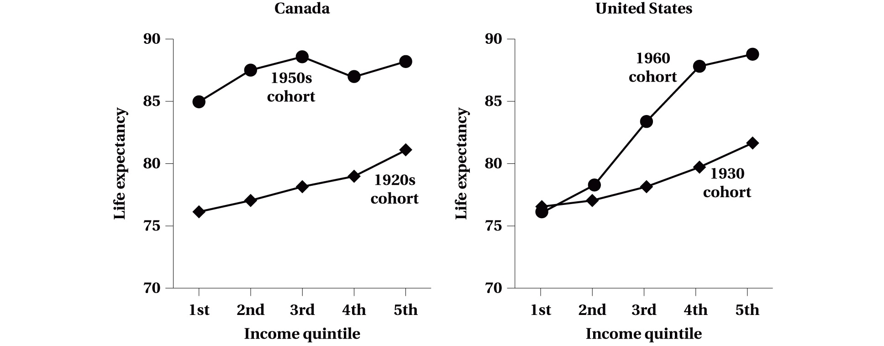
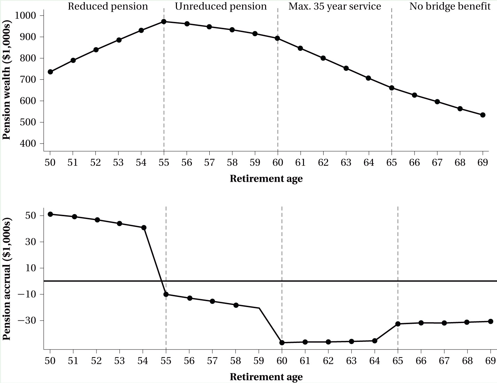
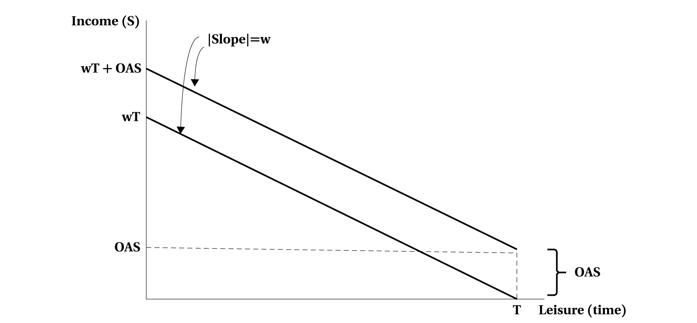
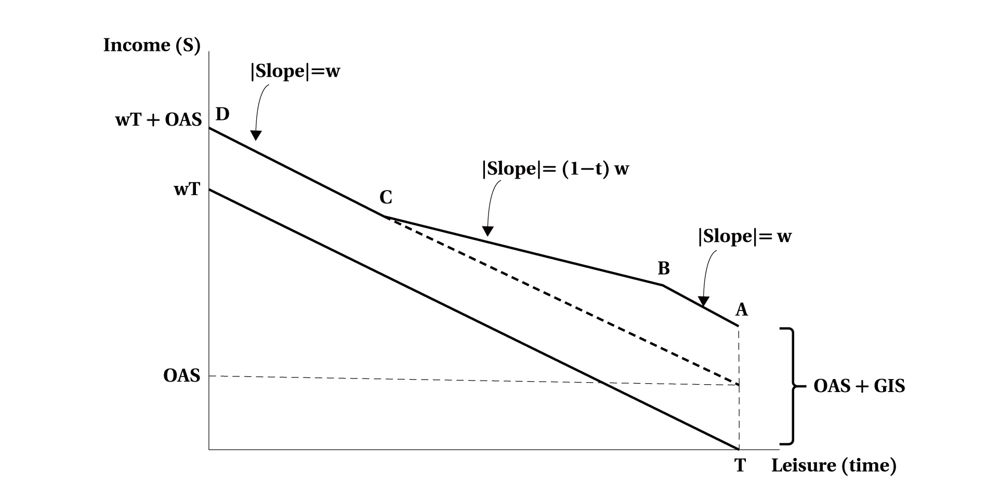

---
format:
  revealjs:
    theme: [default, hygge.scss]
    center-title-slide: false
    slide-number: true
    height: 900
    width: 1600
    chalkboard:
      theme: whiteboard
      src: drawings.json
    post-render: "scripts/decktape.sh"
    incremental: false
editor: visual
---

<h1>Labour Supply and Later&nbsp;Career&nbsp;Decisions</h1>

<hr>

<h2>EC306- Wages and Employment</h2>

<h2>Justin Smith</h2>

<h2>Wilfrid Laurier University</h2>

<h2>Fall 2026</h2>

{.absolute top="275" left="900" width="550"}

# Goals of This Section

## Goals of This Section

In this section we will:

- Describe how work at older ages has changed for women and men, and what people do with their time once they stop working for pay
- Explain mandatory retirement and Canada's three-tier pension system
- Ask how much more older Canadians could work, given their health
- Show how defined benefit pension plans reward retiring at particular ages
- Analyze how OAS, GIS, and the C/QPP change the incentive to work at older ages

::: {.notes}
Chapter 6 was the early career. This is the later career. Canadians are living longer and healthier lives: over the past century, both life expectancy and healthy life expectancy have risen by more than 20 years. What do we do with the extra time?

The labour supply model is the same at any age: opportunities, preferences, and prices. But four things make later-career decisions different. First, norms: many people expect to retire, and older people are often grandparents or caring for their own parents. Second, the horizon is shorter, so investing in more training pays off less (Chapter 14). Third, health may limit how much and what kind of work we can do. Fourth, and the biggest concern for most people, income comes from different places: public programs, employer pensions, and savings, along with the worry about outliving those savings, which is called longevity risk. Sometimes the static model of Chapter 3 is enough. For some retirement questions we need the dynamic thinking of Chapter 6.
:::

# Labour Supply and Age

## What Is Retirement? {.smaller}

- Usually it means leaving the labour force for good at an older age
- But it can also mean:
  - Cutting hours a lot
  - Moving to a less demanding job or occupation
  - Leaving a career job, then coming back part-time
- The move can be sudden or spread over years
- For someone whose work was mostly unpaid, retirement may change very little
- Because it is so hard to pin down, we usually study specific outcomes instead: participation, employment, hours, and time use

::: {.callout-important}
## Key Definition
**[Retirement decisions]{.fg style="color: #2780e3;"}**: the series of work and saving choices, made over a whole lifetime, that determine when and how a person moves out of paid work
:::

::: {.notes}
Ask the class what retirement means to them, or to their parents. You'll get several of the answers on the slide. The point is that retirement isn't one event, so economists tend to describe specific labour supply outcomes at older ages rather than try to define retirement exactly.
:::

## Participation at Older Ages: Women

Participation of women aged 60–64 held near 24% until the mid-1990s, then rose to 52% by 2025

```{r echo=FALSE}
#| message: false
#| warning: false
#| fig-width: 13
#| fig-height: 5.9

library(tidyverse)

# Book Figure 7.1, at five-year intervals. LFS participation rates by sex and five-year
# age group, 1980-2025 (2025 is January to May), from the publisher's replication data
# for Figure 6.1 (Schirle's tabulations of the LFS public use microdata), ages 50-69 only.
lfp <- read_csv("older-lfp-1980-2025.csv", show_col_types = FALSE) %>%
  mutate(group = factor(paste0(age, "–", age + 4),
                        levels = c("50–54", "55–59", "60–64", "65–69")))
age_cols <- c("50–54" = "#2780e3", "55–59" = "#f0ad4e", "60–64" = "#5cb85c", "65–69" = "#c7254e")

lfp_plot <- function(g, x_step = 5) {
  d <- filter(lfp, gender == g)
  ggplot(d, aes(year, lfp, colour = group)) +
    geom_line(linewidth = 1.4) +
    geom_point(size = 3) +
    geom_text(data = filter(d, year == max(year)), aes(label = group), hjust = -0.25, size = 6) +
    scale_colour_manual(values = age_cols) +
    scale_x_continuous(breaks = seq(1980, 2025, x_step), expand = expansion(mult = c(0.02, 0.02))) +
    scale_y_continuous(limits = c(0, 100), breaks = seq(0, 100, 20)) +
    coord_cartesian(clip = "off") +
    labs(x = NULL, y = "Participation rate (%)", subtitle = "Every five years; 2025 is January to May",
         caption = "Source: Benjamin et al. (2026) replication files, from the LFS") +
    theme_minimal(base_size = 16) +
    theme(legend.position = "none", panel.grid.minor = element_blank(),
          plot.margin = margin(5, 75, 5, 5))
}

lfp_plot("Women")
```

::: {.notes}
Every age group of older women works more than it used to. At 50–54, participation went from 49% in 1980 to 82% in 2025. At 60–64 it was flat at about 24% until 1995 and then climbed to 52%.

That timing is the cohort effect from Chapter 6. The women who turned 60 in 1995 were born in 1935 and were young adults in the 1960s, when the pill arrived and new careers opened up to women. As we saw in Chapter 6, broad legal access came at the end of the decade: the pill was approved in Canada in 1960 only to regulate the menstrual cycle, and selling contraceptives was a criminal offence until 1969. Each later cohort had worked more over its whole career, and kept working longer.

The book's figure plots every year. This version uses the publisher's own data, which are tabulated every five years, so every number on this and the next slide matches the book.
:::

## Participation at Older Ages: Men

:::: columns
:::: {.column width="56%"}
```{r echo=FALSE}
#| fig-width: 8.4
#| fig-height: 6.6

lfp_plot("Men", x_step = 10)
```
::::

:::: {.column width="44%"}
- Men aged 60–64 went from 64% in 1980 to 43% in 1995, then back to 65% by&nbsp;2025
- Men aged 65–69 doubled from 17% in 1995 to 35% in 2025, the highest in the whole&nbsp;series
- [Schirle (2008); Milligan & Schirle&nbsp;(2019):]{.fg style="color: #555;"} much of the turnaround came from wives working more
  - Husbands, often a little older, put off retiring while their wives kept&nbsp;working
::::
::::

::: {.notes}
For older men the story is a U: falling through the 1980s and early 1990s, rising since the mid-1990s. One explanation for the rise is the women on the last slide. Their husbands appear to have responded by working longer too. Perhaps they didn't want to retire while their wives were still working, or didn't want to give up being the family breadwinner. It's not the only factor, and the rest of the chapter takes up others: health, pensions, and public programs.

Correction to the book: it says the participation rates "of women and men at ages 60–64" were stable around 24% until the mid-1990s and then rose to 52%. Those are the women's numbers. Men aged 60–64 fell from 64% in 1980 to 43% in 1995 and recovered to 65% in 2025, in the publisher's own data.
:::

## Retirement Is Not Just Leisure

- People over 65 spend much more time on leisure and socializing than anyone younger (Statistics Canada 2025)
- But many older people, retired or not, also do a lot of unpaid&nbsp;work
- [Caring for adults:]{.fg style="color: #555;"} 18% of people aged 60–69 regularly care for an elderly person, often a spouse or parent (Milligan & Schirle 2025a)
  - Daughters take on the main caregiving role more often than sons
  - Unpaid elder care is worth about 1.3% of GDP; formal care costs 1.8%, a share expected to rise through the&nbsp;2030s
- [Caring for grandchildren:]{.fg style="color: #555;"} 10 years after the first grandchild arrives, earnings are [16% lower for grandmothers]{.fg style="color: #2780e3;"} and [15% lower for grandfathers]{.fg style="color: #2780e3;"} (Karademir et&nbsp;al.&nbsp;2026)
- Retirement is better seen as shifting time from paid work toward a range of nonmarket&nbsp;activities

::: {.notes}
Some of this care is enjoyable, but much of it is work that we wouldn't call leisure. Just as becoming a parent comes with a child penalty (Chapter 6), becoming a grandparent comes with one too.

The 16% and 15% are the long-run earnings effects 10 years after the first grandchild in the working paper version of Karademir, Laliberté and Staubli (NBER Working Paper 32204, 2024), which also reports employment falls of 8% for grandmothers and 6% for grandfathers. The book adds that grandparents' care is "often complementary" to formal child care. The paper is more specific. Quebec's low-fee child care raised grandmothers' employment by about 2%, so formal care replaced intensive care by grandparents, and complemented only light care of 5 hours a week or less. That ties back to the Quebec slide in Chapter 6.
:::

## iClicker Question {background-color="#f0f4f8"}

Participation of women aged 60–64 stayed near 24% from 1980 to 1995, then rose to 52% by 2025. Which explanation best fits that timing?

A\) An age effect: women work more as they get older\
B) Women's health at 60 improved suddenly in the mid-1990s\
C) A cohort effect: women born from the mid-1930s on had worked more all their careers, and began turning 60 in the mid-1990s\
D) An added worker effect: husbands were retiring earlier, so wives worked to replace the income\
E) Mandatory retirement was abolished in the mid-1990s

::: {.notes}
Answer: C. The women who turned 60 in 1995 were born in 1935 and were young adults in the 1960s. Each later cohort had worked more over its whole career (Chapter 6), and kept working longer. A is backwards: at any date, participation falls with age (compare the 50–54 and 60–64 lines). D is the added worker effect from Chapter 3, which is a response to a spouse's temporary job loss, and the timing is wrong: women's rate was flat exactly while older men's was falling. B: health improves gradually, not in one jump. E: the bans came province by province, the last by 2012, and a rule at 65 wouldn't touch women aged 60–64 anyway.
:::

# Retirement Policies in Canada

## Mandatory Retirement Provisions {.smaller}

::: {.callout-important}
## Key Definition
**[Mandatory retirement provisions]{.fg style="color: #2780e3;"}**: rules in an employer's personnel policy or a collective agreement that end a worker's job at a set&nbsp;age
:::

- [Automatic:]{.fg style="color: #555;"} the worker must leave at that age
- [Compulsory:]{.fg style="color: #555;"} the employer can make the worker leave, but can also keep them on, usually year to year
- The name misleads: the rule ended the job, not the working life. No law ever required anyone to leave the labour&nbsp;force
- Allowed for many years, as long as no one was forced out before 65
- Treated as age discrimination from the 1970s on, and gone from almost every Canadian jurisdiction by December&nbsp;2012
- Exceptions remain:
  - [Bona fide occupational requirements]{.fg style="color: #2780e3;"}, such as jobs where physical dexterity matters (Gomez & Gunderson&nbsp;2011)
  - Partners in large law firms

::: {.notes}
Warman and Worswick (2010) and Messacar and Kocourek (2019) give the history: the provinces abolished it one at a time, and the federal government last.

On law firms, the book says the Supreme Court ruled such contracts enforceable and not age discrimination. The ruling is narrower than that. In McCormick v. Fasken Martineau DuMoulin LLP (2014 SCC 39), the Court held that an equity partner is not an employee under BC's Human Rights Code, so the Code's protection against age discrimination in employment didn't reach the partnership agreement. The Court didn't decide whether a retirement age of 65 is age discrimination.
:::

## Did Mandatory Retirement Matter? {.smaller}

- [Warman & Worswick (2010):]{.fg style="color: #555;"} professors stayed longer where mandatory retirement was banned; there, about 23% of those working at 64 were still at the same university at&nbsp;72
- [Reid (1988); Shannon & Grierson (2004):]{.fg style="color: #555;"} participation barely changed in Manitoba and Quebec, which banned it&nbsp;first
- [Grant & Townsend (2013):]{.fg style="color: #555;"} it was harder on immigrants, who arrive later and have less time to build pensions and&nbsp;savings
- [Messacar & Kocourek (2019):]{.fg style="color: #555;"} using the timing of the bans across provinces
  - Mandatory retirement was rarely used, even before the bans
  - Banning it raised some workers' retirement age, but fewer retired partially, which offset some of that
  - No detectable effect on health, happiness, or financial security

::: {.callout-note}
## The Evidence
Mixed, and the effects mostly small
:::

::: {.notes}
The professors' study is the cleanest case, because universities with and without mandatory retirement are otherwise alike.
:::

## What a Ban Changes for Employers {.smaller}

- [Gunderson (1983):]{.fg style="color: #555;"} the reasons mandatory retirement existed in the first place predict the side effects of a ban

::: {.callout-important}
## Key Definition
**[Deferred compensation]{.fg style="color: #2780e3;"}**: pay held back early in a job and paid later, so wages run below productivity when young and above it when older ([Chapter 18]{.fg style="color: #555;"})
:::

- A set retirement date made deferred compensation workable. Without one:
  - Retirement timing is less predictable, and workers have less reason to stay with the employer
  - Older workers face more monitoring and evaluation
  - Younger workers have fewer promotion opportunities
  - Defined benefit pension plans, which went hand in hand with mandatory retirement, may fade
  - Less training, if deferred wages no longer keep trainees around
- There is little research testing these predictions

::: {.notes}
If you're paid less than you produce early on, in exchange for being paid more than you produce later, the employer needs to know when the overpaid years will end. A mandatory retirement date did that. Problem 2 asks you to draw the deferred wage profile with and without mandatory retirement, so I'll leave the diagram to you.
:::

## Canada's Three-Tier Pension System {.smaller}

| Tier | Programs | Paid for by | Benefit | Can start |
|:-----|:---------|:------------|:--------|:----------|
| 1. Income&nbsp;support | Old Age Security (OAS), Guaranteed Income Supplement (GIS) | General tax revenue, year by&nbsp;year | OAS a flat amount; GIS tested on&nbsp;income | 65 (OAS can wait to&nbsp;70) |
| 2. Social&nbsp;insurance | Canada and Quebec Pension Plans (C/QPP) | Payroll contributions by workers and&nbsp;employers | Tied to past earnings | Between 60 and&nbsp;70 |
| 3. Private | Employer pension plans, RRSPs, TFSAs | Employers, employees,&nbsp;individuals | Set by the plan, or by what was saved | Set by the plan; savings any&nbsp;time |

: {tbl-colwidths="[15,25,22,22,16]"}

::: {.callout-important}
## Key Definition
**[Pay-as-you-go]{.fg style="color: #2780e3;"}**: a pension paid out of current revenue, so today's taxes or contributions pay today's benefits, instead of from funds set aside in&nbsp;advance
:::

- Tier 3 reach: employer plans covered 33% of the labour force in 2024; 21% of tax filers paid into an RRSP in 2023, with a median of \$4,000

::: {.notes}
This is the book's Exhibit 7.1 as a table. Two notes on it. The exhibit calls OAS "a pay-as-you-go system, funded by contributions from current workers." Pay-as-you-go is right, but there are no OAS contributions: OAS is paid out of general tax revenue, and retirees pay those taxes too. The C/QPP is the program funded by contributions. Second, the exhibit's 33% of the labour force and the 41% of employees in the next section are not in conflict: the labour force also includes the self-employed and the unemployed, who aren't in employer plans.
:::

## Tier 1: OAS and GIS {.smaller}

::: {.callout-important}
## Key Definitions
**[Old Age Security (OAS)]{.fg style="color: #2780e3;"}**: a monthly pension paid to nearly everyone aged 65 and over who meets residency requirements

**[Guaranteed Income Supplement (GIS)]{.fg style="color: #2780e3;"}**: an income-tested supplement to OAS for seniors with low income
:::

:::: columns
:::: {.column width="50%"}
[OAS]{.fg style="color: #2780e3;"}

- A demogrant: paid whatever your need or work history ([Chapter 4]{.fg style="color: #555;"})
- Up to \$727.67 a month at 65–74 (June 2025), and 10% more at&nbsp;75+
- Recovered from high earners: 15% of income above&nbsp;\$86,912
- Can start any time from 65 to 70; waiting raises the monthly amount
::::

:::: {.column width="50%"}
[GIS]{.fg style="color: #2780e3;"}

- Paid on top of OAS, based on family income
- Up to \$1,086.88 a month for a single person (June&nbsp;2025)
- Falls as other income rises, so it works like a negative income tax ([Chapter&nbsp;4]{.fg style="color: #555;"})
::::
::::

::: {.notes}
These are the book's June 2025 amounts. Current values, October to December 2026 (canada.ca): OAS up to \$762.50 a month at 65–74 and \$838.75 at 75 and over; GIS up to \$1,138.90 for a single person. The recovery tax threshold is \$93,454 of 2025 income, which applies to payments from July 2026 to June 2027. The amounts are indexed to prices every quarter. Waiting raises OAS by 0.6% a month, up to 36% at 70. Very few seniors have income high enough to face the recovery tax. The old version of these slides said the clawback started at \$148,000; that is roughly where OAS is fully clawed back, not where the clawback starts.
:::

## Tier 2: Canada and Quebec Pension Plans {.smaller}

::: {.callout-important}
## Key Definitions
**[Canada and Quebec Pension Plans (C/QPP)]{.fg style="color: #2780e3;"}**: social insurance pensions, paid for by contributions from workers and employers, that pay a monthly benefit based on past&nbsp;earnings

**[Longevity risk]{.fg style="color: #2780e3;"}**: the risk of outliving your savings
:::

- Contributions are a payroll tax on all workers, employees and self-employed alike
- Partly pre-funded (some contributions are invested to pay future benefits), partly pay-as-you-go
- Higher earnings over your career mean a higher pension: after the recent expansion, up to one-third of average earnings (Schirle&nbsp;2024)
- Up to \$1,433 a month for someone starting at 65 in 2025
- Can start any time from 60 to 70
- Paid for as long as you live, so it [insures against longevity risk]{.fg style="color: #5cb85c;"}

::: {.notes}
These are the book's 2025 figures. For 2026, the maximum at 65 is \$1,507.65 a month and the average new pension at 65 is \$858.34 (canada.ca, July 2026). There are many details in how benefits are calculated (Schirle 2024), but the basic idea is simple: contribute more over your career and you get more.

Correction to the book: Exhibit 7.1 gives the 2025 maximum employee contribution as \$4,034.10. That's only the first (base) contribution. Since 2024, workers earning above the first ceiling also pay a second additional contribution (CPP2), up to \$396 in 2025, so the full maximum was \$4,430.10. For 2026 it's \$4,230.45 plus \$416, or \$4,646.45. The CPP2 maximum is 4% of earnings between the first ceiling and the second, higher one.
:::

## There Is No "Retirement Age"

- None of these programs requires you to stop working
  - You can work and collect OAS or the C/QPP at the same time
- What they have instead: ages at which you become eligible, and a choice of when to take up&nbsp;benefits
- 65 is often called the "normal" or "standard" age, but it's only the benchmark used to calculate benefits
- Benchmarks still matter. [Glenzer, Michaud & Staubli (2025):]{.fg style="color: #555;"} in a survey experiment, raising the benchmark age, without changing the benefit at any age, made people choose to claim&nbsp;later
  - Sometimes [at a financial cost]{.fg style="color: #c7254e;"} to themselves
- The rules affect behaviour by changing [nonlabour income]{.fg style="color: #2780e3;"} or [the price of leisure]{.fg style="color: #2780e3;"}, which is where the rest of this chapter goes

::: {.notes}
The experiment had over 3,000 Canadians nearing retirement choose when they would claim, under different descriptions of the same rules. Moving the reference point moved their choices, even though nothing real had changed. That's a framing effect. The same paper finds that teaching people about the claiming decision and about life expectancy led to better choices.
:::

## iClicker Question {background-color="#f0f4f8"}

Dev turns 65 this year. He has lived in Canada all his adult life and plans to keep working full time at his \$60,000 job. Which is true?

A\) He can collect OAS and start his CPP pension while he keeps working\
B) He can't collect OAS or the CPP until he stops working\
C) He gets OAS only if his income is low enough to qualify for the GIS\
D) He must stop working at 65, the standard retirement age\
E) He can start his CPP now, but OAS waits until he retires

::: {.notes}
Answer: A. None of these programs requires you to stop working. OAS is paid from 65 to residents whatever their work, and at \$60,000 Dev is below the recovery tax threshold (\$86,912), so he gets the full amount. He can start his CPP any time from 60 to 70, working or not. B and E describe rules that don't exist. OAS has never had a work test, and the CPP's old work-cessation test, dropped in 2012, applied only to people starting their pension before 65, so it wouldn't have touched Dev. C confuses OAS with the income-tested GIS: at \$60,000 Dev gets no GIS, but he still gets OAS. D: 65 is a benchmark for calculating benefits, not a retirement age, and mandatory retirement never forced anyone out of the labour force.
:::

# Health Capacity to Work

## Health and Work at Older Ages

- Older men work much more today than they did 30 years ago (Figure&nbsp;7.1)
- Health tends to decline with age, which can reduce work in two ways:
  - [Opportunities:]{.fg style="color: #555;"} lower productivity means lower wage offers
  - [Preferences:]{.fg style="color: #555;"} poor health makes time away from paid work more valuable
- [Schirle (2010):]{.fg style="color: #555;"} a decline in health raises the chance of retiring, other things equal
- But health has improved: healthy life expectancy has risen along with life expectancy
- So do older men in the same health work as much as they used to?
  - Measuring health is hard, so we use a simple proxy: the [death rate]{.fg style="color: #2780e3;"} at each age (Wise 2017; Milligan & Schirle 2018)

::: {.callout-important}
## Key Definition
**[Health capacity to work]{.fg style="color: #2780e3;"}**: how much a person could work, given their health
:::

::: {.notes}
Think of a warehouse worker who finds it harder to lift heavy loads, or needs more time or equipment to do the job. That's the opportunity channel. The preference channel is that someone in poor health would rather give up less of their time to work.

Correction to the book: it says that by the early 2010s, participation of men aged 60–64 had returned to the high rates of the early 1980s. In the publisher's own data it was 57.5% in 2010 and 60.3% in 2015, against 63.9% in 1980. It was close by 2020 (63.3%) but not quite back, and passed the 1980 rate only in 2025 (64.6%).

The death rate is the chance of dying before the next birthday. It's a crude measure of health, but it's measured the same way in every year, and it lines up with a wide range of other health measures.
:::

## Same Health, Less Work

Each 2012 point is men of one age; the 1976 line shows how much men with the same death rate worked in&nbsp;1976

```{r echo=FALSE}
#| fig-width: 13
#| fig-height: 6.2

# Book Figure 7.2, rebuilt from Milligan & Schirle (2016, LCERPA WP 2016-3), Table 1: for men
# aged 55-69 in 2012, the death rate, the employment rate, and the 1976 employment rate at
# the same death rate (read off the 1976 line by the authors).
ms <- read_csv("milligan-schirle-table1.csv", show_col_types = FALSE)
health <- bind_rows(
  transmute(ms, age, death = death_2012 * 100, emp = emp_2012 * 100, year = "2012"),
  transmute(ms, age, death = death_2012 * 100, emp = emp_1976_same_death * 100, year = "1976"))
age_labs <- filter(health, year == "2012", age %in% c(55, 60, 65, 69)) %>%
  mutate(lab = paste("Age", age), hj = c(1.2, 1.15, 1.15, 0.5), vj = c(0.5, 0.5, 0.5, 2.2))
gap <- filter(ms, age == 69)

ggplot(health, aes(death, emp, colour = year)) +
  geom_segment(data = gap, aes(x = death_2012 * 100, xend = death_2012 * 100,
                               y = emp_2012 * 100 + 2.5, yend = emp_1976_same_death * 100 - 2.5),
               inherit.aes = FALSE, colour = "grey40", linewidth = 0.9,
               arrow = arrow(length = unit(0.25, "cm"), ends = "both")) +
  annotate("text", x = gap$death_2012 * 100 - 0.03, y = 48, label = "About 50\npoints",
           hjust = 1, size = 5.5, colour = "grey30") +
  geom_line(linewidth = 1.4) +
  geom_point(size = 3) +
  geom_text(data = age_labs, aes(label = lab, hjust = hj, vjust = vj), size = 5) +
  geom_text(data = filter(health, age == 69), aes(label = year), hjust = -0.4, size = 6) +
  scale_colour_manual(values = c("1976" = "#2780e3", "2012" = "#f0ad4e")) +
  scale_y_continuous(limits = c(0, 100), breaks = seq(0, 100, 20)) +
  scale_x_continuous(limits = c(0.4, 1.8), breaks = seq(0.5, 1.75, 0.25)) +
  coord_cartesian(clip = "off") +
  labs(x = "Death rate (%)", y = "Employment rate (%)", subtitle = "Men aged 55–69",
       caption = "Source: Milligan & Schirle (2016), Table 1, from the LFS and the Canadian Human Mortality Database") +
  theme_minimal(base_size = 16) +
  theme(legend.position = "none", panel.grid.minor = element_blank(),
        plot.margin = margin(5, 70, 5, 5))
```

::: {.notes}
Follow the 2012 line from left to right. At 55, 79% of men were employed and the death rate was 0.5%. At 69, 23% were employed and the death rate was 1.8%. The line slopes down: as health worsens, people work less.

Now the thought experiment. Draw a vertical line at a death rate of 1.8%. In 1976, men with that death rate, who were about 60, were employed at about 73%: about 50 points more than 69-year-olds in 2012 with the same health. At 55 the gap is 11 points; by 65 it's 49.

These numbers come from Milligan and Schirle's table, which the chart is built from. The book reads the gap off its own figure, using the 1976 point for 60-year-olds, and gets 70% and 47 points. Same story. Because the 1976 line here is the 1976 employment rate at each 2012 death rate, its points don't stand for ages.

The book's version of this figure labels the vertical axis −8, −6, −4, −2. Those should be 0.8, 0.6, 0.4, 0.2; the book's own text description of the figure says the axis runs from 0 to 1.
:::

## Unused Capacity and Policy

- [Milligan & Schirle (2016):]{.fg style="color: #555;"} if men in 2012 worked as much as 1976 men with the same death rates, they would work about [5 more years]{.fg style="color: #2780e3;"} between 55 and&nbsp;69
- Since 2012, health has kept improving faster than work:
  - By 2023, death rates were down to 1.2% at 65 and 1.6% at 69
  - Employment of men aged 65–69 only rose to 34%, far below 1976 men in similar&nbsp;health
- More leisure isn't necessarily a problem: people value it
- But it raises policy questions:
  - Raise the age for OAS and GIS? Announced in 2012 (65 to 67), and cancelled before it took&nbsp;effect
  - Change how much the C/QPP pays for starting later (last section of this chapter)
  - Make it easier to work flexibly at older ages

::: {.notes}
The 5 years is the sum of the gaps between the two lines at each age from 55 to 69. Men in 2012 actually worked about 7.8 years over those ages, so working like 1976 men in the same health would be an increase of about two-thirds.

A death rate of 1.2 to 1.6% belonged to men aged about 55 to 58 in 1976, and about 78 to 84% of them were employed.

Is this a problem? Maximizing utility is the point, and if people choose more leisure because they can afford it, that's not obviously bad. The policy question is whether programs like OAS are pushing people out of work earlier than they would otherwise choose. The age change for OAS and GIS was announced in the 2012 federal budget and reversed in 2016.
:::

## Health Capacity Differs Across Groups

- [Women:]{.fg style="color: #555;"} the apparent unused capacity is much smaller, about 2 years (Milligan & Schirle 2016), but hard to interpret
  - Women's roles have changed so much since 1976 that the comparison with 1976 means&nbsp;less
- [Region:]{.fg style="color: #555;"} men in Atlantic Canada are in worse health than men in Ontario, yet work more at each death&nbsp;rate
  - So their "unused" capacity to work is much lower
- [Income:]{.fg style="color: #555;"} people who earn more live longer, so capacity to work at older ages is unequal as well (next&nbsp;slide)

::: {.notes}
Anyone thinking about raising eligibility ages has to remember that these averages hide large differences. A policy that assumes everyone can work longer would land hardest on the groups with the least capacity to do it. The 2 years for women is from Milligan and Schirle's table; for women they use a sample of those who had worked after 45, to focus on women who had been in the labour market.
:::

## Life Expectancy Rises with Earnings {.smaller}

:::: columns
:::: {.column width="60%"}


[Source: Benjamin et al. (2026), Figure 7.3, from Milligan & Schirle (2021) and National Academies (2015)]{.fg style="color: #555;"}
::::

:::: {.column width="40%"}
- Expected age at death for men who reach 50, by earnings quintile
- [Canada:]{.fg style="color: #555;"} for men born in the 1920s, 5 years between the bottom and top quintiles; for the 1950s cohort, longer lives and a smaller&nbsp;gap
- [United States:]{.fg style="color: #555;"} similar to Canada for men born in 1930, but [nearly 13 years]{.fg style="color: #2780e3;"} for men born in&nbsp;1960
- More on inequality: [Chapter 13]{.fg style="color: #555;"}

::: {.callout-important}
## Key Definition
**[Quintile]{.fg style="color: #2780e3;"}**: one-fifth of a group ranked from lowest to highest; the 1st quintile is the lowest-earning&nbsp;20%
:::
::::
::::

::: {.notes}
Quintiles here are based on average earnings in mid-career among people who paid into the public pension. The book describes the gradient for Canadian men born in the 1950s as "similar" to the 1920s cohort. The figure shows a smaller gap, about 3 years, and it doesn't rise steadily: the 3rd quintile is above the 4th. The striking contrast is the United States, where the gap for the 1960 cohort is more than twice Canada's. The Canadian and American contexts for working at older ages can be very different.
:::

## iClicker Question {background-color="#f0f4f8"}

Suppose death rates at every age keep falling, but the employment rate at each age stays where it was in 2012. By Milligan and Schirle's measure, older men's unused capacity to work:

A\) Falls, because healthier men are able to work more\
B) Stays the same, because employment at each age hasn't changed\
C) Falls, because each age's point moves closer to the 1976 line\
D) Rises, because each age now has the health of younger men in 1976, who worked more\
E) Stays the same, because it depends only on 1976 employment rates

::: {.notes}
Answer: D. Unused capacity is the gap between how much men work and how much 1976 men with the same death rate worked. If death rates fall but employment doesn't move, each age's point on the chart slides left, to the death rates of younger men in 1976, who were employed at higher rates. The gap widens. That's roughly what has happened since 2012. A confuses the capacity to work with actual work. C reads the chart backwards: the 1976 line slopes down, so moving left moves away from it. B and E leave out the health side of the comparison.
:::

# Employer Pensions and Retirement

## Employer-Sponsored Pension Plans {.smaller}

::: {.callout-important}
## Key Definitions
**[Employer-sponsored pension plans]{.fg style="color: #2780e3;"}**: pensions set up by an employer, also called registered pension plans (RPPs); a form of deferred compensation

**[Defined benefit (DB) plans]{.fg style="color: #2780e3;"}**: pay a set monthly benefit for life, from a formula

**[Defined contribution (DC) plans]{.fg style="color: #2780e3;"}**: pay whatever the contributions and their investment returns add up to
:::

- 41% of employees belonged to a registered pension plan in the early 2020s (Schirle 2023)

:::: columns
:::: {.column width="50%"}
[Defined benefit]{.fg style="color: #2780e3;"}

- The most common: about two-thirds of members
- Most are earnings-based: years of service times a measure of average&nbsp;earnings
- Flat-benefit plans pay a set amount per year of service, and are common in&nbsp;unions
::::

:::: {.column width="50%"}
[Defined contribution]{.fg style="color: #2780e3;"}

- Under one-fifth of members
- Benefits depend on what was paid in and how the investments did
- Most common in small establishments
::::
::::

::: {.notes}
The employer sets money aside now and pays it out as a pension later, which is why these plans are a form of deferred compensation. The 41% is a share of employees; Exhibit 7.1's 33% is a share of the whole labour force.
:::

## The Shift from DB to DC

- Defined contribution plans are growing and defined benefit plans shrinking. Why?
  - [Regulation:]{.fg style="color: #555;"} DB plans are heavily regulated
  - [Surpluses:]{.fg style="color: #555;"} uncertainty and conflict over who owns the surplus assets DB plans often build&nbsp;up
  - [Longer lives:]{.fg style="color: #555;"} a DB plan pays for life, so rising life expectancy adds to its cost and risk
- Who bears the risk:

| | Defined benefit | Defined contribution |
|:--|:--|:--|
| Investment risk | The plan, and so the&nbsp;employer | The worker |
| Longevity risk | The plan, and so the&nbsp;employer | The worker |
| Benefit known in advance | Yes | No |

: {tbl-colwidths="[34,33,33]"}

::: {.notes}
Review Question 5 asks about this, so I'll keep it to the main points. The shift moves risk from employers to workers: under DC, a bad decade in the stock market, or a long life, is the worker's problem.
:::

## Pension Wealth and Pension Accrual {.smaller}

::: {.callout-important}
## Key Definitions
**[Pension wealth]{.fg style="color: #2780e3;"}**: the expected present value of all future pension payments, discounted for interest and for the chance of surviving to collect&nbsp;them

**[Pension accrual]{.fg style="color: #2780e3;"}**: the change in pension wealth from working one more year
:::

- One more year of work is a trade-off:
  - [Gain:]{.fg style="color: #555;"} another year of service, or a smaller early-retirement reduction
  - [Cost:]{.fg style="color: #555;"} a year of pension payments given up
- Example (Exhibit 7.2): a member of the federal Public Service Pension Plan
  - 50 years old in 2025, with 25 years of service and average (best) earnings of \$70,000
  - Pension: 2% of earnings for each year of service, unreduced from 55 with 30 years of&nbsp;service
  - Can retire at 50, but the pension is cut 5% for each year short of 30 years of service

::: {.notes}
Present value is from Chapter 6. Two quick numbers to make the example concrete: retiring at 55 with 30 years of service gives 2% × 30 × \$70,000 = \$42,000 a year. Retiring at 50 with 25 years gives 2% × 25 × \$70,000 = \$35,000, cut by 25% to \$26,250. These rules are for members who joined before 2013. Members who joined from 2013 on get an unreduced pension at 60 with 30 years of service, or at 65.
:::

## Picking the Retirement Age {.smaller}

:::: columns
:::: {.column width="55%"}


[Source: Benjamin et al. (2026), Exhibit 7.2]{.fg style="color: #555;"}
::::

:::: {.column width="45%"}
- Pension wealth peaks at 55, the first age with an unreduced pension
- [Before 55:]{.fg style="color: #555;"} each extra year shrinks the early-retirement cut, so accrual is positive
- [55 to 60:]{.fg style="color: #555;"} more service, but not enough to make up a year of lost payments: accrual is&nbsp;negative
- [After 60:]{.fg style="color: #555;"} service is capped at 35 years, so accrual falls further
- [After 65:]{.fg style="color: #555;"} slightly less negative, because the bridge benefit is no longer being given&nbsp;up

::: {.callout-note}
Working past the first unreduced age carries an [implicit tax]{.fg style="color: #c7254e;"}. It's common in DB plans (Pesando & Gunderson&nbsp;1991)
:::
::::
::::

::: {.notes}
Top panel: pension wealth at each retirement age. Bottom panel: accrual, the change from one more year. The bridge benefit is a supplement paid until the age at which a normal CPP pension starts, 65. If you retire after 65 you never collect it, so a year of delay after 65 costs a little less.

The pension wealth is in 2025 dollars, and future payments are discounted for the chance of surviving past 50 using Statistics Canada's life tables. The financial incentive to leave at the first unreduced age is large, and it's common to many defined benefit plans.
:::

## The Option Value Model {.smaller}

- [Stock & Wise (1990):]{.fg style="color: #555;"} once you retire and take your pension, you rarely go back to that employer
- So each year, the choice is to retire now, or keep working and keep the [option]{.fg style="color: #2780e3;"} to retire later
- Keep working as long as the expected present value of continuing beats the expected present value of retiring&nbsp;now
- In Exhibit 7.2, most of that comparison is the pension: a higher monthly benefit later against the payments given up&nbsp;now
- Without mandatory retirement, pension design is the employer's main tool for managing when people retire
  - Generous early-retirement offers can replace layoffs, and open up promotions for younger&nbsp;workers

::: {.callout-important}
## Key Definition
**[Option value]{.fg style="color: #2780e3;"}**: the value of keeping the choice to retire at a later, better time, instead of retiring&nbsp;now
:::

::: {.notes}
This is the dynamic model of Chapter 6 applied to a decision you can't undo. If early-retirement payments are generous enough, an early-retirement offer can suit both sides: the firm downsizes without layoffs, and some retirees start new careers. Problem 4 uses the option value framework for a change to the C/QPP, so I'll leave that one to you.
:::

## iClicker Question {background-color="#f0f4f8"}

A defined benefit plan pays an unreduced pension from 60, and cuts the pension for each year someone retires before 60. After 60, another year of service raises the pension, but by less than a year of payments is worth. Pension wealth peaks at \_\_\_, and pension accrual at 62 is \_\_\_.

A\) 65; positive\
B) 60; negative\
C) 60; positive\
D) 70, since a longer career always means a bigger monthly pension; positive\
E) 60; zero

::: {.notes}
Answer: B. Before 60, each extra year shrinks the early-retirement cut, so pension wealth rises and accrual is positive. After 60, the extra service doesn't make up for a year of payments given up, so wealth falls and accrual is negative. Wealth peaks at the first unreduced age, 60, just as it peaks at 55 in Exhibit 7.2. C mixes up the monthly pension, which does keep rising after 60, with pension wealth, which falls. D makes the same mistake more crudely. A anchors on 65. E: accrual is near zero only right at the peak, not two years past it.
:::

# Public Pensions and Labour Supply&nbsp;Decisions

## OAS in the Static Model

:::: columns
:::: {.column width="55%"}


[Source: Benjamin et al. (2026), Figure 7.4(a)]{.fg style="color: #555;"}
::::

:::: {.column width="45%"}
- Taking up public pensions doesn't require leaving the labour force, so the static model of [Chapter&nbsp;3]{.fg style="color: #555;"} is a good start
- OAS is a demogrant: the budget constraint shifts up by the OAS amount at every number of&nbsp;hours
- A pure [income effect]{.fg style="color: #2780e3;"}: people already working cut their hours, and the higher reservation wage leads some to leave the labour force ([Chapter&nbsp;4]{.fg style="color: #555;"})
- But people see OAS coming ([Chapter 6]{.fg style="color: #555;"}), so turning 65 isn't news; an unexpected or temporary increase&nbsp;is
::::
::::

::: {.notes}
This is the demogrant diagram from Chapter 4 (Figures 4.2 and 4.3), with OAS as the demogrant. We ignore the recovery tax, because few seniors earn enough to face it.

The forward-looking point matters. An anticipated payment is part of lifetime wealth from the start, so people may spread it over their lives, taking slightly more leisure when younger and cutting work only a little at 65. Past increases to OAS that were unexpected or temporary should have had real income effects. Problem 1(b) asks about an announced future increase, so I'll leave that to you.

The publisher has a short video walking through Figure 7.4 on Connect, under Student Resources for Chapter 7. The book's figure labels both panels "(a) OAS"; the versions on these slides have the panel titles removed.
:::

## GIS in the Static Model {.smaller}

:::: columns
:::: {.column width="55%"}


[Source: Benjamin et al. (2026), Figure 7.4(b)]{.fg style="color: #555;"}
::::

:::: {.column width="45%"}
- A person whose only other income is OAS. Not working, they get OAS plus the full GIS, at&nbsp;A
- [A to B:]{.fg style="color: #555;"} the first \$5,000 of earnings is exempt, so the slope is still&nbsp;$w$
- [B to C:]{.fg style="color: #555;"} GIS falls by 50 cents for each dollar earned, so the slope is $(1-t)w$, with $t = 0.5$
- [C to D:]{.fg style="color: #555;"} the GIS is used up, so the slope is back to $w$
- The dashed line is the constraint with OAS alone, without the&nbsp;GIS
- Income and substitution effects both mean [less work]{.fg style="color: #2780e3;"}, as with a negative income tax ([Chapter&nbsp;4]{.fg style="color: #555;"})
- The exemption [helps those who work a little]{.fg style="color: #5cb85c;"}; work incentives only matter for people healthy enough to&nbsp;work
::::
::::

::: {.notes}
Between B and C, the clawback lowers the reward for extra work, which lowers the price of leisure: a substitution effect toward less work. The GIS also adds income: an income effect toward less work. Both point the same way, so the model predicts unambiguously less work, as in Figure 4.5.

The book simplifies the earnings exemption. Since July 2020, the first \$5,000 of employment and self-employment income is fully exempt, and half of the next \$10,000 is exempt as well, so there's a second, gentler kink that the figure leaves out. Review Question 1 asks what policies could encourage more work without making GIS recipients worse off, so I'll leave that to you.
:::

## iClicker Question {background-color="#f0f4f8"}

Rosa, 67, receives OAS and the GIS and earns \$8,000 a year, so she is between B and C in the book's Figure&nbsp;7.4(b). If the GIS clawback rate fell from 50% to 25%, the effects on her hours would be:

A\) Both effects toward more work\
B) Both effects toward less work\
C) Substitution effect toward less work, income effect toward more work\
D) No effect, because her first \$5,000 of earnings is exempt\
E) Substitution effect toward more work, income effect toward less work, so the net effect is&nbsp;ambiguous

::: {.notes}
Answer: E. A lower clawback rate raises Rosa's net wage from $0.5w$ to $0.75w$, so leisure costs more: a substitution effect toward more work. At her current hours she also keeps more of her GIS, so her income is higher: an income effect toward less work, if leisure is a normal good. The net effect is ambiguous. It's the same as cutting the tax rate of a negative income tax for someone in the phase-out range (Chapter 4). B is the tempting one. Having a GIS does reduce work through both effects, but that compares a GIS with no GIS. A change in the clawback rate is a different question. C has the signs flipped. D: the exemption covers only the first \$5,000, and Rosa earns \$8,000, so she's on the clawed-back segment.
:::

## When to Start the C/QPP {.smaller}

- Taking up the C/QPP is a dynamic decision, best seen with the option value approach
- The monthly benefit depends permanently on when you start:
  - 7.2% less for each year before 65
  - 8.4% more for each year after 65

| Start at | 60 | 65 | 70 |
|:--|:--:|:--:|:--:|
| Monthly benefit, for someone entitled to \$1,000 at 65 | \$640 | \$1,000 | \$1,420 |

: {tbl-colwidths="[52,16,16,16]"}

- For the average person, these adjustments are close to [actuarially fair]{.fg style="color: #2780e3;"}, so there's little to gain from waiting (Laurin, Milligan & Schirle&nbsp;2012)

::: {.callout-important}
## Key Definition
**[Actuarially fair]{.fg style="color: #2780e3;"}**: an adjustment that leaves the expected present value of lifetime benefits the same whatever age you&nbsp;start
:::

::: {.notes}
The adjustments are 0.6% a month before 65 and 0.7% a month after. Starting at 60 means 5 × 7.2% = 36% less; starting at 70 means 5 × 8.4% = 42% more. The table is my example, not the book's. Starting early means a smaller cheque for more years; starting late means a bigger cheque for fewer years. For someone with average life expectancy, the two come out about even. For someone who expects to live a long time, waiting pays. Problem 4 asks what would happen with a 15% reduction for each year before 65, so I'll leave that to you.
:::

## Where Public Pensions Discourage Work

- For most people, the C/QPP's rules on timing have little effect on behaviour (next&nbsp;slide)
- For low-income seniors, though, the programs interact:
  - Delaying the C/QPP raises the monthly benefit, but each extra dollar of CPP [cuts the GIS by 50 cents]{.fg style="color: #c7254e;"}
  - So waiting, or working longer, carries an [implicit tax]{.fg style="color: #c7254e;"}
- [Milligan & Schirle (2025b):]{.fg style="color: #555;"} the implicit tax on working at older ages has fallen a lot over time, but still has a significant effect on retirement&nbsp;decisions
- [Baker, Gruber & Milligan (2003):]{.fg style="color: #555;"} the same approach for Canada's income security programs, with the same conclusion
- Canada's work disincentives are small next to those in many other countries (Börsch-Supan & Coile&nbsp;2025)

::: {.notes}
C/QPP income counts as income for the GIS, so a bigger C/QPP cheque means a smaller GIS cheque. For someone counting on the GIS, a lot of the gain from waiting disappears. Milligan and Schirle use the option value approach while accounting for these interactions.

The book also lists Glenzer et al. (2025) as one of the studies that measure the implicit tax on delaying. That paper is the survey experiment from earlier in the chapter. It tested education, framing, and financial incentives, and found that claiming ages respond relatively little to financial incentives, while framing and education matter more.
:::

## A Natural Experiment: QPP vs CPP {.smaller}

- In the 1980s, early retirement (before 65) was rising in most countries, just as pension plans became more generous, especially for retiring early
  - Tempting to link the two, but it could be correlation, not causation
- The C/QPP's split provides a test:
  - From 1984, the QPP paid a reduced pension from age 60
  - The CPP didn't allow that until 1987
- [Baker & Benjamin (1999):]{.fg style="color: #555;"} no sign that early retirement took off in Quebec during those three&nbsp;years
  - Most people who took early benefits would have retired anyway, because of poor job prospects or generous private pensions

::: {.callout-note}
## Two Plans, One Experiment
The CPP and QPP have nearly identical rules. When they briefly differ, researchers can compare Quebec with the rest of Canada before and after
:::

::: {.notes}
This is the book's Exhibit 7.3. It's the same logic as the Quebec child care studies in Chapter 6: compare Quebec with the rest of Canada, before and after a policy that only Quebec had. Here the answer is that the early-retirement option did little: most people who took early benefits would have retired anyway.
:::

## iClicker Question {background-color="#f0f4f8"}

Suppose OAS were paid only to seniors who did no paid work at all. Compared with today's OAS, which is most likely?

A\) No change in work, since the OAS amount is the same either way\
B) Some seniors who would have worked a few hours stop entirely, since a little work would cost them the whole OAS\
C) Fewer people working full time, but no change for people working a few hours\
D) Lower OAS spending, with no effect on anyone's decision to work\
E) The same effect on work as today's GIS clawback

::: {.notes}
Answer: B. Paying OAS only to people who don't work puts a notch in the budget constraint: the first hour of work costs the whole OAS payment. Someone who wanted to work a few hours would lose more in OAS than they'd earn, so stopping entirely is better. It's the 100% clawback of social assistance from Chapter 4, only steeper. C has it backwards: part-time workers lose the most relative to what they earn. E: the GIS takes back 50 cents per dollar, gradually; this takes everything at once. D: spending would fall, but behaviour changes too. For people who keep working, losing OAS removes its income effect, so they may work a little more than today, but the participation effect is the main one. Before 2012 the CPP had a milder rule like this, the work-cessation test: to start a pension before 65, you had to stop working, or nearly so, when you started it. Problem 3 is about a retirement test.
:::

# Summary

## Summary {.smaller}

:::: columns
:::: {.column width="50%"}
[Labour supply and age:]{.fg style="color: #2780e3;"}

- Older women's participation has risen steadily; older men's fell until the mid-1990s and has risen since. Retirement shifts time toward leisure and toward caring for family

[Retirement policies in Canada:]{.fg style="color: #2780e3;"}

- Mandatory retirement is largely gone, and the evidence on its effects is mixed. Pensions come in three tiers: OAS and GIS, the C/QPP, and private plans and savings
::::

:::: {.column width="50%"}
[Health capacity to work:]{.fg style="color: #2780e3;"}

- Older men work much less than men in the same health did in 1976

[Employer pensions:]{.fg style="color: #2780e3;"}

- Defined benefit pension wealth peaks at the first unreduced age, which rewards retiring then

[Public pensions:]{.fg style="color: #2780e3;"}

- OAS is a demogrant and the GIS works like a negative income tax; C/QPP timing is close to actuarially fair, but interactions with the GIS can tax work for low-income seniors
::::
::::

## References {.smaller}

- Baker, M., & Benjamin, D. (1999). Early retirement provisions and the labor force behavior of older men: Evidence from Canada. *Journal of Labor Economics*, 17(4), 724–756.
- Baker, M., Gruber, J., & Milligan, K. (2003). The retirement incentive effects of Canada's income security programs. *Canadian Journal of Economics*, 36(2), 261–290.
- Benjamin, D., Foley, K., Gunderson, M., Lemieux, T., Schirle, T., & Skuterud, M. (2026). *Labour Market Economics*, 2026 Release. McGraw Hill. Chapter 7, figure bank, and Chapter 6 replication&nbsp;files.
- Börsch-Supan, A., & Coile, C. (Eds.). (2025). *Social security programs and retirement around the world: The effects of reforms on retirement behavior*. University of Chicago Press.
- Glenzer, F., Michaud, P.-C., & Staubli, S. (2025). Frames, incentives, and education: Effectiveness of interventions to delay public pension claiming. *Journal of Public Economics*, 248, 105419.&nbsp;https://doi.org/10.1016/j.jpubeco.2025.105419
- Gomez, R., & Gunderson, M. (2011). For whom the retirement bell tolls: Accounting for changes in the expected age of retirement and the incidence of mandatory retirement in Canada. *Canadian Public Policy*, 37(4), 513–539.

## References (cont.) {.smaller}

- Government of Canada. (2026). *Old Age Security payment amounts*; *CPP retirement pension: How much you could receive*; *CPP contribution rates, maximums and exemptions*. canada.ca.
- Grant, H., & Townsend, J. (2013). Mandatory retirement and the employment rights of elderly Canadian immigrants. *Canadian Public Policy*, 39(1), 135–152.
- Gunderson, M. (1983). Mandatory retirement and personnel policies. *Columbia Journal of World Business* (Summer), 8–15.
- Karademir, S., Laliberté, J.-W., & Staubli, S. (2026). The multigenerational impact of children and childcare policies. *Journal of Labor Economics*, 44(1), 189–227. https://doi.org/10.1086/732358
- Laurin, A., Milligan, K., & Schirle, T. (2012). *Comparing nest eggs: How CPP reform affects retirement choices*. C.D. Howe Institute Commentary No. 352.
- *McCormick v. Fasken Martineau DuMoulin LLP*, 2014 SCC 39.

## References (cont.) {.smaller}

- Messacar, D., & Kocourek, P. (2019). Pathways to retirement, well-being, and mandatory retirement rules: Evidence from Canadian reforms. *Journal of Labor Research*, 40, 249–275.
- Milligan, K., & Schirle, T. (2016). *The health and capacity to work of older men and women in Canada*. LCERPA Working Paper No. 2016-3.
- Milligan, K., & Schirle, T. (2018). Health and capacity to work of older Canadians: Gender and regional dimensions. *Canadian Public Policy*, 44(2), 159–172.
- Milligan, K., & Schirle, T. (2019). The labor force participation rates of older men in Canada. In C. Coile, K. Milligan, & D. A. Wise (Eds.), *Social security programs around the world: Working longer* (pp. 51–65). University of Chicago Press.
- Milligan, K., & Schirle, T. (2021). The evolution of longevity: Evidence from Canada. *Canadian Journal of Economics*, 54(1), 164–192.
- Milligan, K., & Schirle, T. (2025a). The economics of long-term care in Canada. In J. Gruber & K. McGarry (Eds.), *Long-term care around the world* (pp. 35–68). University of Chicago Press.

## References (cont.) {.smaller}

- Milligan, K., & Schirle, T. (2025b). Retirement decisions and retirement incentives: New evidence from Canada. In A. Börsch-Supan & C. Coile (Eds.), *Social security programs and retirement around the world: The effects of reforms on retirement behavior* (pp. 67–91). University of Chicago Press.
- National Academies of Sciences, Engineering, and Medicine. (2015). *The growing gap in life expectancy by income: Implications for federal programs and policy responses*. National Academies Press.
- Pesando, J. E., & Gunderson, M. (1991). Does pension wealth peak at the age of early retirement? *Industrial Relations*, 30(1), 79–95.
- Reid, F. (1988). Economic aspects of mandatory retirement: The Canadian experience. *Relations industrielles / Industrial Relations*, 43(1), 101–113.
- Schirle, T. (2008). Why have the labour force participation rates of older men increased since the mid-1990s? *Journal of Labor Economics*, 26(4), 549–594.
- Schirle, T. (2010). Health, pensions, and the retirement decision: Evidence from Canada. *Canadian Journal on Aging*, 29(4), 519–527.
- Schirle, T. (2023). Pensions, retirement incentives, and the role of inflation. *Canadian Tax Journal*, 71(2).

## References (cont.) {.smaller}

- Schirle, T. (2024). Federal and provincial income support programs for seniors in Canada. *Canadian Tax Journal*, 72(3). https://doi.org/10.32721/ctj.2024.72.3.fn
- Shannon, M., & Grierson, D. (2004). Mandatory retirement and older worker employment. *Canadian Journal of Economics*, 37(3), 528–551.
- Statistics Canada. (2025). *Time use in Canada: Interactive visualization tool*. Catalogue no. 71-607-X.
- Statistics Canada. *Labour Force Survey* public use microdata files, 1980–2025, as tabulated in the Benjamin&nbsp;et&nbsp;al. (2026) replication files.
- Stock, J. H., & Wise, D. A. (1990). Pensions, the option value of work, and retirement. *Econometrica*, 58(5), 1151–1180.
- Warman, C., & Worswick, C. (2010). Mandatory retirement rules and the retirement decisions of university professors in Canada. *Labour Economics*, 17(6), 1022–1029.
- Wise, D. A. (Ed.). (2017). *Social security programs and retirement around the world: The capacity to work at older ages*. University of Chicago Press.
