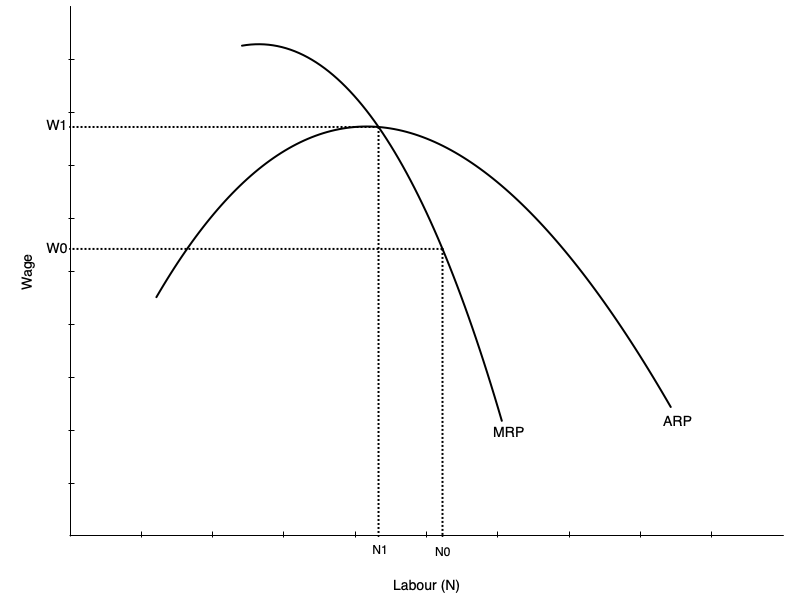
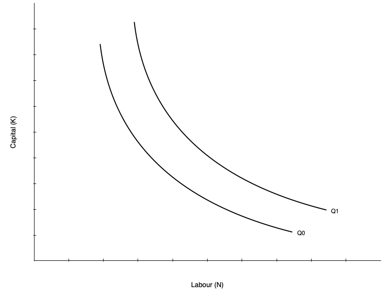
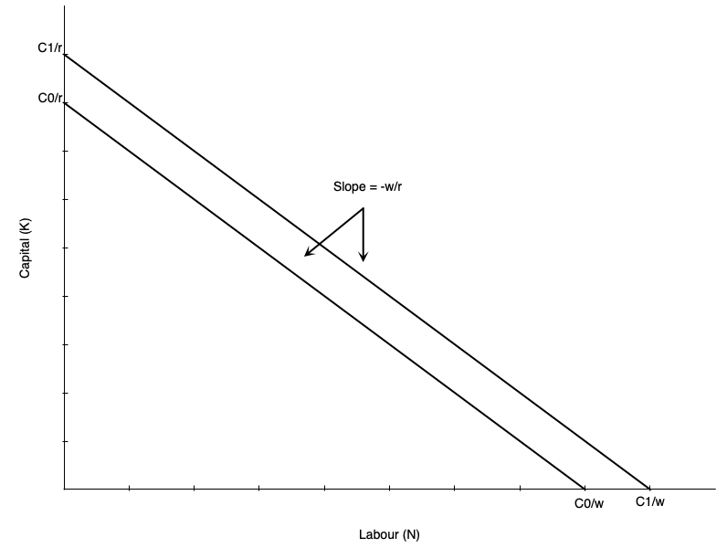
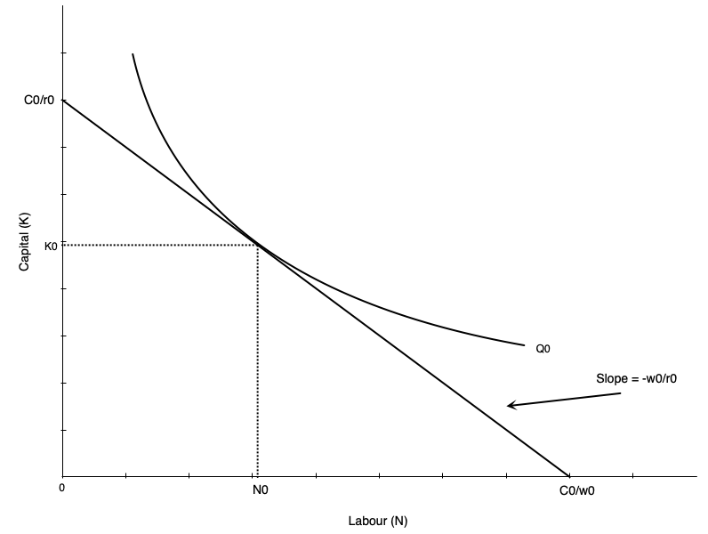
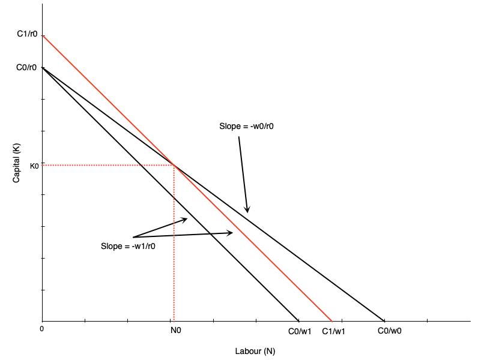
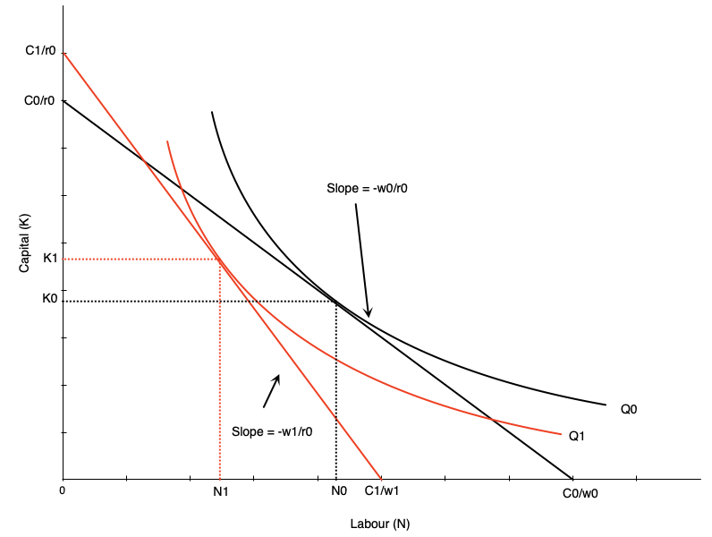
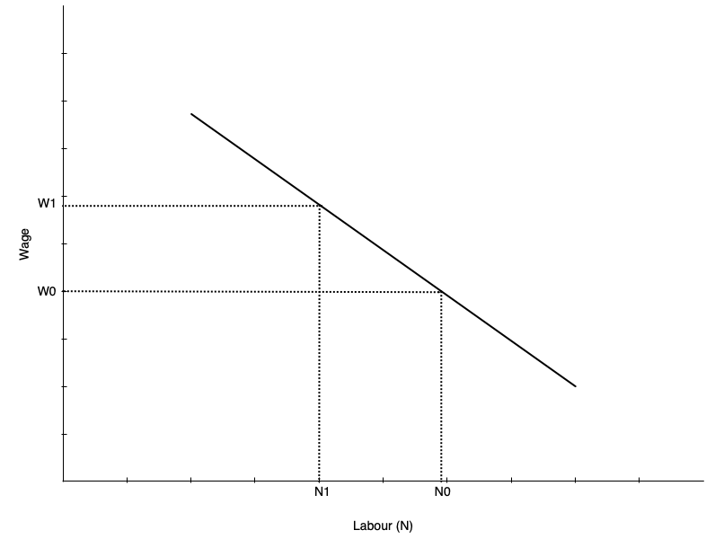
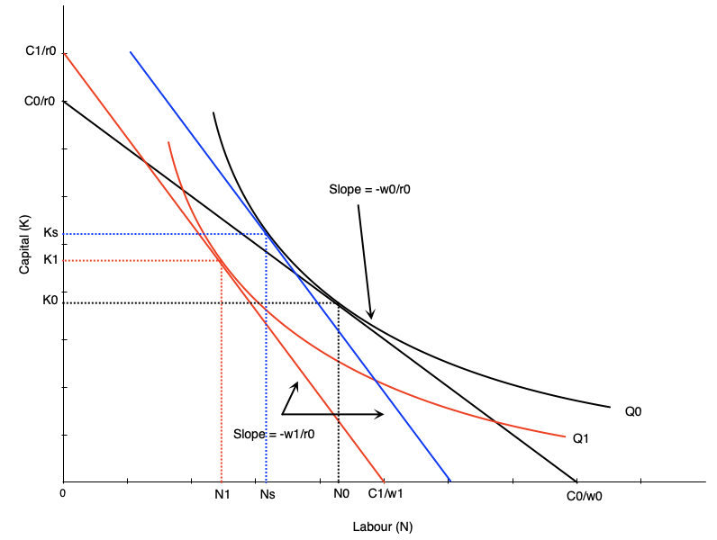
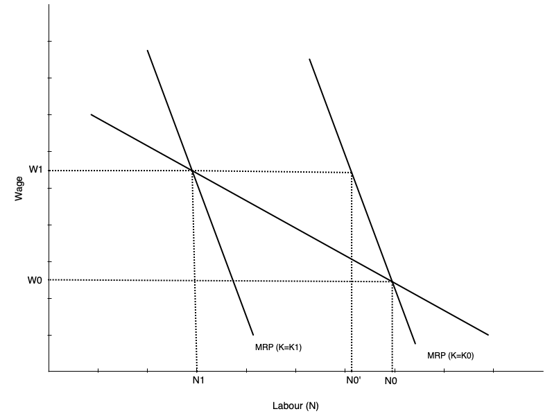
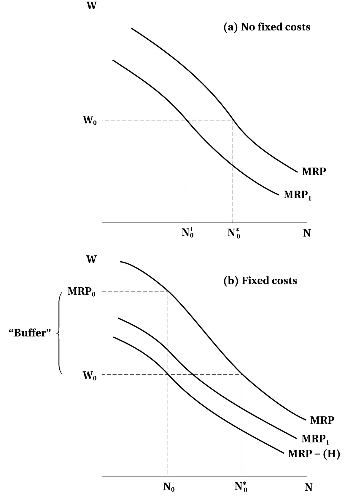

---
format:
  revealjs:
    theme: [default, hygge.scss]
    center-title-slide: false
    slide-number: true
    height: 900
    width: 1600
    chalkboard:
      theme: whiteboard
      src: drawings.json
    post-render: "scripts/decktape.sh"
    incremental: false
editor: visual
---

<h1>Labour Demand</h1>

<hr>

<h2>EC306- Wages and Employment</h2>

<h2>Justin Smith</h2>

<h2>Wilfrid Laurier University</h2>

<h2>Fall 2026</h2>

{.absolute top="275" left="900" width="550"}

# Goals of This Section

## Goals of This Section

In this section we will:

- Explain why the demand for labour is a derived demand
- Show how a firm chooses employment in the short run, when its capital is fixed
- Use isoquants and isocost lines to find the cheapest mix of capital and labour
- Split the long-run response to a wage increase into substitution and scale effects
- Identify what makes labour demand more or less elastic, and what the estimates show
- Explain why adding workers and adding hours are different, and what quasi-fixed costs&nbsp;explain

::: {.notes}
Chapters 3 to 6 were the supply side: whether people work and how much. Now we turn to the other side of the market: how much labour firms want to hire, and how that depends on the wage.

After this chapter we go to Chapter 10, which uses the capital–labour model from this chapter to think about technology. The isoquant and isocost tools are worth getting comfortable with now.
:::

# Introduction

## Labour Is a Derived Demand {.smaller}

- Firms don't want workers for their own sake. They want what workers help produce
- Demand for construction workers comes from demand for new buildings, roads and&nbsp;bridges

::: {.callout-important}
## Key Definition
**[Derived demand]{.fg style="color: #2780e3;"}**: demand for a [factor of production]{.fg style="color: #2780e3;"} (an input such as labour, machinery or energy) that comes from demand for the goods and services it helps&nbsp;produce
:::

- Firms usually aim to maximize profit. Some instead produce a set level of output at the lowest&nbsp;cost
- What limits them:
  - [Product demand:]{.fg style="color: #555;"} what consumers will buy, and at what price
  - [Input prices:]{.fg style="color: #555;"} what labour, capital and other inputs cost
  - [Technology:]{.fg style="color: #555;"} the production function, which says how much output each mix of inputs&nbsp;makes

::: {.notes}
This is why labour demand depends so much on what is happening in product markets. When demand for cars falls, auto plants lay off workers even though nothing about the workers has changed.

The "set level of output at lowest cost" case is mostly the public sector: hospitals, schools, government departments. With output fixed, a wage increase has a substitution effect but no scale effect.
:::

# Labour Demand in the Short Run

## The Firm's Short-Run Problem {.smaller}

::: {.callout-important}
## Key Definition
**[Short run]{.fg style="color: #2780e3;"}**: the period in which the firm has committed to its capital, such as a factory and its machines, so capital is&nbsp;fixed
:::

- One firm makes one output, $Q$, with two inputs, capital $K$ and labour $N$, using a [production function]{.fg style="color: #2780e3;"}:

$$Q = F(K, N)$$

- More of either input always raises output, but by less and less as you add more of it: [diminishing marginal&nbsp;returns]{.fg style="color: #2780e3;"}
- In the short run capital is fixed at $K_0$, so the only choice is $N$
  - For now, $N$ is total hours: workers × average hours. Workers versus hours comes in the last&nbsp;section
- The labour market is competitive: each firm takes the market wage as given, so it is a [wage&nbsp;taker]{.fg style="color: #2780e3;"}
- The rule: keep adding labour as long as the next unit adds more to revenue than to&nbsp;costs

::: {.notes}
The production function is Equation 8.1. The rule is the familiar one from introductory micro, produce until marginal revenue equals marginal cost, applied to the labour input instead of output.

The long run, when the firm can adjust every input, capital included, comes in the next section. How much calendar time each covers differs a lot by industry: a coffee shop can add an espresso machine in a week, while a steel mill or a mine takes years. The short run and long run are about what is fixed, not a set number of months.

Firms that can set the wage, because they face an upward-sloping labour supply curve (monopsony), come in Chapter 12.

In calculus terms, profit is π(N) = pF(K₀, N) − WN − rK₀. Setting dπ/dN = 0 gives p × MPP_N = W, which is where the next slide ends up. You won't need the calculus.
:::

## Marginal Revenue Product of Labour {.smaller}

::: {.callout-important}
## Key Definitions
**[Marginal physical product of labour]{.fg style="color: #2780e3;"}** ($MPP_N$): the extra output from one more unit of labour

**[Marginal revenue product of labour]{.fg style="color: #2780e3;"}** ($MRP_N$): the extra revenue from one more unit of labour
:::

- $MRP_N$ multiplies the extra output by the extra revenue each unit of output brings, $MR_Q$:

$$MRP_N = MR_Q \times MPP_N = p \times MPP_N$$

- A firm that takes its output price as given gets $MR_Q = p$ for every unit
- $MPP_N$ falls as $N$ rises because each worker has less capital to work with
  - Add diggers to a fence job without adding shovels, and each extra digger adds fewer post&nbsp;holes

::: {.callout-tip}
## Profit-Maximizing Rule
Hire labour until $MRP_N = W$. In a competitive labour market, one more unit of labour costs the&nbsp;wage
:::

::: {.notes}
Equation 8.2.

Notation: this edition writes MPP_N for the marginal physical product, where older versions of these slides used MP_N, and it no longer uses the term "value of marginal product" (VMP). For a firm that takes its output price as given, MRP_N and VMP are the same thing.
:::

## The Short-Run Labour Demand Curve {.smaller}

:::: columns
:::: {.column width="50%"}

::::

:::: {.column width="50%"}
- The short-run demand curve is the falling part of the [$MRP_N$ curve]{.fg style="color: #2780e3;"}
  - At $W_0$ the firm hires $N_0$; if the wage rises to $W_1$, it cuts back to&nbsp;$N_1$
- It slopes down because of [diminishing marginal returns]{.fg style="color: #2780e3;"}, not because later hires are worse&nbsp;workers
  - Every worker here is the same; each new one just has less capital to work with
- [Shut-down rule:]{.fg style="color: #555;"} if the wage is above the [average revenue product]{.fg style="color: #2780e3;"}, $ARP_N$, at the best $N$, revenue doesn't cover variable costs and the firm closes, even in the short&nbsp;run
::::
::::

::: {.notes}
The book calls the "worse workers" explanation a common misconception. In real firms later hires may be less productive, but the model doesn't need that to get a downward-sloping curve.

MRP_N can rise at very low N, say when a machine runs best with two operators, so the demand curve is only the falling part. ARP_N is revenue per unit of labour, pQ/N. In the graph, W₁ is where MRP crosses ARP at its peak: at any higher wage, the wage is above revenue per worker and the firm is better off closing. Capital is already paid for in the short run, so it doesn't enter the decision to operate.
:::

## Market Power Lowers Labour Demand {.smaller}

:::: columns
:::: {.column width="56%"}
```{r echo=FALSE}
#| message: false
#| warning: false
#| fig-width: 8.4
#| fig-height: 6.6

library(tidyverse)

# Illustrative only. Output Q = 20 N^0.7, so MPP_N = 14 N^-0.3.
# A competitive firm sells every unit at p = 10. A monopolist faces demand
# p = 10 - 0.01 Q, so MR_Q = 10 - 0.02 Q.
mpp   <- function(n) 14 * n^-0.3
q     <- function(n) 20 * n^0.7
mrp_c <- function(n) 10 * mpp(n)
mrp_m <- function(n) (10 - 0.02 * q(n)) * mpp(n)
w0    <- 60
n_c   <- uniroot(function(n) mrp_c(n) - w0, c(1, 100))$root
n_m   <- uniroot(function(n) mrp_m(n) - w0, c(1, 100))$root

curves <- tibble(n = seq(2, 40, length.out = 300)) %>%
  mutate(Competitive = mrp_c(n), Monopoly = mrp_m(n)) %>%
  pivot_longer(-n, names_to = "market", values_to = "mrp")
curve_labs <- tibble(market = c("Competitive", "Monopoly"), n = c(30, 30),
                     mrp = c(mrp_c(30), mrp_m(30)),
                     lab = c("Competitive: p × MPP", "Monopoly: MR × MPP"))
stars <- tibble(n = c(n_m, n_c), market = c("Monopoly", "Competitive"))

ggplot(curves, aes(n, mrp, colour = market)) +
  geom_hline(yintercept = w0, linetype = "dashed", colour = "grey40") +
  geom_segment(data = stars, aes(x = n, xend = n, y = 0, yend = w0),
               linetype = "dotted", linewidth = 0.9) +
  geom_line(linewidth = 1.4) +
  geom_point(data = stars, aes(n, w0), size = 3.5) +
  geom_text(data = curve_labs, aes(label = lab), vjust = -0.8, hjust = 0.3, size = 5.5) +
  scale_colour_manual(values = c(Competitive = "#2780e3", Monopoly = "#f0ad4e")) +
  scale_x_continuous(breaks = c(n_m, n_c), labels = c("N*\nmonopoly", "N*\ncompetitive"),
                     limits = c(0, 40), expand = expansion(mult = c(0, 0.02))) +
  scale_y_continuous(breaks = w0, labels = expression(W[0]), limits = c(0, 120),
                     expand = expansion(mult = c(0, 0.02))) +
  labs(x = "Labour (N)", y = "Wage, MRP", subtitle = "Illustrative production and demand functions") +
  theme_minimal(base_size = 16) +
  theme(legend.position = "none", panel.grid = element_blank(),
        axis.line = element_line(colour = "grey30"))
```
::::

:::: {.column width="44%"}
- A firm with [market power]{.fg style="color: #2780e3;"}, like a [monopolist]{.fg style="color: #2780e3;"}, must cut its price on every unit to sell one more, so $MR_Q < p$, and $MR_Q$ falls as output&nbsp;rises
- So $MRP_N = MR_Q \times MPP_N$ falls for two reasons, and is lower [at every $N$]{style="white-space: nowrap;"}
- At the same wage the firm hires [less labour]{.fg style="color: #2780e3;"}, produces less, charges a higher price, and earns economic&nbsp;profit

::: {.callout-warning}
Less competition in product markets means lower labour demand
:::
::::
::::

::: {.notes}
The curves are made up for illustration. Output is Q = 20N^0.7. The competitive firm sells every unit at \$10; the monopolist faces demand p = 10 − 0.01Q. At a wage of 60, the competitive firm hires about 17 units of labour and the monopolist about 9.

If product markets become less competitive over time, labour demand falls, which lowers wages and employment in the labour markets those firms hire in.

Why MR is below the price: a firm that has to cut its price from \$200 to \$190 to sell an 11th unit gains \$190 on that unit but loses \$10 on each of the first 10, so MR_Q = \$190 − \$100 = \$90. Market power comes from things like a patent, or a product buyers see as different. This assumes the firm can't price discriminate.
:::

## iClicker Question {background-color="#f0f4f8"}

A bakery sells bread in a competitive market. Demand for bread falls, and the price drops from \$5 to \$4 a loaf. The wage and the bakery's equipment don't change. The bakery's short-run labour demand curve:

A\) Doesn't change, because the wage didn't change\
B) Shifts left, because each worker's marginal revenue product falls\
C) Shifts left, because each worker now produces fewer loaves\
D) Stays put, and the bakery moves down along it to fewer workers\
E) Shifts right, because the bakery must sell more loaves to cover its costs

::: {.notes}
Answer: B. Labour demand is a derived demand: MRP_N = p × MPP_N, and p fell by 20%, so what each worker adds to revenue falls by 20% at every N. The curve shifts left, and at the same wage the bakery hires fewer bakers.

C is the tempting one. The bakers make just as many loaves as before, so their marginal physical product hasn't changed; what changed is what each loaf is worth. D confuses a shift with a movement along the curve: moving along it takes a change in the wage. A: the curve says how many workers the firm wants at each wage, and that changed even though the wage didn't. E has it backwards: a lower price makes each extra loaf less worth producing, not more.
:::

# Labour Demand in the Long Run

## Two Steps to Long-Run Demand

::: {.callout-important}
## Key Definition
**[Long run]{.fg style="color: #2780e3;"}**: the period over which the firm can adjust all of its inputs, including&nbsp;capital
:::

- The best amount of labour depends on how much capital the firm has, and the best amount of capital depends on how much labour it has
- So the firm has to choose $K$ and $N$ together. We split that into two steps:

1. [Cost minimization:]{.fg style="color: #2780e3;"} find the cheapest mix of $K$ and $N$ that produces a given output, $Q_0$
2. [Profit maximization:]{.fg style="color: #2780e3;"} choose the output level that maximizes&nbsp;profit

- Together, the two steps show how long-run labour demand responds to the wage
- Same setup as before: two inputs, one output, a competitive labour market, identical&nbsp;workers

::: {.notes}
Firms don't literally decide in two steps. Splitting it up is just a way to solve a hard problem in pieces. Step 1 also matters on its own, because some organizations, like hospitals and school boards, really do take their output as given and only minimize cost.
:::

## Isoquants {.smaller}

:::: columns
:::: {.column width="42%"}

::::

:::: {.column width="58%"}
::: {.callout-important}
## Key Definition
**[Isoquant]{.fg style="color: #2780e3;"}**: all the combinations of capital and labour that produce the same&nbsp;output
:::

- Isoquants further from the origin mean more output: $Q_1 > Q_0$
- Like indifference curves in [Chapter&nbsp;3]{.fg style="color: #555;"}, they show a third dimension, output, on a flat graph
- The shape shows how easily capital and labour substitute for each other:
  - [Linear:]{.fg style="color: #555;"} perfect substitutes, e.g. a robot that always does exactly one worker's job
  - [L-shaped:]{.fg style="color: #555;"} perfect complements, e.g. digging a hole takes one worker and one shovel
  - [In between:]{.fg style="color: #555;"} most technologies, e.g. two diggers taking turns with one&nbsp;shovel
::::
::::

::: {.notes}
The L-shaped case is sometimes called Leontief technology. A second shovel does nothing without a second worker, and a second worker does nothing without a second shovel. In the in-between case, the second digger still adds something by taking turns, so less time is spent leaning on the shovel.

The everyday version: accountants with spreadsheets need fewer hours than accountants with calculators to do the same work. More capital, less labour, same output.
:::

## The Marginal Rate of Technical Substitution {.smaller}

::: {.callout-important}
## Key Definition
**[Marginal rate of technical substitution (MRTS)]{.fg style="color: #2780e3;"}**: the slope of the isoquant; how much capital the firm can give up for one more unit of labour while keeping output the&nbsp;same
:::

$$MRTS = \frac{MPP_N}{MPP_K}$$

- If one more unit of labour adds as much output as 3 units of capital, the firm can give up 3 units of capital for it
- The MRTS [diminishes]{.fg style="color: #2780e3;"} as you move down an isoquant
  - Swapping labour in for capital lowers $MPP_N$ and raises $MPP_K$, so the ratio falls
- The harder the inputs are to substitute, the faster the MRTS falls and the more curved the isoquant
  - [Linear isoquant:]{.fg style="color: #555;"} the MRTS never changes
  - [L-shaped isoquant:]{.fg style="color: #555;"} the MRTS jumps at the corner

::: {.notes}
Equation 8.3. "Technical" separates it from the marginal rate of substitution along a consumer's indifference curve in Chapter 3. Diminishing MRTS comes straight from diminishing marginal returns to each input.

Up in the top-left of an isoquant, where capital is plentiful and labour scarce, it takes a lot of capital to replace a little labour. Down in the bottom-right, a little capital replaces a lot of labour.
:::

## Isocost Lines {.smaller}

:::: columns
:::: {.column width="42%"}

::::

:::: {.column width="58%"}
::: {.callout-important}
## Key Definition
**[Isocost line]{.fg style="color: #2780e3;"}**: all the combinations of capital and labour that cost the firm the same&nbsp;amount
:::

$$C = rK + WN \quad\Rightarrow\quad K = \frac{C}{r} - \frac{W}{r}N$$

- $W$ is the wage. $r$ is the price of capital, best thought of as its [opportunity cost]{.fg style="color: #2780e3;"}: what the owners could earn on their next-best&nbsp;investment
- Slope $= -W/r$, the price of labour relative to capital
  - $r = 100$ and $W = 20$: one more unit of capital costs the same as 5 units of labour, so the [slope is $-0.2$]{style="white-space: nowrap;"}
  - If $W$ rises to 50, the slope is $-0.5$: a higher wage makes the line [steeper]{.fg style="color: #2780e3;"}
- Lines further out cost more: $C_1 > C_0$
::::
::::

::: {.notes}
Equation 8.4. Isocost lines are always straight, because the firm pays the same price for every unit of each input. If capital and financial markets are competitive, the firm has no more say over r than it does over W.

The graphs in this section label the wage with a small w. It's the same W.
:::

## The Cost-Minimizing Mix of Capital and Labour {.smaller}

:::: columns
:::: {.column width="50%"}

::::

:::: {.column width="50%"}
- To make $Q_0$ as cheaply as possible, find the point on the $Q_0$ isoquant that sits on the [lowest isocost line]{.fg style="color: #2780e3;"}
- That's where the isocost line just touches the isoquant, at $(K_0, N_0)$
- Any other point on $Q_0$ is on a higher isocost line, so it costs&nbsp;more

::: {.callout-tip}
## Cost-Minimizing Condition
$$MRTS = \frac{MPP_N}{MPP_K} = \frac{W}{r}$$

The rate at which the firm can swap capital for labour in production equals the rate at which the market swaps&nbsp;them
:::
::::
::::

::: {.notes}
Equation 8.5. Same logic as the consumer's tangency in Chapter 3, with the isoquant in place of the indifference curve and the isocost line in place of the budget line.

One difference to keep in mind: a consumer's budget is fixed, but a firm's spending isn't. It depends on how much the firm decides to produce.
:::

## Why the Tangency Is the Cheapest Point {.smaller}

- Rearrange the condition: $\dfrac{MPP_N}{W} = \dfrac{MPP_K}{r}$
  - The last dollar spent on each input must add the same output
- Example: $W = 20$, $r = 100$, $MPP_N = 5$, $MPP_K = 10$
  - A dollar on labour adds $5/20 = 0.25$ units of output; a dollar on capital adds $10/100 = 0.10$
  - Move \$100 from capital to labour: lose 10 units of output, gain $5 \times 5 = 25$
  - Same cost, more output, so this mix wasn't the cheapest way to make $Q_0$
  - Keep shifting: $MPP_N$ falls and $MPP_K$ rises until the two ratios are&nbsp;equal
- This condition gives labour demand [for a given output]{.fg style="color: #2780e3;"}
  - In the short run the rule was $MRP_N = W$; here it's $MPP_N / MPP_K = W/r$
  - Both tie what labour is paid to how productive it is
  - That's why economists look first at productivity to explain why some workers earn more than&nbsp;others

::: {.notes}
This replaces the Cobb-Douglas cost-minimization derivation from older versions of these slides. You won't need the Lagrangian. You do need to be able to explain why the firm moves toward the tangency.

Moving \$100 from capital buys one fewer unit of capital, which loses MPP_K = 10 units of output, and 5 more units of labour, each adding MPP_N = 5. The book calls this the firm's conditional labour demand: conditional on producing Q₀. The next step drops that condition.
:::

## iClicker Question {background-color="#f0f4f8"}

At a firm's current mix of inputs, $MPP_N = 8$ and $MPP_K = 20$. The wage is $W = 25$ and the price of capital is $r = 50$. To make the same output for less, the firm should:

A\) Use more labour and less capital, because labour is the cheaper input\
B) Use more capital and less labour, because capital's marginal product is higher\
C) Use more capital and less labour, because the last dollar spent on capital adds more output\
D) Keep its current mix, because it is already producing that output\
E) Use more labour and less capital, because the MRTS (0.4) is below $W/r$ (0.5)

::: {.notes}
Answer: C. A dollar on labour adds 8/25 = 0.32 units of output; a dollar on capital adds 20/50 = 0.40. Moving spending from labour to capital makes the same output for less, and the firm keeps moving until the two ratios are equal.

A compares only prices: labour is cheaper per unit, but it's also less productive. B compares only marginal products and gets the direction right by luck. If r were 100, capital would add 20/100 = 0.20 per dollar, and the firm should use more labour despite capital's higher MPP. E has the right comparison but reads it backwards: MRTS = MPP_N/MPP_K = 0.4 is below W/r = 0.5, so labour's productivity relative to capital is lower than its price relative to capital, and the firm should use less labour. D: producing Q₀ isn't enough; it has to be the cheapest way to produce it.
:::

## A Wage Increase Makes the Old Mix Too Expensive {.smaller}

:::: columns
:::: {.column width="50%"}

::::

:::: {.column width="50%"}
- The wage rises from $W_0$ to $W_1$; the price of capital stays at&nbsp;$r_0$
- Isocost lines get [steeper]{.fg style="color: #2780e3;"}: the slope is now $-W_1/r_0$
- Buying the old mix $(K_0, N_0)$ now costs $C_1$, [more than $C_0$]{style="white-space: nowrap;"}
- The new isocost line isn't tangent to the isoquant at that point, so it's no longer the cheapest way to [make $Q_0$]{style="white-space: nowrap;"}
- And $Q_0$ itself may no longer be the profit-maximizing&nbsp;output
- Two questions: how much does the firm now produce, and with what&nbsp;mix?
::::
::::

::: {.notes}
This is panel (a) of the book's Figure 8.3.

Will total cost end up higher or lower? It could go either way. Producing less saves money, while the higher wage costs more. That's another difference from the consumer, whose budget is fixed: a firm's spending is chosen along with its output.
:::

## Deriving the Long-Run Labour Demand Curve {.smaller}

:::: columns
:::: {.column width="50%"}
{height="360"}
::::

:::: {.column width="50%"}
{height="360"}
::::
::::

- A higher wage raises marginal cost, so the firm produces less. Prices rise a little as the whole industry cuts back, but output still&nbsp;falls
- At $W_1$ the firm moves to a lower isoquant, $Q_1$, and picks the tangency with the steeper isocost line. It uses [less labour]{.fg style="color: #2780e3;"}: $N_1 < N_0$
- $(W_0, N_0)$ and $(W_1, N_1)$ are two points on the [long-run labour demand curve]{.fg style="color: #2780e3;"}; other wages trace out the&nbsp;rest
- The curve holds the price of capital, technology and product demand constant. A change in any of those shifts the whole&nbsp;curve

::: {.notes}
The output step is the book's Figure 8.4, worth sketching on the chalkboard. At the old price P₀ the firm would cut output from Q₀ to Q₂, where MC₁ = P₀. But every firm faces the higher wage, so industry supply shifts left and the price rises to P₁, and each firm ends at Q₁, between Q₂ and Q₀. With less competitive product markets the size of the effect changes, not its direction. Correction to the book: in Figure 8.4 the panel labelled "(a) Firm" holds both the firm and the industry graphs, and the panel labelled "(b) Industry" actually shows a firm with market power.

Correction to the book: the text describing Figure 8.3(b) calls the new isoquant Q₂ in one sentence and Q₁ in the next. The figure labels it Q₁, as these slides do.

What happens to capital? In this graph it rises, from K₀ to K₁. That isn't guaranteed, as the next slide shows.
:::

## Substitution and Scale Effects {.smaller}

:::: columns
:::: {.column width="50%"}

::::

:::: {.column width="50%"}
::: {.callout-important}
## Key Definitions
**[Substitution effect]{.fg style="color: #2780e3;"}**: the change in labour from the change in relative input prices, with output held at $Q_0$: $N_0 \rightarrow N_S$

**[Scale effect]{.fg style="color: #2780e3;"}**: the change in labour from the change in [output: $N_S \rightarrow N_1$]{style="white-space: nowrap;"}
:::

- [Labour:]{.fg style="color: #555;"} the substitution effect always cuts it, and the scale effect normally does too, so long-run labour demand slopes&nbsp;down
- [Capital:]{.fg style="color: #555;"} the substitution effect raises it and the scale effect lowers it, so the net effect is ambiguous. In this graph [it rises: $K_1 > K_0$]{style="white-space: nowrap;"}
::::
::::

::: {.notes}
These two effects are why long-run labour demand slopes down. When labour gets more expensive, firms switch toward the input that is now relatively cheaper, and they produce less because their costs went up.

Reading the graph: the substitution effect is the move along Q₀ to the point where the slope equals the new −W₁/r₀ (the blue line). The scale effect is the move from there to the new best point on Q₁ (the red line).

"Normally": the scale effect cuts labour when labour is a normal input, one the firm uses less of when output falls. Even if labour were an inferior input, the substitution effect would win (Nagatani 1978), so labour demand always slopes down. With more than two inputs, a wage increase can also cut the use of another input, which is then a price complement to labour rather than a price substitute. That idea comes back in Chapter 10.
:::

## iClicker Question {background-color="#f0f4f8"}

After a minimum wage increase, a burger chain (a) installs ordering kiosks and (b) closes some locations, because its higher prices cut its sales. These are:

A\) (a) the substitution effect, (b) the scale effect\
B) (a) the scale effect, (b) the substitution effect\
C) Both substitution effects\
D) Both scale effects\
E) (a) the substitution effect, (b) the income effect

::: {.notes}
Answer: A. Kiosks replace workers with capital because labour got more expensive relative to capital. That's the substitution effect, which holds output fixed. Closing locations because higher costs pushed prices up and sales down is the scale effect.

E carries the income effect over from labour supply. Firms don't have one; the closest thing is the scale effect, which works through output rather than income. B swaps the two definitions.
:::

# The Relationship Between Short-Run and Long-Run Labour&nbsp;Demand

## Short-Run and Long-Run Responses {.smaller}

:::: columns
:::: {.column width="50%"}

::::

:::: {.column width="50%"}
- [Short run:]{.fg style="color: #555;"} capital is fixed at $K_0$, so there's a scale effect but no substitution effect. The firm moves along $MRP(K = K_0)$ from $N_0$ to&nbsp;$N_0'$
- [Long run:]{.fg style="color: #555;"} the firm also adjusts capital. In this graph it ends up with less, $K_1$, so each worker is less productive and the short-run curve shifts left to $MRP(K = K_1)$. Employment falls [to $N_1$]{style="white-space: nowrap;"}
- So the long-run response is usually larger, and long-run demand [more elastic]{.fg style="color: #2780e3;"}
- [But not always:]{.fg style="color: #555;"} if the firm instead ends up with more capital, that raises $MPP_N$ and softens the scale effect
  - In theory the long-run response could then be smaller. It's unusual, but the book doesn't rule it&nbsp;out
::::
::::

::: {.notes}
The graph shows the usual case. In the substitution-and-scale graph earlier, capital rose instead. Either can happen, and which way the short-run curve shifts depends on it.

A caution if you go further in economics: for a single firm that takes both its output price and its input prices as given, a standard result (the Le Chatelier principle) says the long-run response can't be smaller than the short-run one. So the book's exception needs something extra, such as the output price changing too. Don't lose sleep over it: the evidence later in this chapter finds long-run elasticities larger than short-run ones.

Organizations that minimize the cost of a fixed output, such as governments, Crown corporations, schools and hospitals, have a substitution effect but no scale effect. Their labour demand slopes down but is less elastic than a profit-maximizing firm's. Their spending still rises with the wage, but by less than if they kept the old mix. Example: a hospital facing a raise for its cleaning staff can't cut its patient load, but it can contract out the cleaning or buy floor-cleaning machines.
:::

<!-- Lecture 2: Mon Nov 16 -->

# Elasticity of Demand for Labour

## Why the Elasticity Matters {.smaller}

:::: columns
:::: {.column width="56%"}
```{r echo=FALSE}
#| fig-width: 8.4
#| fig-height: 6.6

# Illustrative: two demand curves through (N0 = 100, W0 = 20). The wage rises 20% to 24.
# Less elastic: slope -0.5, so N falls to 92 (-8%). More elastic: slope -4/30, so N falls to 70 (-30%).
dem <- bind_rows(
  tibble(curve = "Less elastic", n = c(88, 108)) %>% mutate(w = 20 - 0.5 * (n - 100)),
  tibble(curve = "More elastic", n = c(55, 130)) %>% mutate(w = 20 - (4 / 30) * (n - 100)))
dem_labs <- tibble(curve = c("Less elastic", "More elastic"), n = c(88, 55), w = c(26, 26))
drops <- tibble(curve = c("Less elastic", "More elastic", "Both"), n = c(92, 70, 100),
                w = c(24, 24, 20))

ggplot(dem, aes(n, w, colour = curve)) +
  geom_segment(data = drops, aes(x = 0, xend = n, y = w, yend = w),
               linetype = "dashed", colour = "grey55") +
  geom_segment(data = drops, aes(x = n, xend = n, y = 0, yend = w),
               linetype = "dashed", colour = "grey55") +
  geom_line(linewidth = 1.5) +
  geom_text(data = dem_labs, aes(label = curve), vjust = -0.6, size = 5.5) +
  scale_colour_manual(values = c("Less elastic" = "#f0ad4e", "More elastic" = "#2780e3")) +
  scale_x_continuous(breaks = c(70, 92, 100), limits = c(0, 140),
                     expand = expansion(mult = c(0, 0.02))) +
  scale_y_continuous(breaks = c(20, 24), labels = c("$20", "$24"), limits = c(0, 29),
                     expand = expansion(mult = c(0, 0.02))) +
  labs(x = "Labour (N)", y = "Wage (W)") +
  theme_minimal(base_size = 16) +
  theme(legend.position = "none", panel.grid = element_blank(),
        axis.line = element_line(colour = "grey30"))
```
::::

:::: {.column width="44%"}
- Minimum wages and pay equity laws push wages up. Theory says that costs jobs
- How many depends on the [elasticity of demand for labour]{.fg style="color: #2780e3;"}

::: {.callout-important}
## Key Definition
**[Elasticity of demand for labour]{.fg style="color: #2780e3;"}**: the percentage change in labour demanded when the wage [rises 1%: $\%\Delta N / \%\Delta W$]{style="white-space: nowrap;"}
:::

- In the graph the wage rises 20%:
  - [Less elastic:]{.fg style="color: #555;"} employment falls 8%, an elasticity of −0.4
  - [More elastic:]{.fg style="color: #555;"} employment falls 30%, an elasticity of −1.5
::::
::::

::: {.notes}
Pay equity laws require firms to pay equally productive women and men the same. There may be offsetting benefits of these policies that the simple model misses. Whether the job losses are worth it is a policy judgment, but you can't make it without knowing the elasticity.

From a common starting point, the steeper curve is the less elastic one. The numbers are my own example.
:::

## The Hicks-Marshall Rules {.smaller}

- What makes labour demand more or less elastic? Marshall set out four rules, which Hicks (1963) formalized
- Each one works through the substitution effect or the scale effect

| Rule | Labour demand is less elastic when... | Works mainly&nbsp;through |
|:-----|:-----|:-----|
| Availability of substitute inputs | Other inputs are hard to substitute for labour | Substitution effect |
| Elasticity of supply of substitute&nbsp;inputs | The supply of those substitutes is inelastic | Substitution effect |
| Elasticity of demand for output | Demand for the product is inelastic | Scale effect |
| Share of labour costs in total costs | Labour is a small share of total cost | Scale effect |

: {tbl-colwidths="[34,44,22]"}

- Flip each condition to get the cases where labour demand is more elastic

::: {.notes}
These are often called the Hicks-Marshall rules of derived demand. The next slide gives an example of each. When a union or a minimum wage law raises pay, these rules tell you where job losses will be small and where they'll be large.
:::

## The Rules in Practice {.smaller}

- [Substitutes:]{.fg style="color: #555;"} labour is hard to replace when it's essential to production, when a union contract limits outsourcing or new technology, or in the short run. Robots and AI make it easier to replace, which makes demand more elastic ([Chapter&nbsp;10]{.fg style="color: #555;"})
- [Supply of substitutes:]{.fg style="color: #555;"} a patented robot made by one supplier that can't scale up gets more expensive as firms switch to it, which limits&nbsp;substitution
- [Demand for output:]{.fg style="color: #555;"} where buyers have few alternatives, like construction on scarce zoned land, tariff-protected industries or public services, firms pass higher costs on and lose few sales. Clothing and computers are the&nbsp;opposite
- [Labour's share of cost:]{.fg style="color: #555;"} a raise for airline pilots or a bank's cleaners barely moves total cost, so their demand is inelastic. For government workers and university faculty, pay is most of the cost, so demand is more&nbsp;elastic

::: {.notes}
The share rule is sometimes called "the importance of being unimportant": being a small part of costs gives workers bargaining power, because the threat of job loss does little to hold back their wage demands. Hicks (1963) showed it holds only when consumers can switch away from the product more easily than the firm can switch away from labour, that is, when the elasticity of demand for output exceeds the elasticity of substitution between inputs.

Evidence on substitutes (the book's Exhibit 8.1): Jäger and Heining (2022) use the unexpected death of an employee as a natural experiment. Firms usually hire a replacement into the same job rather than spread the work across coworkers, and they raise the pay of the remaining coworkers, most in similar jobs. Workers are imperfect substitutes, so labour demand is relatively inelastic. The chapter text dates the study 2019; the book's reference list gives the 2022 NBER working paper.

The construction example: if commercially zoned lots are scarce, builders face little competition, so higher construction wages show up as higher prices rather than fewer projects.
:::

## iClicker Question {background-color="#f0f4f8"}

Which group of workers likely faces the *least* elastic labour demand?

A\) Sewing-machine operators at a clothing maker that competes with imports\
B) Cashiers at a grocery chain that can install self-checkouts\
C) Call-centre agents, whose wages are 70% of the firm's costs\
D) Maintenance electricians at an oil refinery\
E) Warehouse pickers whose firm can lease picking robots from many competing suppliers

::: {.notes}
Answer: D. Every Hicks-Marshall rule points toward inelastic demand for refinery electricians. They're essential and hard to replace. Labour is a tiny share of a refinery's costs next to crude oil. And demand for gasoline is inelastic, at least in the short run.

Each other option breaks one rule. A: demand for the product is elastic, because imports are close substitutes. B: a substitute for labour is available. C: labour is a large share of costs, so a raise moves total costs, prices and output a lot. E: the substitute is in elastic supply, so firms can switch to it without bidding up its price.
:::

## Estimates of the Elasticity of Labour Demand

Most estimates lie between 0 and −1: labour demand is inelastic, but it clearly slopes&nbsp;down

```{r echo=FALSE}
#| fig-width: 13
#| fig-height: 5.6

# Estimates reported in Benjamin et al. (2026), Chapter 8. Points are point estimates
# (Hamermesh's is his "best guess"; Lichter et al.'s is the median of 151 studies);
# bars are reported ranges. Beaudry et al.'s city-industry estimate is "close to -1".
est <- read_csv("elasticity-estimates.csv", show_col_types = FALSE) %>%
  mutate(label = paste0(study, "\n", setting),
         label = fct_rev(fct_inorder(label)),
         group = factor(group, levels = c("Other countries", "Canada")))

ggplot(est, aes(y = label, colour = group)) +
  geom_vline(xintercept = -1, linetype = "dashed", colour = "grey55") +
  geom_linerange(aes(xmin = low, xmax = high), linewidth = 4, alpha = 0.45, na.rm = TRUE) +
  geom_point(aes(x = point), size = 4.5, na.rm = TRUE) +
  facet_grid(group ~ ., scales = "free_y", space = "free_y") +
  scale_colour_manual(values = c("Other countries" = "#2780e3", "Canada" = "#f0ad4e")) +
  scale_x_continuous(limits = c(-1.1, 0), breaks = seq(-1, 0, 0.25)) +
  labs(x = "Elasticity of labour demand (dashed line: unit elastic)", y = NULL,
       subtitle = "Points are estimates; bars are reported ranges",
       caption = "Source: Benjamin et al. (2026), Chapter 8") +
  theme_minimal(base_size = 16) +
  theme(legend.position = "none", panel.grid.minor = element_blank(),
        panel.grid.major.y = element_blank(), strip.text.y = element_text(angle = 0, size = 15))
```

::: {.notes}
Hamermesh's range comes from his review of mostly US private-sector studies, and −0.30 is his best guess. Lichter et al.'s point is the median of 151 studies, 87% of which fall between 0 and −1. Beaudry et al.'s city-industry estimate is plotted at −1; the book describes it as close to −1. Gordon reports a range, not a single estimate.

What the studies say. Hamermesh (1993): a best guess of −0.30, about half from the substitution effect and half from the scale effect. Lichter et al. (2015), a meta-analysis of 151 studies: a median of −0.55, with elasticities growing over time (consistent with labour-saving technology), smaller for more skilled labour, and larger in the long run than the short run. Beaudry, Green and Sand (2018): −0.3 across cities but close to −1 for one industry within a city, because the other industries keep hiring at the old wage; they put it down to how hard it is to find workers in a tight market. Canada: Gordon (1996), −0.1 to −0.3 for all of manufacturing, 1961–1986; Card (1990), −0.62 in unionized manufacturing contracts; Currie (1991), about −0.55 for Ontario school teachers.
:::

# Adjusting Workers versus Hours&nbsp;Worked

## Workers and Hours Are Not the Same {.smaller}

- So far, more hours from existing workers and more workers were the same thing. Two reasons they aren't:
- [In production:]{.fg style="color: #555;"} they're [imperfect substitutes]{.fg style="color: #2780e3;"}
  - To add 40 hours a week, a firm could give 5 workers an extra 8-hour Saturday shift, or hire one new full-time&nbsp;worker
  - Tired workers favour the new hire; [learning by doing]{.fg style="color: #2780e3;"} favours the experienced ones
- [In costs:]{.fg style="color: #555;"}
  - [Variable costs]{.fg style="color: #2780e3;"} rise with total hours, however they're added: wages, and benefits set as a share of pay, like pension contributions or vacation&nbsp;pay
  - Other costs come per worker

::: {.callout-important}
## Key Definition
**[Quasi-fixed costs]{.fg style="color: #2780e3;"}**: labour costs paid per employee that don't depend, or barely depend, on hours worked. They're *pure* if completely independent of hours, and *mixed* if they rise with both workers and hours, but not&nbsp;equally
:::

::: {.notes}
Either way, quasi-fixed costs make changing the number of workers relatively costly compared with changing hours.
:::

## Examples of Quasi-Fixed Costs {.smaller}

- [Hiring:]{.fg style="color: #555;"} recruiting, interviewing and training a new worker, whatever hours they go on to&nbsp;work
- [Expected termination:]{.fg style="color: #555;"} a new hire may turn out to be a poor match, and letting them go has costs too
- [Payroll taxes with a ceiling:]{.fg style="color: #555;"} employer contributions to the CPP and EI stop once a worker's earnings pass a ceiling, so extra hours from that worker add no&nbsp;tax
- [Employment standards legislation:]{.fg style="color: #555;"} after a minimum length of service, workers qualify for paid holidays and notice of termination
- [Benefits per employee:]{.fg style="color: #555;"} life, medical and dental plans often cost a set amount per&nbsp;person

::: {.callout-note}
## Not Quasi-Fixed
Costs that scale with pay, like pension contributions set as a share of earnings, or vacation pay. They cost the same whether the extra labour comes from more workers or more&nbsp;hours
:::

- [Recurring]{.fg style="color: #2780e3;"} quasi-fixed costs come every period (payroll taxes); [nonrecurring]{.fg style="color: #2780e3;"} ones come once (hiring, orientation,&nbsp;dismissal)

::: {.notes}
Correction to the book: it describes EI contributions as having a weekly earnings ceiling. EI premiums are charged on insurable earnings up to an annual maximum: \$68,900 in 2026, at a rate of 1.63% for employees and 1.4 times the employee premium for employers, outside Quebec (Canada Revenue Agency, "EI premium rates and maximums", canada.ca). The weekly maximum in EI is on benefits, not premiums. The point about the ceiling still holds: once a worker's earnings for the year pass it, extra hours add no EI premium.
:::

## Hiring as an Investment {.smaller}

- Quasi-fixed costs raise the cost of adding a worker compared with having existing workers put in more&nbsp;hours

::: {.callout-important}
## Key Definitions
**[Extensive margin]{.fg style="color: #2780e3;"}** of adjustment: changing the number of workers

**[Intensive margin]{.fg style="color: #2780e3;"}** of adjustment: changing hours per worker
:::

- Firms want to spread fixed costs over as many hours and years as possible, especially for skilled workers, whose training costs the&nbsp;most
- A firm hires until the present value of what a new worker adds equals the present value of what they&nbsp;cost:

$$H + \sum_{t=0}^{T} \frac{W_t}{(1+r)^t} = \sum_{t=0}^{T} \frac{MRP_t}{(1+r)^t}$$

- $H$ is the hiring cost, including training, paid when the worker starts ($t = 0$); $r$ is the discount rate; $T$ is how long the worker is expected to&nbsp;stay

::: {.notes}
Equation 8.6. Like any investment: hire if the present value of the returns at least covers the present value of the costs. The new worker doesn't have to pay for themselves every period, only over the whole time they're expected to stay. Present value works just as it did in Chapter 6.

Careful: r here is the firm's discount rate, not the price of capital from the isocost line. Older versions of these slides split hiring and training into H and T; this edition folds both into H.
:::

## What the Hiring Condition Implies {.smaller}

- Hiring depends on [expectations]{.fg style="color: #2780e3;"}: how long the worker will stay, future wages, and future demand for the&nbsp;product
- To pay back $H$, a worker's $MRP$ has to be above the wage in most future periods:

$$\sum_{t=0}^{T} \frac{MRP_t}{(1+r)^t} > \sum_{t=0}^{T} \frac{W_t}{(1+r)^t}$$

- Example, with no discounting: hiring cost \$12,000; wage \$50,000 a year; $MRP$ \$56,000 a year

| Expected tenure | Hiring cost | Total wages | Total MRP | Profit from the hire |
|:--|--:|--:|--:|--:|
| 1 year | \$12,000 | \$50,000 | \$56,000 | −\$6,000 |
| 2 years | \$12,000 | \$100,000 | \$112,000 | \$0 |
| 3 years | \$12,000 | \$150,000 | \$168,000 | \$6,000 |
| 4 years | \$12,000 | \$200,000 | \$224,000 | \$12,000 |

- The firm won't fill a job it expects to last [less than 2 years]{.fg style="color: #2780e3;"}. Discounting pushes that point out&nbsp;further

::: {.notes}
Equation 8.7. The table is my own example.

Correction to the book: the text says the hiring costs are on the left-hand side of Equation 8.7, but H doesn't appear in 8.7. It's what 8.6 implies when H is positive.

That gap between MRP and the wage comes back when we get to layoffs: it's what protects workers when demand drops.
:::

## Overtime, Outsourcing, and Gig Work

- Quasi-fixed costs help explain several things we see in labour markets
- [Overtime:]{.fg style="color: #555;"} firms pay time-and-a-half for extra hours instead of hiring, because a new hire brings hiring and training&nbsp;costs
- [Temporary help agencies and outsourcing:]{.fg style="color: #555;"} the agency or contractor does the hiring and training, so firms skip quasi-fixed costs for short spells. Canada's employment services industry grew 10.6% a year from 1991 to 2015, against 2.1% for all&nbsp;jobs
- [The gig economy:]{.fg style="color: #555;"} Uber's drivers are generally treated as independent contractors, not&nbsp;employees
  - No hiring costs or benefits, and the drivers supply the capital: their own cars
  - More on the gig economy in [Chapter&nbsp;10]{.fg style="color: #555;"}

::: {.notes}
Closer to home: Laurier doesn't employ most of the people who clean its buildings. It contracts with a cleaning company, which carries the hiring, training and benefit costs.

Temp agencies are the book's Exhibit 8.2. In 2019, 208,000 Canadians (1.2% of the workforce) and 3.6 million Americans (2.4%) worked for employment services firms, mostly temp agencies. Houseman (2001) lists the reasons firms give: filling a vacancy until a permanent hire starts, covering for an absent employee, extra help when business picks up unexpectedly, and saving on wage and benefit costs. All of them tie back to quasi-fixed costs: for a short spell, paying full hiring and training costs doesn't pay. The limit is that a firm that needs a stable, loyal workforce can't rely on temps for everything.
:::

## iClicker Question {background-color="#f0f4f8"}

A province requires employers to provide dental coverage costing \$2,000 per employee per year, whatever hours the employee works. To produce the same output, firms will most likely:

A\) Use fewer workers, each working longer hours\
B) Use more part-time workers, to spread the cost across more people\
C) Keep the same workers and hours, because labour costs rise either way\
D) Cut every worker's hours, because the coverage raises the cost of each hour worked\
E) Lay off their most experienced workers, because they cost the most

::: {.notes}
Answer: A. The coverage is a quasi-fixed cost: it's paid per worker, not per hour. That raises the cost of adding workers relative to adding hours, so firms shift toward the intensive margin: fewer workers, longer hours, more overtime.

D treats it as a variable cost, but an extra hour from an existing worker costs exactly what it did before. B gets it backwards: more people means paying the \$2,000 more times, which is why part-time workers become relatively expensive. C misses that the cost rises only with the number of workers. E: the coverage costs the same for every worker whatever their pay, and experienced workers carry more sunk hiring and training costs, so they're the last ones a firm wants to lose.
:::

## Layoffs and Labour Hoarding {.smaller}

:::: columns
:::: {.column width="40%"}
{height="680"}

[Source: Benjamin et al. (2026), Figure 8.7]{.fg style="color: #555;"}
::::

:::: {.column width="60%"}
::: {.callout-important}
## Key Definition
**[Labour hoarding]{.fg style="color: #2780e3;"}**: keeping workers on the payroll through a downturn even though current output doesn't need&nbsp;them
:::

- [(a) No hiring costs:]{.fg style="color: #555;"} the firm hires where $MRP = W_0$. When demand falls to $MRP_1$, it lays workers&nbsp;off
- [(b) Hiring cost $H$:]{.fg style="color: #555;"} the firm hires only where $MRP - H = W_0$, so at $N_0$ the worker's $MRP_0$ is above $W_0$ by a [buffer]{.fg style="color: #2780e3;"}
- $H$ is already spent, so when demand falls to $MRP_1$ the firm keeps all $N_0$ workers as long as $MRP_1$ still [covers $W_0$]{style="white-space: nowrap;"}
- Skilled workers cost more to hire and train, so they have a bigger buffer and [lower layoff rates]{.fg style="color: #5cb85c;"}
::::
::::

::: {.notes}
The hiring cost is a sunk cost: it can't be recovered, so it shouldn't drive the layoff decision. What matters is whether keeping the worker is worth more than letting them go, given what it would cost to hire someone again once demand recovers. Hoarding is most likely when the drop looks temporary, or when laid-off workers might not be available to recall.

Read panel (a) as low-skilled workers and panel (b) as high-skilled workers. Correction to the book: the caption of Figure 8.7 states the condition for keeping employment at N₀ in a garbled form, with MRP₁ on both sides. The point is that employment stays at N₀ as long as MRP₁ at N₀ still covers W₀.

COVID-19 (the book's Exhibit 8.3): Canadians aged 20–64 absent from their job rose from 1.3 million in February 2020 to over 3 million in April 2020, so firms were hoarding close to 2 million workers, and most were recalled in the following months (Lemieux et al. 2020). The Canada Emergency Wage Subsidy covered up to 75% of wages for employers whose revenue fell at least 30% (the test was lower for March 2020 and later moved to a sliding scale). Other evidence is indirect: productivity usually falls in recessions, which diminishing returns wouldn't predict unless firms hold on to workers, and Aizcorbe (1992) finds that US car plants in 1978–1985 kept up to 5% more workers than production needed.

Quasi-fixed costs also help explain segmentation: a protected sector with stable jobs and an unprotected sector that sheds workers in downturns, because trained insiders aren't interchangeable with outsiders. Firms that avoid hiring may also push for longer hours and harder work; big law firms work associates very long hours instead of hiring more, because a new associate is so expensive to recruit and train. Work sharing, a four-day week at the same output, needs 25% more workers, so it adds quasi-fixed costs and employers resist. Correction to the book: it says 20%, but going from five days to four cuts each worker's hours by 20%, so covering the same hours takes 5/4 = 1.25 times as many workers. (New hires would be 20% of the larger workforce.)
:::

# Summary

## Summary {.smaller}

:::: columns
:::: {.column width="50%"}
[Short run:]{.fg style="color: #2780e3;"}

- With capital fixed, firms hire until $MRP_N = W$. Product market power lowers $MRP_N$, so firms hire&nbsp;less

[Long run:]{.fg style="color: #2780e3;"}

- Firms find the cheapest mix where $MRTS = W/r$, then choose output. A wage increase has a substitution and a scale effect; both cut labour, while capital can go either&nbsp;way

[Short run versus long run:]{.fg style="color: #2780e3;"}

- The long-run response is usually larger, because the firm can also substitute away from&nbsp;labour
::::

:::: {.column width="50%"}
[Elasticity:]{.fg style="color: #2780e3;"}

- Four Hicks-Marshall rules: substitutes, the supply of substitutes, demand for output, and labour's share of cost. Most estimates are between 0 and&nbsp;−1

[Workers versus hours:]{.fg style="color: #2780e3;"}

- Quasi-fixed costs make adding workers costlier than adding hours. They help explain overtime, temp agencies and labour&nbsp;hoarding
::::
::::

## References {.smaller}

- Aizcorbe, A. (1992). Procyclical labour productivity, increasing returns to labour and labour hoarding in car assembly plant employment. *Economic Journal*, 102(413), 860–873.
- Beaudry, P., Green, D. A., & Sand, B. M. (2018). In search of labor demand. *American Economic Review*, 108(9),&nbsp;2714–2757.
- Benjamin, D., Foley, K., Gunderson, M., Lemieux, T., Schirle, T., & Skuterud, M. (2026). *Labour Market Economics*, 2026 Release. McGraw Hill. Chapter 8 and figure&nbsp;bank.
- Canada Revenue Agency. (2026). *EI premium rates and maximums*. canada.ca.
- Card, D. (1990). Unexpected inflation, real wages, and employment determination in union contracts. *American Economic Review*, 80(4), 669–688.
- Currie, J. (1991). Employment determination in a unionized public-sector labor market: The case of Ontario's school teachers. *Journal of Labor Economics*, 9(1), 45–66.
- Gordon, S. (1996). Using mixtures of flexible forms to estimate factor demand elasticities. *Canadian Journal of Economics*, 29, 717–736.

## References (cont.) {.smaller}

- Hamermesh, D. S. (1993). *Labor demand*. Princeton University Press.
- Hicks, J. R. (1963). *The theory of wages* (2nd ed.). Macmillan.
- Houseman, S. N. (2001). Why employers use flexible staffing arrangements: Evidence from an establishment survey. *Industrial and Labor Relations Review*, 55(1), 149–170.
- Jäger, S., & Heining, J. (2022). *How substitutable are workers? Evidence from worker deaths*. NBER Working Paper No. 30629.
- Lemieux, T., Milligan, K., Schirle, T., & Skuterud, M. (2020). Initial impacts of the COVID-19 pandemic on the Canadian labour market. *Canadian Public Policy*, 46(S1), S55–S65.
- Lichter, A., Peichl, A., & Siegloch, S. (2015). The own-wage elasticity of labor demand: A meta-regression analysis. *European Economic Review*, 80, 94–119.
- Nagatani, K. (1978). Substitution and scale effects in factor demands. *Canadian Journal of Economics*, 11(3),&nbsp;521–527.
