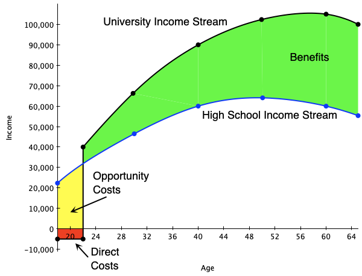
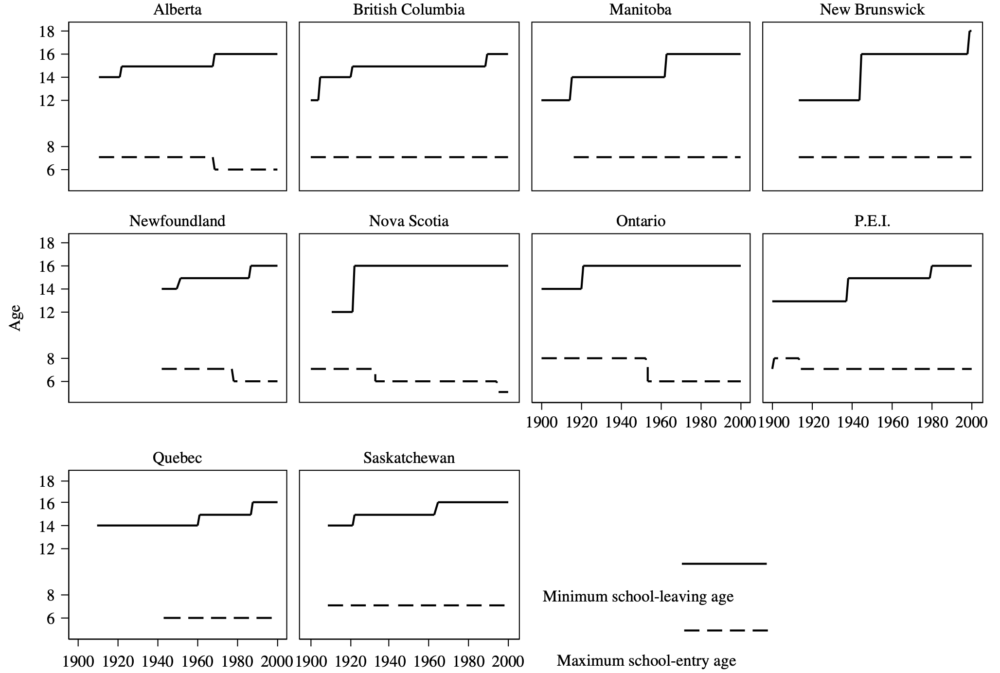
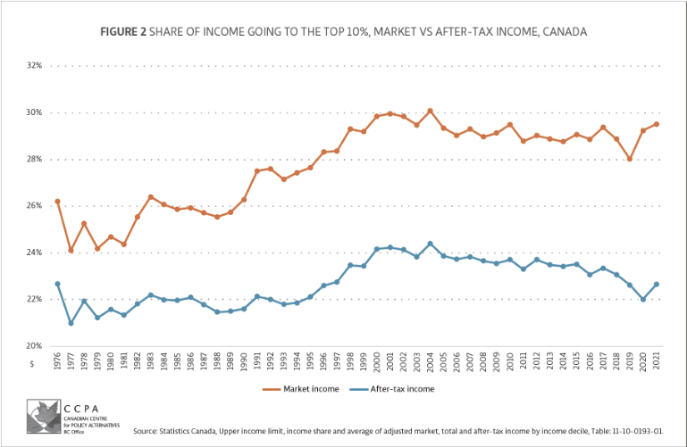

---
format:
  revealjs:
    theme: [default, hygge.scss]
    center-title-slide: false
    slide-number: true
    height: 900
    width: 1600
    chalkboard:
      theme: whiteboard
      src: drawings.json
    post-render: "scripts/decktape.sh"
editor: visual
---

<h1>Human Capital Theory: Applications to Education and Training</h1>

<hr>

<h2>EC306- Wages and Employment</h2>

<h2>Justin Smith</h2>

<h2>Wilfrid Laurier University</h2>

<h2>Fall 2026</h2>

{.absolute top="275" left="900" width="550"}

# Goals of This Section

## Goals of This Section

In this section we will:

- See how education is related to employment and unemployment in&nbsp;Canada
- Treat schooling as an investment, and find the best amount using present values and the internal rate of&nbsp;return
- Explain how education can raise pay by signalling ability, even if it adds no&nbsp;skills
- Estimate the return to schooling, and see how economists deal with ability&nbsp;bias
- Look at early childhood education, social returns, and the link between education and&nbsp;inequality
- Ask who pays for job training, and whether government training programs&nbsp;work

::: {.notes}
Two lectures. Lecture 1 is the theory: schooling as an investment, then signalling. Lecture 2 is the evidence, early childhood, social returns, inequality, and training.

The notation follows the textbook: I is annual earnings, ΔI the gain from more schooling, D the direct cost, r the interest rate, irr the internal rate of return, S years of schooling, and EXP experience.
:::

# Introduction

## Educational Attainment by Sex, Ages 25–44

```{r echo=FALSE}
#| message: false
#| warning: false
#| fig-width: 14
#| fig-height: 6.6

library(tidyverse)
library(janitor)

# attain.csv was pulled from Statistics Canada Table 14-10-0020-01:
#attain <- cansim::get_cansim("14100020") %>% clean_names() %>%
#  filter(geo == "Canada",
#         age_group == "25 to 44 years",
#         educational_attainment %in% c("Total, all education levels",
#                                       "0 to 8  years",
#                                       "Some high school",
#                                       "High school graduate",
#                                       "University degree")) %>%
#  group_by(ref_date, labour_force_characteristics, gender) %>%
#  mutate(total = value[educational_attainment == "Total, all education levels"],
#         percent = 100*value/total) %>%
#  ungroup() %>%
#  filter(educational_attainment != "Total, all education levels")

attain <- read_csv("attain.csv", show_col_types = FALSE) %>%
  mutate(gender = recode(gender, "Men+" = "Men", "Women+" = "Women"),
         educational_attainment = factor(educational_attainment,
           levels = c("0 to 8  years", "Some high school",
                      "High school graduate", "University degree"),
           labels = c("0 to 8 years", "Some high school",
                      "High school graduate", "University degree")))

ggplot(filter(attain, labour_force_characteristics == "Population",
              gender != "Total - Gender"),
       aes(x = ref_date, y = percent, colour = gender)) +
  geom_line(linewidth = 1.3) +
  facet_wrap(~ educational_attainment, nrow = 1) +
  scale_colour_manual(values = c(Men = "#2780e3", Women = "#f0ad4e")) +
  scale_x_continuous(breaks = c(1990, 2005, 2020)) +
  labs(x = "Year", y = "Percentage of Population", colour = NULL,
       caption = "Data Source: Statistics Canada Table 14-10-0020-01") +
  theme_minimal(base_size = 18) +
  theme(legend.position = "top",
        strip.text = element_text(face = "bold"))
```

::: {.notes}
Among 25 to 44 year olds, the share with a university degree rose from 16% in 1990 to 45% in 2025. Women passed men in the late 1990s (for good from 1999), and the gap is now 12 points: 51% of women and 39% of men have a degree. The share with 8 or fewer years of school fell from about 6% to about 1%.

The textbook's Figure 14.1 shows the same divergence by sex. One reason to come back to: estimated returns to schooling are higher for women than for men (about 15% versus 10% a year in the book's Table 14.2).
:::

## Unemployment Rate by Education, Ages 25–44

```{r echo=FALSE}
#| message: false
#| warning: false

ggplot(filter(attain, labour_force_characteristics == "Unemployment rate",
              gender == "Total - Gender"),
       aes(x = ref_date, y = value, group = educational_attainment, color = educational_attainment)) +
  geom_line(linewidth = 1.2) +
  labs(
    x = "Year",
    y = "Unemployment Rate (%)",
    color = "Educational Attainment",
    caption = "Data Source: Statistics Canada Table 14-10-0020-01"
  ) +
  theme_minimal() +
  theme(
    plot.title = element_text(size = 16, face = "bold"),
    plot.subtitle = element_text(size = 12),
    axis.title = element_text(size = 12),
    legend.title = element_text(size = 12),
    legend.text = element_text(size = 10),
    legend.position = c(0.75, 0.95),        # top-left corner (x, y)
    legend.justification = c("left", "top"),# aligns legend box corner to position
    legend.background = element_rect(fill = alpha("white", 0.6), color = NA) # optional semi-transparent box
  )
```

::: {.notes}
Degree holders have the lowest unemployment rate, and the gap widens in recessions. In 2009, 5.2% of university graduates were unemployed against 9.8% of high school graduates; in 2020, 6.7% against 11.7%. In 2025, 5.4% against 8.2%.

Participation follows the same pattern: in 2025, 92% of degree holders aged 25 to 44 were in the labour force, against 82% of high school graduates and 61% of those with 8 or fewer years of school.

Is this all productivity? Human capital theory says education makes people more productive. Signalling says it identifies people who were already more productive. And people who get more education may differ in other ways. Both theories come next, and lecture 2 asks what the data say.
:::

# Human Capital Theory

## Education as an Investment {.smaller}

- Firms invest in [physical capital]{.fg style="color: #2780e3;"}: they pay now for machines that raise output later, and invest when the benefits outweigh the&nbsp;costs

::: {.callout-important}
## Key Definition
**[Human capital]{.fg style="color: #2780e3;"}**: the skills, knowledge and abilities that make a person productive. People pay now, in tuition and forgone earnings, for higher earnings&nbsp;later
:::

- Human capital differs from physical capital in three&nbsp;ways:
  - [Non-money benefits:]{.fg style="color: #555;"} school can be enjoyable, and more educated workers face less unemployment&nbsp;risk
  - [Financing:]{.fg style="color: #555;"} you can't offer your future skills as collateral for a&nbsp;loan
  - [Private vs. social:]{.fg style="color: #555;"} education can benefit other people too, and some of its costs to the student are transfers rather than costs to&nbsp;society

::: {.notes}
Benefits of education come in two kinds: investment benefits (higher earnings later) and consumption benefits (enjoying learning now). This chapter treats schooling mainly as an investment.

The private vs. social distinction comes back in lecture 2, with real costs vs. transfer costs.
:::

# Private Investment in Education

## Comparing Income Streams {.smaller}

:::: columns
:::: {.column width="50%"}
{width="100%"}
::::

:::: {.column width="50%"}
- An 18-year-old high school graduate decides whether to go to&nbsp;university
- Going has [direct costs]{.fg style="color: #c7254e;"} (tuition, books) and the [earnings forgone]{.fg style="color: #f0ad4e;"} while in&nbsp;school
- The payoff is [higher earnings]{.fg style="color: #5cb85c;"} for the rest of a working&nbsp;life
- Each path is an [age-earnings profile]{.fg style="color: #2780e3;"}: earnings rise with age at a decreasing rate, as workers keep learning on the&nbsp;job
- Go if the present value of the green area beats the present value of the red and yellow&nbsp;areas
::::
::::

::: {.notes}
The textbook's simplifying assumptions: no utility or disutility from school itself, fixed hours of work, income streams known with certainty, and the ability to borrow and lend at the interest rate r ("perfect capital markets"). Relaxing these comes later.

The book's Figure 14.3 has three streams (leave school at 16, finish high school at 18, finish university at 22), with costs and benefits shown as areas a to f. This figure shows only the university choice.

The profiles are concave because people keep investing in skills through on-the-job learning, with diminishing returns to experience. More education shifts the whole profile up, though graduates may start below workers their age with more experience.
:::

## The Present Value of Each Path {.smaller}

- Work from age 18 until retirement at age $T$, earning $I$ a year, with interest rate&nbsp;$r$:

$$PV = I + \frac{I}{1+r} + \dots + \frac{I}{(1+r)^{T-18}} \approx I + \frac{I}{r}$$

- One more year of school: pay direct costs $D$, earn nothing that year, then earn $I + \Delta I$ every year&nbsp;after:

$$PV^* \approx \frac{I + \Delta I}{r} - D$$

- The net gain from the extra&nbsp;year:

$$PV^* - PV \approx \frac{\Delta I}{r} - (I + D)$$

::: {.notes}
The approximation treats each stream as lasting forever, which is close when retirement is far away. At r = 5% and 45 working years, the exact sum of discount factors is about 18, against 1/r = 20.

The book also assumes earnings are flat with age, which keeps the formula simple. Letting earnings grow changes the numbers but not the logic.
:::

## The Investment Condition {.smaller}

::: {.callout-tip}
## Investment Condition
- [Marginal benefit:]{.fg style="color: #555;"} $MB = \Delta I / r$, the present value of the earnings&nbsp;gain
- [Marginal cost:]{.fg style="color: #555;"} $MC = I + D$, forgone earnings plus direct&nbsp;costs

Another year of school is worth it if $MB > MC$. Keep going until

$$\frac{\Delta I}{r} = I + D$$
:::

- [Example:]{.fg style="color: #555;"} a year of school means giving up $I = \$30{,}000$ and paying $D = \$10{,}000$, and it raises earnings by $\Delta I = \$3{,}000$ a year&nbsp;after
- At $r = 5\%$: $MB = \$3{,}000 / 0.05 = \$60{,}000$, more than $MC = \$40{,}000$. Stay in&nbsp;school

::: {.notes}
The same example comes back on the internal rate of return slide.

Ask the room: what interest rate would make this person indifferent? MB = MC when 3,000/r = 40,000, so r = 7.5%. That's the internal rate of return.
:::

## Marginal Benefit Equals Marginal Cost {.smaller}

:::: columns
:::: {.column width="55%"}
```{r echo=FALSE}
#| message: false
#| warning: false
#| fig-width: 8
#| fig-height: 6.4

# Illustrative curves only
mb <- function(s) 80 * exp(-0.18 * (s - 8))
mc <- function(s) 15 + 0.6 * (s - 8)^2
s_star <- uniroot(function(s) mb(s) - mc(s), c(8, 20))$root
y_star <- mb(s_star)

curves <- tibble(s = seq(8, 19, length.out = 300)) %>%
  mutate(MB = mb(s), MC = mc(s)) %>%
  pivot_longer(-s, names_to = "curve", values_to = "y")

ggplot(curves, aes(s, y, colour = curve)) +
  geom_segment(aes(x = s_star, xend = s_star, y = 0, yend = y_star),
               linetype = "dotted", colour = "grey30", linewidth = 0.9) +
  geom_line(linewidth = 1.5) +
  geom_point(aes(x = s_star, y = y_star), colour = "grey20", size = 3.5) +
  annotate("text", x = 18.6, y = mb(18.6) + 7, label = "MB = ΔI / r",
           colour = "#5cb85c", size = 6.5, hjust = 1) +
  annotate("text", x = 15.6, y = mc(15.6), label = "MC = I + D  ",
           colour = "#c7254e", size = 6.5, hjust = 1) +
  scale_colour_manual(values = c(MB = "#5cb85c", MC = "#c7254e")) +
  scale_x_continuous(breaks = s_star, labels = "S*", limits = c(8, 19),
                     expand = expansion(mult = c(0, 0.02))) +
  scale_y_continuous(breaks = NULL, limits = c(0, 85),
                     expand = expansion(mult = c(0, 0.02))) +
  labs(x = "Years of schooling (S)", y = "Present value of MB and MC") +
  theme_minimal(base_size = 18) +
  theme(legend.position = "none", panel.grid = element_blank(),
        axis.line = element_line(colour = "grey30"),
        axis.text.x = element_text(size = 20))
```
::::

:::: {.column width="45%"}
- [MB falls]{.fg style="color: #2780e3;"} with more schooling: each year adds less to earnings, and there are fewer working years left to collect the&nbsp;gain
- [MC rises]{.fg style="color: #2780e3;"}: forgone earnings $I$ grow with each year of school, and university charges tuition where high school is&nbsp;free
- The [optimal schooling]{.fg style="color: #2780e3;"} $S^*$ is where $MB = MC$
::::
::::

::: {.notes}
The curves are made up for illustration; this is panel (a) of the book's Figure 14.4.

Different people have different curves. Someone who learns quickly has a higher MB curve and chooses more schooling. Someone with high-paying alternatives, or who finds school unpleasant, has a higher MC curve and chooses less.
:::

## The Internal Rate of Return {.smaller}

:::: columns
:::: {.column width="55%"}
```{r echo=FALSE}
#| message: false
#| warning: false
#| fig-width: 8
#| fig-height: 6.4

# Illustrative: irr = MB / MC * r, using the same curves as the last slide
r0 <- 0.05
irr <- function(s) r0 * mb(s) / mc(s)
irr_curve <- tibble(s = seq(8.6, 19, length.out = 300), y = irr(s))

ggplot(irr_curve, aes(s, y)) +
  geom_hline(yintercept = r0, colour = "#555555", linewidth = 1.3) +
  geom_segment(aes(x = s_star, xend = s_star, y = 0, yend = r0),
               linetype = "dotted", colour = "grey30", linewidth = 0.9) +
  geom_line(colour = "#2780e3", linewidth = 1.5) +
  geom_point(aes(x = s_star, y = r0), colour = "grey20", size = 3.5) +
  annotate("text", x = 18.8, y = r0 + 0.012, label = "r", colour = "#555555",
           size = 7, hjust = 1) +
  annotate("text", x = 11.2, y = irr(11.2) + 0.02,
           label = "irr = ΔI / (I + D)", colour = "#2780e3", size = 6.5, hjust = 0) +
  scale_x_continuous(breaks = s_star, labels = "S*", limits = c(8.6, 19),
                     expand = expansion(mult = c(0, 0.02))) +
  scale_y_continuous(breaks = NULL, limits = c(0, 0.2),
                     expand = expansion(mult = c(0, 0.02))) +
  labs(x = "Years of schooling (S)", y = "irr and r") +
  theme_minimal(base_size = 18) +
  theme(panel.grid = element_blank(),
        axis.line = element_line(colour = "grey30"),
        axis.text.x = element_text(size = 20))
```
::::

:::: {.column width="45%"}
::: {.callout-important}
## Key Definition
**[Internal rate of return]{.fg style="color: #2780e3;"}** ($irr$): the interest rate that makes the net present value of the investment&nbsp;zero
:::

- Setting $\Delta I / irr = I + D$ gives $irr = \dfrac{\Delta I}{I + D}$
- Invest while $irr > r$, the [opportunity cost]{.fg style="color: #2780e3;"} of the money. Stop where $irr = r$, at the same&nbsp;$S^*$
- [Example:]{.fg style="color: #555;"} $irr = 3{,}000 / 40{,}000 = 7.5\%$, above $r = 5\%$, so stay in&nbsp;school
::::
::::

::: {.notes}
This is panel (b) of the book's Figure 14.4. The irr falls with schooling for the same two reasons: the gain ΔI shrinks, and the cost I + D grows.

The alternative to spending I + D on school is to invest it at the interest rate r. So the comparison is: does school return more than the bank?
:::

## iClicker Question {background-color="#f0f4f8"}

Priya can take a one-year program. Tuition and books cost \$8,000, and she would give up a \$32,000 job for the year. After it, she would earn \$3,000 a year more for the rest of her career. She can borrow or save at 8%. Using the approximations from class, what should she&nbsp;do?

A\) Enroll, because the return of 37.5% beats the 8% interest rate\
B) Enroll, because she earns \$3,000 more every year for the rest of her career\
C) Don't enroll, because the return of 7.5% is below the 8% interest rate\
D) Don't enroll, because \$3,000 a year is less than the \$40,000 cost\
E) Enroll, because the return of 9.4% beats the 8% interest rate

::: {.notes}
Answer: C. irr = ΔI/(I + D) = 3,000/(32,000 + 8,000) = 7.5%, below r = 8%. MB and MC give the same answer: MB = 3,000/0.08 = \$37,500, less than MC = \$40,000. At 7% interest she would enroll.

A divides by tuition alone (3,000/8,000) and forgets forgone earnings. That's the most common mistake: the biggest cost of school is usually the pay you give up. E divides by forgone earnings alone (3,000/32,000) and forgets tuition. B ignores costs and discounting altogether. D gets the right decision for the wrong reason: it compares a yearly gain with a one-time cost, and over a career \$3,000 a year adds up to far more than \$40,000 before discounting.
:::

## What Changes the Decision {.smaller}

- [Age:]{.fg style="color: #555;"} invest early. The young give up less pay, and have more years to collect the&nbsp;return
- [Time out of the labour force:]{.fg style="color: #555;"} people who expect to be in and out of work collect the gain for fewer years, so they invest&nbsp;less
- [Student loans or tuition subsidies:]{.fg style="color: #555;"} they lower the cost of borrowing or $D$, so [more&nbsp;schooling]{.fg style="color: #2780e3;"}
- [A more progressive income tax:]{.fg style="color: #555;"} it shrinks the after-tax gain $\Delta I$ more than the after-tax cost, so [less&nbsp;schooling]{.fg style="color: #2780e3;"}
- [Better pay in jobs that need no degree:]{.fg style="color: #555;"} as in an oil boom, it raises forgone earnings $I$, so [less&nbsp;schooling]{.fg style="color: #2780e3;"}
- [A lower interest rate:]{.fg style="color: #555;"} it raises the present value of future gains, so [more&nbsp;schooling]{.fg style="color: #2780e3;"}

::: {.notes}
The first two are the book's main implications of the theory. The tax and student loan examples are its comparative statics. A progressive tax hits the high-income stream (university) harder than the low-income one.

Oil booms: there is Canadian evidence that Alberta's resource booms, by raising pay for young workers without degrees, pulled some young men out of school.
:::

## Financing and Other Complications {.smaller}

::: {.callout-warning}
## Credit Constraints
- The model assumes [perfect capital markets]{.fg style="color: #2780e3;"}: anyone can borrow at $r$ against future&nbsp;earnings
- In reality, students can't easily borrow that way: there's no collateral, and a bank can't repossess a&nbsp;degree
- So some students [invest too little]{.fg style="color: #c7254e;"}, even when the return beats the interest&nbsp;rate
:::

- [Income-contingent loans:]{.fg style="color: #555;"} repayments rise with later income, so graduates who earn little repay little. Australia has used this since&nbsp;1989
- [Debt aversion:]{.fg style="color: #555;"} some students avoid loans even when borrowing would pay&nbsp;off
- [Risk and information:]{.fg style="color: #555;"} returns are uncertain, and risk-averse students invest less. Students may also misjudge costs and returns, especially if no one in their family went to&nbsp;university
- [Field of study:]{.fg style="color: #555;"} returns differ widely by program, so the choice is what to study as well as how&nbsp;much

::: {.notes}
The book's Exhibit 14.1 discusses new ways to finance higher education, including Australia's income-contingent loans (Riddell 2003). Canada's student loan Repayment Assistance Plan also ties repayments to income after graduation.

Risk: the model assumed income streams are known. In reality, a degree's payoff depends on the field, the economy, and on technology (the book mentions AI changing which skills pay). Education is also hard to diversify: you can't spread your human capital over many investments. Debt aversion is from Field (2009); the book spells it "Fields".
:::

## iClicker Question {background-color="#f0f4f8"}

A recession cuts pay and hours this year for 18-year-olds who go straight to work. It doesn't change what anyone will earn in later years. In the human capital model from class, what happens to college and university&nbsp;enrolment?

A\) It rises, because students give up less pay, so the cost of school falls\
B) It doesn't change, because what graduates will earn later hasn't changed\
C) It falls, because families have less money to pay tuition\
D) It falls, because a recession lowers the return to all investments\
E) It rises, because the earnings gain from school, $\Delta I$, rises

::: {.notes}
Answer: A. The marginal cost of school is MC = I + D, and I, the pay given up while in school, fell. So MC falls at every level of schooling and S* rises. Enrolment does tend to rise in recessions. This is the mirror image of the oil-boom bullet.

C is a credit-constraint story. It's real, but the basic model assumes students can borrow at r; in practice the two effects pull in opposite directions. B forgets that forgone earnings are a cost. D: the return to school depends on ΔI, I and D, and only I changed. E: ΔI is the gap in later earnings, which the stem says hasn't changed.
:::

# Signalling

## Human Capital or Signalling? {.smaller}

::: {.callout-note}
## Two Explanations for Why Education Pays
- [Human capital:]{.fg style="color: #2780e3;"} education raises productivity, and pay&nbsp;follows
- [Signalling:]{.fg style="color: #2780e3;"} education reveals productivity that was already&nbsp;there
:::

- Employers can't see a new hire's [productivity]{.fg style="color: #2780e3;"}. Workers know their own ability, but can't credibly tell the&nbsp;employer
- With no information, firms pay everyone the average&nbsp;productivity
- Under the right conditions, education acts as a [signal]{.fg style="color: #2780e3;"}: high-ability workers get it, and employers pay them&nbsp;more
- Education can then raise pay even if it adds no skills at&nbsp;all

::: {.notes}
The signalling model is due to Michael Spence. The book calls this "education as a filter," and also uses the word screening: employers use education to sort job applicants.
:::

## When Education Can Signal Ability {.smaller}

::: {.callout-note}
## Conditions for a Signal
- Education must be [costly]{.fg style="color: #2780e3;"} to&nbsp;get
- It must be [more costly for low-ability workers]{.fg style="color: #2780e3;"}. Otherwise they would get it too, and fake high&nbsp;ability
- Employers' beliefs must be [confirmed]{.fg style="color: #2780e3;"} once they see workers on the job, or they will change their wage&nbsp;offers
:::

- When these hold, education sorts workers by ability, and each is paid what they&nbsp;produce
- Why would school cost low-ability students more? It takes them more effort, more time, and more stress to get the same&nbsp;credential

::: {.notes}
The costs here include effort and psychic costs, not just tuition.
:::

## A Two-Type Model {.smaller}

- Two types of workers, and employers can't tell them&nbsp;apart:

:::: columns
:::: {.column width="50%"}
[Low ability (L):]{.fg style="color: #555;"}

- Marginal product: $1$
- Cost of $s$ years of school: $c_L(s) = s$
::::

:::: {.column width="50%"}
[High ability (H):]{.fg style="color: #555;"}

- Marginal product: $2$
- Cost of $s$ years of school: $c_H(s) = s/2$
::::
::::

- Employers believe that anyone with at least $s^*$ years of school is type H, and&nbsp;pay

$$w(s) = \begin{cases} 2 & \text{if } s \ge s^* \\ 1 & \text{if } s < s^* \end{cases}$$

- Each worker chooses $s$ to maximize $w(s) - c(s)$. More than $s^*$ costs more but pays no more, so each worker picks either $0$ or&nbsp;$s^*$

::: {.notes}
Without any signal, everyone is paid the average marginal product. If a fraction q of workers are type L, the wage is 1·q + 2(1 − q) = 2 − q. With q = 0.5, everyone earns 1.5: type L is paid more than they produce and type H less. That's why type H wants a way to stand out.

Here education adds nothing to productivity at all. That's deliberate: it shows education can pay even with no human capital.
:::

## Who Gets Educated? {.smaller}

:::: columns
:::: {.column width="52%"}
```{r echo=FALSE}
#| message: false
#| warning: false
#| fig-width: 8
#| fig-height: 6.4

# The two-type signalling model with s* = 1.5
s_cut <- 1.5
wage <- tibble(s = c(0, s_cut, s_cut, 3), w = c(1, 1, 2, 2))
costs <- tibble(s = seq(0, 3, length.out = 100)) %>%
  mutate(`c[L](s) == s` = s, `c[H](s) == s/2` = s / 2) %>%
  pivot_longer(-s, names_to = "type", values_to = "cost")

ggplot() +
  annotate("rect", xmin = 1, xmax = 2, ymin = 0, ymax = 3,
           fill = "#5cb85c", alpha = 0.12) +
  geom_line(data = costs, aes(s, cost, colour = type), linewidth = 1.4) +
  geom_step(data = wage, aes(s, w), linewidth = 1.5, colour = "#2780e3") +
  annotate("text", x = 2.95, y = 2.12, label = "w(s)", colour = "#2780e3",
           size = 6.5, hjust = 1) +
  annotate("text", x = 2.55, y = 2.85, label = "c[L](s) == s", parse = TRUE,
           colour = "#c7254e", size = 6.5, hjust = 1) +
  annotate("text", x = 2.95, y = 0.95, label = "c[H](s) == s/2", parse = TRUE,
           colour = "#555555", size = 6.5, hjust = 1) +
  annotate("text", x = 1.5, y = 0.12, label = "separating range",
           colour = "#3d8b3d", size = 5.5) +
  scale_colour_manual(values = c(`c[L](s) == s` = "#c7254e",
                                 `c[H](s) == s/2` = "#555555")) +
  scale_x_continuous(breaks = c(0, 1, s_cut, 2, 3),
                     labels = c("0", "1", "s*", "2", "3"),
                     expand = expansion(mult = c(0, 0.02))) +
  scale_y_continuous(breaks = c(0, 1, 2, 3), limits = c(0, 3),
                     expand = expansion(mult = c(0, 0.02))) +
  labs(x = "Years of school (s)", y = "Wage and cost") +
  theme_minimal(base_size = 18) +
  theme(legend.position = "none", panel.grid.minor = element_blank(),
        axis.line = element_line(colour = "grey30"))
```
::::

:::: {.column width="48%"}
- [Type H]{.fg style="color: #555;"} gets $s^*$ if $2 - \frac{s^*}{2} > 1$, that is, if&nbsp;$s^* < 2$
- [Type L]{.fg style="color: #555;"} gets $s^*$ if $2 - s^* > 1$, that is, if&nbsp;$s^* < 1$

::: {.callout-tip}
## A Separating Equilibrium
If $1 < s^* < 2$, only type H gets educated. Employers' beliefs are confirmed, so education [reveals each worker's type]{.fg style="color: #2780e3;"}
:::

- If $s^* < 1$ both types get educated, and if $s^* > 2$ neither does. Either way, the signal tells employers&nbsp;nothing
::::
::::

::: {.notes}
Read the graph as wage minus cost. At s*, type H gets 2 minus a small cost, and type L gets 2 minus a cost that wipes out the gain over the wage of 1 they'd get with no school.

A separating equilibrium: the types make different choices, so education separates them. A pooling equilibrium: everyone makes the same choice, so education reveals nothing. Any s* between 1 and 2 works, and the one with s* just above 1 wastes the least on schooling.

Can everyone be worse off? With no signal, everyone earns 2 − q. With signalling, type L earns 1, and type H nets 2 − s*/2, which is worse whenever s* > 2q. With q = 0.5, type H is worse off in every separating equilibrium. Type H would rather nobody signalled, but no single worker can stop.
:::

## iClicker Question {background-color="#f0f4f8"}

Change one thing in the signalling model: school is now cheaper for type H, with $c_H(s) = s/3$. Type L's cost is still $c_L(s) = s$, and the wages are still 1 and 2. Which cutoffs $s^*$ now separate the two&nbsp;types?

A\) $1 < s^* < 2$\
B) $1 < s^* < 3$\
C) $0 < s^* < 3$\
D) $2 < s^* < 3$\
E) $s^* < 1$

::: {.notes}
Answer: B. Type H gets s* if 2 − s*/3 > 1, so s* < 3. Type L still avoids it if 2 − s* < 1, so s* > 1.

A is the answer from the slide, not updated. C forgets that type L must not want s*: below 1, both types get educated and the signal is useless. D counts only the newly added range. E is where both types get educated, a pooling outcome.

The point: the bigger the cost gap between the types, the wider the range of signals that work.
:::

## What Signalling Implies {.smaller}

- Both theories predict the same thing: [more educated workers earn more]{.fg style="color: #2780e3;"}. That makes them hard to tell apart in the&nbsp;data
- For the individual, education pays either way. The difference is for&nbsp;society:
  - Under [human capital]{.fg style="color: #2780e3;"}, education raises what workers&nbsp;produce
  - Under [signalling]{.fg style="color: #2780e3;"}, it only sorts workers, and the resources spent on it are a [social waste]{.fg style="color: #c7254e;"}
- Under signalling, subsidizing education is mainly a [transfer to high-ability workers]{.fg style="color: #2780e3;"}, who get the subsidized&nbsp;signal
- Sorting still has some value: it helps match workers to the jobs that suit&nbsp;them

::: {.notes}
So the policy case for subsidizing education rests on how much of the return is human capital. Lecture 2 looks at evidence on that: credentials matter, and the best estimates put signalling at a minority of the return.
:::

<!-- Lecture 2 -->

# Estimating the Returns to Schooling

## The Human Capital Earnings Function {.smaller}

::: {.callout-important}
## Key Definition
The **[human capital earnings function]{.fg style="color: #2780e3;"}** relates log earnings to years of schooling $S$ and experience&nbsp;$EXP$:

$$\ln I = \alpha + rS + \beta_1 EXP + \beta_2 EXP^2 + \varepsilon$$
:::

- With small direct costs, $irr = \Delta I / I$, and $\Delta I / I \approx \Delta \ln I$. So the coefficient on $S$ is the [return to schooling]{.fg style="color: #2780e3;"}: the percent rise in earnings per extra&nbsp;year
- It's written $r$ because people invest until $irr = r$
- $EXP$ is [potential experience]{.fg style="color: #2780e3;"}: years since leaving school. The square lets the age-earnings profile curve&nbsp;down
- Estimated across many workers at one point in time, usually with&nbsp;OLS

::: {.notes}
This is the book's equation (14.9). It's also called the Mincer equation, after Jacob Mincer.

Why logs: if a year of school raises earnings by the same percentage at any level of earnings, then log earnings rise linearly with schooling.

The book defines potential experience as EXP = age − S − 5. It's used because most data sets don't record actual work experience.

The book's Table 14.2 estimates this equation with 2022 Canadian Income Survey data: about 10% a year for men and 15% for women.
:::

## Log Earnings and Years of Schooling, Ages 25–44

```{r echo=FALSE}
#| message: false
#| warning: false

lfs <- read_csv("pub0925.csv", show_col_types = FALSE) %>% clean_names() %>%
  mutate(educyrs = case_when(
    educ == 0 ~ 8,
    educ == 1 ~ 11,
    educ == 2 ~ 12,
    educ == 3 ~ 13,
    educ == 4 ~ 14,
    educ == 5 ~ 16,
    educ == 6 ~ 18,
    TRUE ~ NA_real_
  ),
  hrlyearn = hrlyearn/100) %>%
  filter(hrlyearn > 0) %>%
  mutate(
    educ_f = factor(
      educ,
      labels = c(
        "0–8 years",
        "Some high school",
        "High school graduate",
        "Some postsecondary",
        "Postsecondary certificate",
        "Bachelor's degree",
        "Graduate degree"
      )
    ),
    educ_f = relevel(educ_f, ref = "High school graduate")
  )

# Ages 25-44 (AGE_12 codes 03 to 06), matching the slide title
lfs_2544 <- filter(lfs, age_12 %in% c("03", "04", "05", "06"))

library(broom)

# Run the regression
mod <- lm(log(hrlyearn) ~ educyrs, data = lfs_2544)

# Extract coefficients
b <- coef(mod)

# Build equation label
eq_label <- paste0(
  "ln(I) = ",
  round(b[1], 3), " + ",
  round(b[2], 3), " * S"
)

ggplot(lfs_2544, aes(x = educyrs, y = log(hrlyearn))) +
  geom_point(alpha = 0.2) +
  geom_smooth(method = "lm", color = "blue", linewidth = 1.2) +
  annotate("text",
           x = min(lfs_2544$educyrs, na.rm = TRUE),
           y = max(log(lfs_2544$hrlyearn), na.rm = TRUE),
           label = eq_label,
           hjust = 0, vjust = 1,
           size = 5
  ) +
  labs(
    x = "Years of Education",
    y = "Log Hourly Earnings",
    caption = "Data Source: Statistics Canada Labour Force Survey, September 2025"
  ) +
  theme_minimal() +
  theme(
    plot.title = element_text(size = 16, face = "bold"),
    plot.subtitle = element_text(size = 12),
    axis.title = element_text(size = 12)
  )
```

::: {.notes}
Each dot is an employee aged 25 to 44 in the September 2025 Labour Force Survey, and the line is the OLS fit. The slope, about 6.4%, is the return to a year of schooling, with nothing else controlled. Here I is hourly earnings rather than annual earnings; the slope reads the same way.

Two problems with this picture. It doesn't control for experience. And the LFS records education in categories (high school graduate, bachelor's degree, and so on), which are converted here to approximate years.

The next slide fixes both: it controls for age, and uses the categories directly.
:::

## Earnings by Education Relative to High School Graduates

```{r echo=FALSE}
#| message: false
#| warning: false

library(modelsummary)


mod_men <- lm(log(hrlyearn) ~ educ_f + factor(age_12), data = filter(lfs, gender== 1))
mod_women <- lm(log(hrlyearn) ~ educ_f + factor(age_12), data = filter(lfs, gender == 2))


modelsummary(
  list(
    "Men"   = mod_men,
    "Women" = mod_women
  ),
  estimate    = "{estimate} ({std.error})",
  statistic   = NULL,
  coef_omit   = "factor\\(age_12\\)|\\(Intercept\\)",
  coef_rename = function(x) gsub("^educ_f", "", x),
  gof_omit    = "IC|Log|Adj|AIC|BIC|F"
)

```

::: {.notes}
Log hourly earnings regressed on education categories and age group, separately for men and women, all ages, September 2025 LFS. Each coefficient is the log gap relative to high school graduates of the same age group (standard errors in brackets).

Multiply by 100 for an approximate percent. For big gaps, e^b − 1 is more accurate: a coefficient of 0.5 means about 65% more.

The gaps for degrees are larger for women than for men, which matches the book's Table 14.2.

Data sources: the Census has large samples and detailed education and income, but runs every five years. The LFS is monthly, with smaller samples and less detail.
:::

## Ability Bias {.smaller}

::: {.callout-important}
## Key Definition
**[Ability bias]{.fg style="color: #2780e3;"}**: people with more ability tend to get more schooling, and would earn more even without it. So OLS credits schooling with part of the return to&nbsp;ability
:::

- The bias is usually thought to be positive, so OLS would [overstate]{.fg style="color: #c7254e;"} the return to schooling. But it can go either way, because ability has more than one&nbsp;dimension
- The ideal fix is an experiment that randomly assigns schooling, which isn't&nbsp;possible
- Instead, economists look for a [natural experiment]{.fg style="color: #2780e3;"}: something that changes schooling in a way unrelated to ability, "as good as randomly&nbsp;assigned"

::: {.notes}
Ability here means anything unobserved that raises earnings: talent, motivation, family background, connections. The book writes the simple model as ln I = α + βS + ε, where unobserved talent sits in ε and is correlated with S.

Why it can go either way: someone with a talent for skilled trades may earn well as a plumber with less schooling, while someone with academic talent becomes a lawyer. If the omitted ability goes with less schooling, OLS understates the return. Clicker 4 is a case like that.
:::

## The Size of the Bias {.smaller}

- Suppose log earnings depend on schooling and ability&nbsp;$A$:

$$\ln I = \alpha + \beta S + \gamma A + \varepsilon$$

- And ability is related to&nbsp;schooling:

$$A = \delta_0 + \delta_1 S + v$$

- Leave $A$ out, and OLS&nbsp;estimates:

::: {.callout-tip}
## The Bias Formula
$$\tilde{\beta} = \underbrace{\beta}_{\text{true return}} + \underbrace{\gamma\,\delta_1}_{\text{ability bias}}$$
:::

- If ability raises earnings ($\gamma > 0$) and goes with more schooling ($\delta_1 > 0$), OLS overstates the&nbsp;return

::: {.notes}
Derivation: the OLS slope is Cov(ln I, S)/Var(S). Substitute the true model: Cov(α + βS + γA + ε, S) = β Var(S) + γ Cov(A, S), since ε is unrelated to S. Divide by Var(S), and note that Cov(A, S)/Var(S) = δ₁, the slope from regressing A on S. So the OLS estimate is β + γδ₁.

This is the general omitted variable bias formula, applied to ability.
:::

## iClicker Question {background-color="#f0f4f8"}

Some 18-year-olds can step into a well-paid family business. They skip university, and the business lets them earn more for the rest of their lives. A study regresses log earnings on schooling and leaves out "has a family business." Its estimated return to schooling&nbsp;is:

A\) Too high, as with ability bias\
B) Too high, because the business raises earnings\
C) Unbiased, because a family business isn't ability\
D) Too low, because the business raises earnings but goes with less schooling\
E) Unbiased, because the effect of the business averages out across people

::: {.notes}
Answer: D. In the bias formula, γ > 0 (the business raises earnings) but δ₁ < 0 (people with a business get less schooling), so γδ₁ < 0 and OLS understates the return.

A and B pattern-match: omitted variable bias isn't always upward. Its sign is the product of the two signs. C: "ability" stands in for anything left out that is related to both schooling and earnings. E: the effect doesn't average out, because it's correlated with schooling.
:::

## Natural Experiments {.smaller}

- [Compulsory schooling laws:]{.fg style="color: #555;"} students must stay in school until a set age, so birth month and the law decide how long some&nbsp;stay
  - [Angrist and Krueger (1991)]{.fg style="color: #2780e3;"}, US: about [7.5%]{.fg style="color: #2780e3;"} a year for men. But birth month also affects how old a child is relative to classmates, which matters on its own (Bedard and Dhuey&nbsp;2006)
  - [Oreopoulos (2006)]{.fg style="color: #2780e3;"}, school-leaving laws in Canada and the UK: [10% or&nbsp;more]{.fg style="color: #2780e3;"}. [Devereux and Hart (2010)]{.fg style="color: #2780e3;"} find smaller returns for the&nbsp;UK
- [College proximity:]{.fg style="color: #555;"} growing up near a college makes it cheaper to go. [Card (1995)]{.fg style="color: #2780e3;"}: OLS gives 7.5%, proximity gives about&nbsp;[14%]{.fg style="color: #2780e3;"}

::: {.callout-note}
Natural experiments mostly give returns as large as OLS, or larger. So ability bias looks [small]{.fg style="color: #2780e3;"}: the book concludes it was&nbsp;"exaggerated"
:::

::: {.notes}
Why could these estimates be larger than OLS? Schooling is measured with error, which biases OLS down. And a natural experiment measures the return for the people it pushes into more school, often people who faced high costs and had high returns at the margin (Card 2001).

These are returns at particular margins: compulsory schooling laws move people around high school completion, and proximity moves people into college.

Twin studies are another approach, not in this chapter: Ashenfelter and Rouse (1998) compared identical twins with different schooling and found returns of roughly 7 to 9% a year, below the 11% from OLS on the same data.
:::

## Canada's School Entry and Leaving Laws, by Province

{fig-align="center" height="760"}

::: {.notes}
From Oreopoulos (2006). Solid lines are the minimum school-leaving age, and dashed lines the maximum age for starting school. Provinces raised the leaving age at different times, so otherwise similar people born a few years apart, or in different provinces, faced different minimum schooling. That variation has nothing to do with their ability.
:::

## Credentials and Signalling in the Data {.smaller}

- Under pure human capital, a diploma adds nothing beyond the years of learning it&nbsp;took
- [Ferrer and Riddell (2002)]{.fg style="color: #2780e3;"}, Canada: people with the same years of schooling earn more if they finished the [credential]{.fg style="color: #2780e3;"}. That's consistent with&nbsp;signalling
- If employers learn ability over time, signals should matter less as a career goes on ([Altonji and&nbsp;Pierret]{.fg style="color: #2780e3;"})
- [Aryal et al. (2019)]{.fg style="color: #2780e3;"}: about [30%]{.fg style="color: #2780e3;"} of the return to schooling is signalling, and the share falls with&nbsp;experience
- So both theories have support, and most of the return looks like human&nbsp;capital

::: {.notes}
The book's Exhibit 14.2: Altonji (1995) found that taking more academic high school courses (science, math, English instead of shop or physical education) barely raises later earnings. If employers pay for skills, course content should matter. If they read the credential as a signal, finishing matters more than what you took. That evidence leans toward signalling.
:::

# Early Childhood Education

## Investing Early {.smaller}

- Human capital theory says invest early: the payoff lasts longer, and forgone earnings are&nbsp;lower
- Early skills make later learning more productive (Cunha et al. 2010). Children from disadvantaged families are already behind when they start&nbsp;school
- [Perry Preschool]{.fg style="color: #2780e3;"} (US, 1960s): disadvantaged children randomly assigned to intensive preschool had more education, higher earnings, and less crime as adults. But it was small and&nbsp;costly
- [Head Start]{.fg style="color: #2780e3;"} (US, much larger): mixed results, and many gains fade as children grow&nbsp;up
- [Quebec's \$5-a-day child care]{.fg style="color: #2780e3;"} (universal): no positive effect on children's outcomes, even later in life (Baker et al. 2008,&nbsp;2019)

::: {.callout-note}
That matters for the national child care system Canada began funding in 2021. The clearest gains so far come from intensive programs [targeted at disadvantaged children]{.fg style="color: #2780e3;"}
:::

::: {.notes}
Early and later investments are complements: a teenager who missed early investments finds it harder and costlier to catch up.

Parents and neighbourhoods still matter a lot for educational attainment, even after controlling for skills measured in the teen years (Foley 2012). And comprehensive support for youth in very low-income neighbourhoods can raise high school graduation and earnings, and reduce crime, later in life (Lavecchia et al. 2024).

Quebec's program also raised mothers' employment, a labour supply effect. The finding here is about the children.
:::

# Social Returns to Education

## Social Returns to Education {.smaller}

- [Private]{.fg style="color: #2780e3;"} costs and benefits fall on the student. [Social]{.fg style="color: #2780e3;"} costs and benefits count&nbsp;everyone
- [Real costs vs. transfers:]{.fg style="color: #555;"} society counts [real costs]{.fg style="color: #2780e3;"}, the resources used up (teachers' time, buildings, the output students don't produce). [Transfer costs]{.fg style="color: #2780e3;"}, like a tuition subsidy, move money between people and drop out of the social&nbsp;total
- [Spillovers:]{.fg style="color: #555;"} workers earn more in cities with more educated workers (Moretti), and educated STEM immigrants raise other workers' productivity (Peri et&nbsp;al.)
- [Benefits outside the job:]{.fg style="color: #555;"} less crime (Lochner and Moretti), more civic participation (Milligan et al.), and longer lives (Lleras-Muney)
- [But the evidence is mixed:]{.fg style="color: #555;"} there are no clear spillovers from high school, college spillovers may be confined to the 1980s, and newer studies find weaker benefits outside the&nbsp;job

::: {.callout-tip}
## Policy
Spillovers are a case for [public subsidies]{.fg style="color: #2780e3;"} for education. If education is mostly a signal, the case is&nbsp;weaker
:::

::: {.notes}
Measuring spillovers is hard: productive cities attract educated workers, so the link could run the other way.

The mixed evidence: Acemoglu and Angrist, and Ciccone and Peri, find no spillovers from high school; Sand finds college spillovers mainly in the 1980s; and Clark and Royer, and Stephens and Yang, find weaker effects of schooling outside the labour market than earlier studies did.

The social return could also be lower than the private one. If education is partly a signal, some of the private gain comes at other workers' expense.
:::

## iClicker Question {background-color="#f0f4f8"}

Ontario pays \$6,000 of each university student's tuition out of tax revenue. When we add up the social cost of a year of university, the \$6,000&nbsp;subsidy:

A\) Lowers the social cost by \$6,000, because students pay less\
B) Adds \$6,000 to the social cost, on top of the cost of running the university\
C) Doesn't count, because it only moves money from taxpayers to students\
D) Is the only part of tuition that counts as a social cost\
E) Lowers the social cost, because taxpayers spread it across many people

::: {.notes}
Answer: C. Social costs are real costs: instructors' time, buildings, and the output students don't produce while in school. The subsidy is a transfer from taxpayers to students.

A confuses private and social cost: the student's private cost falls by \$6,000, but the social cost doesn't change. B double-counts: the resources the subsidy pays for are already counted once. D: tuition paid by the student is also just a payment for those same resources. E: spreading a cost across more people doesn't make it smaller.

So a subsidy raises the private return to school, but not the social return.
:::

# Education and Inequality

## Education and Inequality {.smaller}

- Earnings inequality in Canada rose in the 1980s and 1990s, and has been fairly stable&nbsp;since
- Two possible sources:
  - A rising [return to education]{.fg style="color: #2780e3;"}: the gap between education groups&nbsp;widens
  - More [inequality within education groups]{.fg style="color: #2780e3;"}: workers with the same education drift&nbsp;apart
- In Canada, most of the rise came from [within]{.fg style="color: #2780e3;"} education groups. The university premium rose modestly, about 5 points for men from 1980 to 2005 (Boudarbat et&nbsp;al.)
- [Explanations for higher returns:]{.fg style="color: #555;"} [technological change]{.fg style="color: #2780e3;"} favouring skilled, non-routine work ([Chapter&nbsp;10]{.fg style="color: #555;"}), and [trade and globalization]{.fg style="color: #2780e3;"}
- [Polarization:]{.fg style="color: #555;"} in the US, both jobs and wages polarized. In Canada, jobs did but wages didn't (Green and&nbsp;Sand)
- [Unions:]{.fg style="color: #555;"} their decline widened wage inequality, but didn't raise the return to schooling (DiNardo and&nbsp;Lemieux)
- Since the mid-2000s, the resource boom and higher minimum wages narrowed wage gaps in several provinces (Fortin and&nbsp;Lemieux)

::: {.notes}
Younger cohorts: Beaudry and Green found that each new cohort entered the labour market at lower earnings than earlier ones, at every education level, while earnings grew with experience at about the same rate. That's a cohort effect, not a rising premium for the young.

Supply matters too. In the 1970s the large, well-educated baby-boom cohorts entered the labour market and held down the university premium, though Dooley found demographics alone can't explain all of the narrowing.

Polarization: employment grew at the top and bottom of the skill distribution and shrank in the middle, as routine jobs were automated (Autor et al.). In the US, wages followed. In Canada, Green and Sand found that employment polarized but wages didn't.

At the very top, the income share of the top 1% rose sharply, and education matters there too: about two-thirds of the top 1% have a bachelor's degree, against about a fifth of all workers (Lemieux and Riddell).
:::

## Top 10% Income Share in Canada, 1976–2021

{fig-align="center" height="760"}

::: {.notes}
The share of income going to the top 10% of Canadians, before taxes and transfers (market income) and after. Market income shares rose from about 26% in the late 1980s to about 30% by 2000, then levelled off. Taxes and transfers took about 4 points off the top share in the late 1980s, and 6 to 7 points since about 2000.

This is income inequality, which is broader than wage inequality: it includes investment income, and it's measured across families, not workers.
:::

# Training

## General and Specific Training {.smaller}

- Workers keep building human capital [on the job]{.fg style="color: #2780e3;"}, after their schooling&nbsp;ends

::: {.callout-important}
## Key Definitions
**[General training]{.fg style="color: #2780e3;"}**: skills valued at many&nbsp;firms

**[Specific training]{.fg style="color: #2780e3;"}**: skills valued only at the firm that provides&nbsp;them
:::

- Who pays for training, the worker or the firm? It depends on whether the worker can take the skills to another&nbsp;employer
- Most training is a mix. Skills can be specific to an industry, an occupation, or a set of tasks rather than to one&nbsp;firm

::: {.notes}
Examples: learning to use spreadsheets or to weld is general. Learning a company's own software or procedures is specific.

This is Becker's analysis of training.
:::

## General Training: The Worker Pays {.smaller}

:::: columns
:::: {.column width="50%"}
```{r echo=FALSE}
#| message: false
#| warning: false
#| fig-width: 8
#| fig-height: 6.4

# Illustrative training diagrams, after the textbook's Figure 14.6
train_plot <- function(shared = FALSE) {
  t_star <- 3; t_end <- 10
  vmp_t <- 1; w_t <- 1.55; w_a <- 2.1; w_s <- 2.75; vmp_s <- 3.4
  if (!shared) {
    areas <- tibble(xmin = c(0, t_star), xmax = c(t_star, t_end),
                    ymin = c(vmp_t, w_a), ymax = c(w_a, vmp_s),
                    fill = c("cost", "benefit"),
                    lab = c("Costs of\ntraining", "Benefits of training"))
    fills <- c(cost = "#c7254e", benefit = "#5cb85c")
    lines <- tibble(x = c(0, 0, t_star), xend = c(t_star, t_end, t_end),
                    y = c(vmp_t, w_a, vmp_s))
    brks <- c(vmp_t, w_a, vmp_s)
    labs_y <- expression(VMP[t], W[a] == VMP[a], VMP^"*")
  } else {
    areas <- tibble(xmin = c(0, 0, t_star, t_star),
                    xmax = c(t_star, t_star, t_end, t_end),
                    ymin = c(vmp_t, w_t, w_a, w_s),
                    ymax = c(w_t, w_a, w_s, vmp_s),
                    fill = c("employer", "worker", "worker", "employer"),
                    lab = c("Employer's\ncost", "Worker's\ncost",
                            "Worker's benefit", "Employer's benefit"))
    fills <- c(worker = "#2780e3", employer = "#f0ad4e")
    lines <- tibble(x = c(0, 0, 0, t_star, t_star),
                    xend = c(t_star, t_star, t_end, t_end, t_end),
                    y = c(vmp_t, w_t, w_a, w_s, vmp_s))
    brks <- c(vmp_t, w_t, w_a, w_s, vmp_s)
    labs_y <- expression(VMP[t], W[t], W[a] == VMP[a], W^"*", VMP^"*")
  }
  ggplot() +
    geom_rect(data = areas, aes(xmin = xmin, xmax = xmax, ymin = ymin,
                                ymax = ymax, fill = fill), alpha = 0.25) +
    geom_text(data = areas, aes(x = (xmin + xmax) / 2, y = (ymin + ymax) / 2,
                                label = lab), size = 5.5, lineheight = 0.9) +
    geom_segment(data = lines, aes(x = x, xend = xend, y = y, yend = y),
                 linewidth = 1.3) +
    geom_vline(xintercept = t_star, linetype = "dashed", colour = "grey40") +
    scale_fill_manual(values = fills) +
    scale_x_continuous(breaks = c(0, t_star), labels = c("0", "t*"),
                       limits = c(0, t_end), expand = expansion(mult = c(0, 0.02))) +
    scale_y_continuous(breaks = brks, labels = labs_y, limits = c(0, 3.8),
                       expand = expansion(mult = c(0, 0.02))) +
    labs(x = "Time (training ends at t*)", y = "Wage, VMP") +
    theme_minimal(base_size = 18) +
    theme(legend.position = "none", panel.grid = element_blank(),
          axis.line = element_line(colour = "grey30"))
}

train_plot()
```
::::

:::: {.column width="50%"}
- Trained workers are more productive [at every firm]{.fg style="color: #2780e3;"}, so other firms will bid their wage up to&nbsp;$VMP^*$
- A firm that paid for the training couldn't get it back: the worker would leave, or demand the higher&nbsp;wage
- So the worker pays, by accepting a wage of $VMP_t$ [during training]{.fg style="color: #c7254e;"}, below the $W_a$ they could earn&nbsp;untrained
- They earn $VMP^*$ [after training]{.fg style="color: #5cb85c;"}. Worth it if the present value of the gain beats the&nbsp;cost
::::
::::

::: {.notes}
This is just like paying for school: the worker gives up earnings now for higher earnings later. Apprenticeships and medical residencies work this way: low pay during training, high pay after.

A minimum wage can get in the way, by stopping workers from paying for training with a lower wage.
:::

## Specific Training: The Firm Pays {.smaller}

:::: columns
:::: {.column width="50%"}
```{r echo=FALSE}
#| message: false
#| warning: false
#| fig-width: 8
#| fig-height: 6.4

train_plot()
```
::::

:::: {.column width="50%"}
- Specific skills raise productivity [only at this firm]{.fg style="color: #2780e3;"}, so other firms won't pay more for&nbsp;them
- The firm can pay $W_a$ throughout, and pay for the training&nbsp;itself:
  - [Cost]{.fg style="color: #c7254e;"} during training: $W_a - VMP_t$
  - [Benefit]{.fg style="color: #5cb85c;"} after training: $VMP^* - W_a$
- The risk: if the worker [quits]{.fg style="color: #c7254e;"} after training, the firm loses its&nbsp;investment
::::
::::

::: {.notes}
The firm invests if the present value of the benefit beats the present value of the cost, just like any other investment.

The worker has no reason to stay: they earn W_a here or anywhere else.
:::

## Sharing the Cost of Specific Training {.smaller}

:::: columns
:::: {.column width="50%"}
```{r echo=FALSE}
#| message: false
#| warning: false
#| fig-width: 8
#| fig-height: 6.4

train_plot(shared = TRUE)
```
::::

:::: {.column width="50%"}
- To keep trained workers, the firm and worker [share]{.fg style="color: #2780e3;"} the&nbsp;investment:
  - During training, the wage $W_t$ is below $W_a$ but above&nbsp;$VMP_t$
  - After training, the wage $W^*$ is above $W_a$ but below&nbsp;$VMP^*$
- Now both lose if the job ends. Specific skills act as [glue]{.fg style="color: #2780e3;"}: fewer quits, fewer layoffs, and longer job&nbsp;tenure
- Training is really gradual, so wages rise smoothly with tenure, but the logic is the&nbsp;same
::::
::::

::: {.notes}
The worker quits less because they earn more here than elsewhere. The firm lays off less because the worker produces more than they're paid.

Firms also use contracts: some require trainees to repay training costs if they leave within a year or two.
:::

## iClicker Question {background-color="#f0f4f8"}

A trucking company trains new hires for a commercial driver's licence, which every trucking company requires. In the training model from class, who pays for the training, and&nbsp;how?

A\) The firm, because it chose to offer the training\
B) The firm and the worker share it, as with specific training\
C) The firm, which gets its money back by paying trained drivers less than their VMP\
D) The government, because the training is general\
E) The worker, by accepting lower pay during training

::: {.notes}
Answer: E. Any trucking company will hire a licensed driver, so the licence is general training: rivals would bid a trained driver's wage up to VMP*. The firm can't get its money back, so the worker pays, through low pay while training.

A: offering the training isn't the same as paying for it. C applies the specific-training logic: paying below VMP after training would just send the driver to a rival. D: governments do fund some training, but that's not the model's answer. B: sharing only makes sense when the skills are worth more at this firm than elsewhere.

In practice, trucking firms that advertise "free" licence training usually make drivers stay a year or repay the cost. So the worker pays after all.
:::

## Government Training Programs {.smaller}

- [Active labour market programs]{.fg style="color: #2780e3;"}: government training, job-search help, and wage subsidies for the&nbsp;unemployed
- The case for them: credit constraints, poor information about training, and&nbsp;spillovers
- Evaluating them is hard. Trainees [select themselves]{.fg style="color: #c7254e;"}, and many enrol after an unusual drop in earnings that would have bounced back anyway ([mean reversion]{.fg style="color: #2780e3;"})
- The best evidence comes from randomized experiments, or careful comparison&nbsp;groups

::: {.callout-note}
## What the Evidence Shows
A review of many programs (Card et al.) finds small effects at first, and [positive effects after two or three years]{.fg style="color: #5cb85c;"}. Effects are largest for [women]{.fg style="color: #2780e3;"} and the [long-term unemployed]{.fg style="color: #2780e3;"}, and programs that build human capital do better than job-search help in the long&nbsp;run
:::

::: {.notes}
Examples in Ontario: the Canada-Ontario Job Grant pays employers to train workers, and NPower Canada runs government-funded tech training.

Methods for non-experimental evaluations: difference-in-differences, matching on observed characteristics, and instrumental variables. The book also discusses Canadian evaluations (Ci et al.).

Mean reversion is why simple before-and-after comparisons overstate training effects: someone who enrols at a low point would usually recover anyway.
:::

# Summary

## Summary {.smaller}

:::: columns
:::: {.column width="50%"}
[Schooling as an investment:]{.fg style="color: #2780e3;"}

- People invest until $\Delta I / r = I + D$, or until $irr = r$
- Credit constraints, taxes, and pay in jobs that need no degree all shift the&nbsp;choice

[Signalling:]{.fg style="color: #2780e3;"}

- Education can raise pay by revealing ability, as long as it costs low-ability workers more. It pays the individual either way, but its value to society&nbsp;differs
::::

:::: {.column width="50%"}
[Evidence:]{.fg style="color: #2780e3;"}

- Returns to schooling in Canada are about 10 to 15% a year. Natural experiments suggest ability bias is&nbsp;small
- Credentials matter too, so part of the return is&nbsp;signalling
- Early childhood investments matter, and targeted programs show the clearest&nbsp;gains

[Training:]{.fg style="color: #2780e3;"}

- Workers pay for general training. Firms and workers share specific&nbsp;training
- Government training programs pay off after a few&nbsp;years
::::
::::
